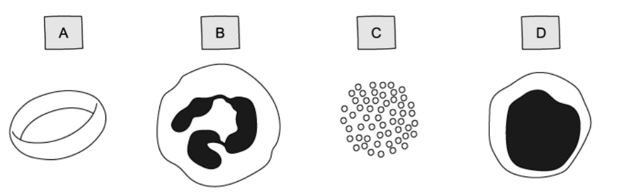

# Exam Questions — Diseases & Immunity
**10. Diseases & Immunity** · Cambridge (CIE) IGCSE science (0654 & 0973)
> Source: [https://www.savemyexams.com/igcse/science/cie/co-ordinated-sciences-double-award/23/biology/topic-questions/](https://www.savemyexams.com/igcse/science/cie/co-ordinated-sciences-double-award/23/biology/topic-questions/) · 12 questions across 1 sets

## Multiple Choice Questions (12 questions)

### Q1 — medium — 1 marks

**Q1** [1 mark]

Which of the following diseases can be transmitted by contact with contaminated surfaces?

### Q2 — medium — 1 marks

**Q2** [1 mark]

**Extended Tier Only**

When a tissue is transplanted from a female donor to a male recipient, it may be rejected.

What is the main cause of this rejection?

### Q3 — hard — 1 marks

**Q3** [1 mark]

**Extended Tier Only**

Components of the blood from a mammal are shown in the diagram below.

In which component would you expect to find the remains of the breakdown of bacterial cells.

### Q4 — medium — 1 marks

**Q4** [1 mark]

Which of the following diseases listed below are **not** caused by infectious pathogens?

1. Coronary Heart Disease
2. Cholera
3. AIDS
4. Scurvy

### Q5 — easy — 1 marks

**Q5** [1 mark]

What is a pathogen?

### Q6 — medium — 1 marks

**Q6** [1 mark]

The human body has a number of barriers to prevent infection by pathogens some of which are listed below.

1. Skin
2. Mucus
3. Hairs in the nose
4. Antibodies
5. Stomach acid

Which of these are examples of mechanical barriers?

### Q7 — medium — 1 marks

**Q7** [1 mark]

Which of the following diseases can be transmitted by contact with contaminated surfaces?

### Q8 — easy — 1 marks

**Q8** [1 mark]

Which body defence listed below acts as a chemical barrier?

### Q9 — easy — 1 marks

**Q9** [1 mark]

Which of the options below is an example of a transmissible disease?

### Q10 — easy — 1 marks

**Q10** [1 mark]

**Extended Tier Only**

In many multicellular animals, pathogens are recognised as foreign and are attacked by the immune system.

Which of the following may be produced during an immune response?

### Q11 — easy — 1 marks

**Q11** [1 mark]

**Extended Tier Only**

The immune system recognises which part of a pathogen?

### Q12 — hard — 1 marks

**Q12** [1 mark]

**Extended Tier Only**

What happens when a person is vaccinated against measles?

|   | **type of immunity** | **production of memory cells?** |
|---|---|---|
| **A** | passive | yes |
| **B** | passive | no |
| **C** | active | yes |
| **D** | active | no |
