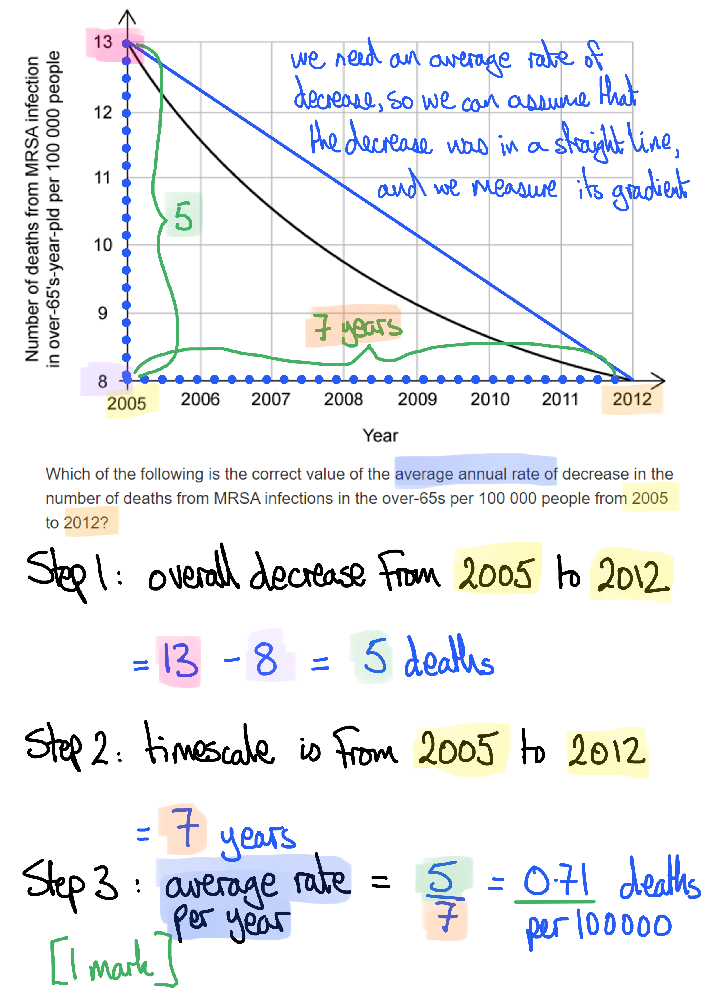

# Mark Schemes — Drugs in Medicine
**14. Drugs** · Cambridge (CIE) IGCSE science (0654 & 0973)

## Multiple Choice Questions (9 questions)

### Q1
**Final answer:** **The correct answer is ****C**

- When an individual fails to complete an antibiotic course their body is less likely to clear the bacterial infection so there is more opportunity for resistance to evolve in the bacterial population
- Antibiotics should never be used to treat viral infections as they are ineffective against viruses

**A** is incorrect because antibiotics are vital for patient survival when they are suffering from serious bacterial infections.

**B** is incorrect because 4 has not been included in the answer.

**D** is incorrect because both 2 and 3 represent ways in which antibiotics should be used in order to minimise antibiotic resistance.

### Q2
**Final answer:** **The correct answer is ****D**** because:**

The bacterial population is increasing before the patient starts to take antibiotics. This can be seen in the graph.

**A** is incorrect because the graph shows that the bacteria population has decreased to zero by 6.5 days after starting the treatment with antibiotics.

**B** is incorrect because we can’t see the mechanism by which the antibiotic works on the bacteria from the graph.

**C** is incorrect because we know that antibiotics are not effective against viruses. The graph also only shows the effect on a bacterial population.

### Q3
**Final answer:** **The correct answer is ****C**** (3 only)because:**

Antibiotics should not be used in the treatment of all infections, but only in the treatment of **bacterial** infections. In addition to this, using the same broad-spectrum antibiotic to treat all infections will increase the chances of bacteria evolving resistance to this particular antibiotic.

**Statement 1** is incorrect because using antibiotics only in the treatment of serious bacterial infections means that they are only used when absolutely necessary, and bacteria are not frequently exposed to antibiotics.

**Statement 2** is incorrect because antibiotics can be chosen specially when they are known to be effective against a particular type of bacteria; this increases the chances of treating an infection successfully and reduces the number of antibiotics to which a bacterial strain may need to be exposed.

### Q4
**Final answer:** **The correct answer is ****C ****because:**

Antibiotics are only effective against bacteria and can kill them in various different ways, e.g. destroying their cell walls or preventing them from reproducing.

**A** is incorrect because not all antibiotics function by immediate destruction of cells.

**B** and **D** are incorrect because antibiotics are only effective against bacteria.

### Q5
**Final answer:** **The correct answer is ****A ****because:**

Viruses are technically not living cells, this means that they are not affected by antibiotics. Viruses do not have cell walls or carry out cellular functions. Antibiotics work by disrupting cell chemical reactions or the production of cell walls.

**B** is incorrect because viruses do not contain cytoplasm, and antibiotics don’t affect cytoplasm.

**C** is incorrect because penicillin does not work on viruses.

**D** is incorrect because, while it is true that viruses use the host cell to reproduce rapidly, this is not relevant to why penicillin will not work on viruses.

### Q6
**Final answer:** **The correct answer is ****C**** (0.71) because:**

- The overall decrease was from 13 to 8 deaths per 100 000 people, and this happened over a 7-year timescale (2005 to 2012)
- The question asks for an **average** annual rate of decrease, so we can assume that the graph fell in a straight line, even though it was a curved line. The gradient is therefore 5 ÷ 7 = <u>0.71</u>

### Q7
**Final answer:** **The correct answer is ****C**** because:**

Antibiotics do not work against viruses. Antibiotics work against bacteria by either killing them or stopping or slowing their growth.

All the other answers are correct for antibiotics.

### Q8
**Final answer:** **The correct answer is ****B**** (a substance taken into the body that modifies or affects chemical reactions) because:**

Drugs always have their effect at a chemical level, by affecting chemical reactions in cells, tissues and organs.

**A** is incorrect because not all drugs are addictive or harmful; many have beneficial effects, though most would be harmful if taken at an excessive level (an 'overdose').

**C** is incorrect because not all drugs are plant extracts (some come from fungi and some are manufactured in a laboratory), and not all of them kill bacteria.

**D** is incorrect because not all drugs produce side effects, though many do.

### Q9
**Final answer:** **The correct answer is ****A ****because:**

From the available options it is most likely that the decrease in number of deaths from MRSA over time is a result of new or different antibiotics being used that are effective at treating MRSA infections; as a result, the death rate will fall.

It is also possible that improved hygiene procedures in hospitals is reducing infection rates.

**B** is incorrect because a decrease in the population would not affect the death rate, as this is calculated per 100 000 people

**C** is incorrect because over-65s are dying from MRSA infection throughout the time period shown. It is also very unlikely that immunity to MRSA would develop, as not all MRSA strains are the same.

**D** is incorrect because, while this is a true statement, it has nothing to do with the data shown.
