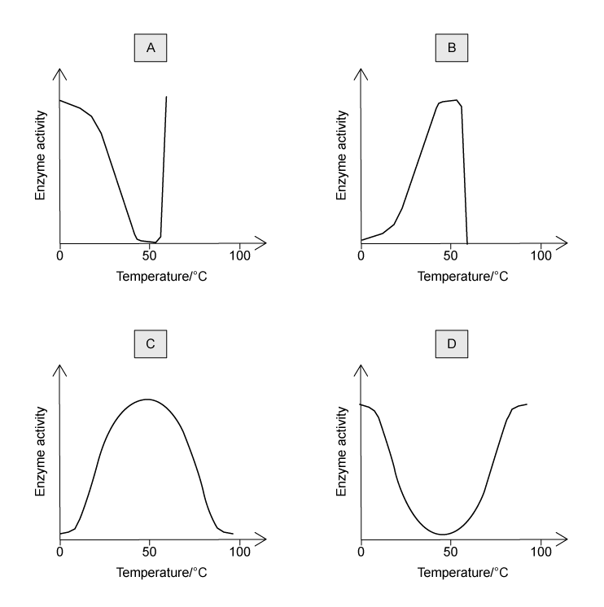
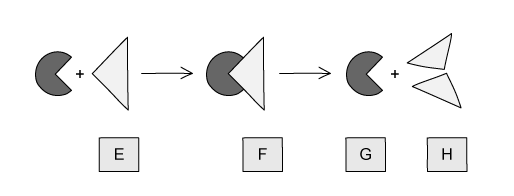

# Exam Questions — Enzymes
**5. Enzymes** · Cambridge (CIE) IGCSE science (0654 & 0973)
> Source: [https://www.savemyexams.com/igcse/science/cie/co-ordinated-sciences-double-award/23/biology/topic-questions/](https://www.savemyexams.com/igcse/science/cie/co-ordinated-sciences-double-award/23/biology/topic-questions/) · 18 questions across 1 sets

## Multiple Choice Questions (18 questions)

### Q1 — easy — 1 marks

**Q1** [1 mark]

The effect of pH on the rate of reaction of three different enzymes is shown in the graph below.

What does the graph show?

### Q2 — medium — 1 marks

**Q2** [1 mark]

The pH of an enzyme controlled reaction is decreased by a pH of 2.

How does this affect the rate of the reaction?

### Q3 — medium — 1 marks

**Q3** [1 mark]

A student decided to investigate the effect of pH on the activity of the enzyme lipase.

Five different test tubes are set up. Each test tube contains a mixture of the enzyme lipase and its substrate, a lipid.

Which condition should not be kept the same in each of the five test tubes?

### Q4 — medium — 1 marks

**Q4** [1 mark]

** Extended Tier Only**

Which of the following correctly describes the effect of increasing temperature from 15°C to 30°C on an enzyme-controlled reaction?

| ** ** | kinetic energy of enzymes and substrates | frequency of effective collisions | shape of active site |
|---|---|---|---|
| **A** | no change | decreases | denatured |
| **B** | increases | increases | denatured |
| **C** | increases | increases | no change |
| **D** | decreases | no change | no change |

### Q5 — medium — 1 marks

**Q5** [1 mark]

**Extended Tier Only**

The pH of an enzyme-controlled reaction is decreased by a pH of 2.

How does this affect the rate of the reaction?

### Q6 — easy — 1 marks

**Q6** [1 mark]

What is the name for the group of compounds that ensures metabolic reactions take place in living organisms at a speed necessary to sustain life?

### Q7 — medium — 1 marks

**Q7** [1 mark]

**Extended Tier Only**

Which graph in the image below shows the correct effect of temperature on the activity of an enzyme?

### Q8 — easy — 1 marks

**Q8** [1 mark]

Which of the following best describes what an enzyme is?

### Q9 — medium — 1 marks

**Q9** [1 mark]

**Extended Tier Only**

Temperature affects the rate of all enzyme-controlled reactions, as shown in the graph below.

Which row correctly describes what is happening at the points on the graph?

| ** ** | X | Y |
|---|---|---|
| **A** | the enzyme has been denatured | the rate of reaction is decreasing |
| **B** | the rate of reaction is increasing | the enzyme is becoming denatured |
| **C** | the reaction is taking less time | the rate of reaction is increasing |
| **D** | the rate of reaction is decreasing | the enzyme is becoming denatured |

### Q10 — hard — 1 marks

**Q10** [1 mark]

**Extended Tier Only**

The diagrams below show an amylase enzyme catalysing the breakdown of part of a starch molecule into smaller molecules of maltose.

Which diagram has three correct labels?

### Q11 — easy — 1 marks

**Q11** [1 mark]

**Extended Tier Only**

The effect of pH on the rate of reaction of three different enzymes is shown in the graph below.

What does the graph show?

### Q12 — hard — 1 marks

**Q12** [1 mark]

Liver cells produce an enzyme called catalase which breaks down toxic hydrogen peroxide into water and oxygen.

A student set up an experiment where cubes of cows' liver in a test tube were incubated with hydrogen peroxide at different temperatures.

The student counted the number of bubbles of oxygen released per minute at each temperature.

Their results are shown in the table below:

| temperature / oC | 10 | 20 | 30 | 40 | 50 |
|---|---|---|---|---|---|
| number of bubbles / minute | 35 | 68 | 79 | 63 | 5 |

The results suggest that the optimum temperature for catalase is between which two values?

### Q13 — medium — 1 marks

**Q13** [1 mark]

A student decided to investigate the effect of pH on the activity of the enzyme lipase.

Five different test tubes are set up. Each test tube contains a mixture of the enzyme lipase and its substrate, a lipid.

Which condition should not be kept the same in each of the five test tubes?

### Q14 — hard — 1 marks

**Q14** [1 mark]

**Extended Tier Only**

The image below represents a chemical reaction.

Which of the following best represents the enzyme responsible for catalysing this reaction?

### Q15 — hard — 1 marks

**Q15** [1 mark]

Starch is digested by the enzyme amylase. Four identical mixtures of starch and amylase were kept at different temperatures.

The graph below shows the time taken for the starch to be digested at each temperature.

At which temperature is the rate of reaction highest?

### Q16 — hard — 1 marks

**Q16** [1 mark]

**Extended Tier Only**

The action of an enzyme in a chemical reaction is outlined in the diagram below.

Which row of the table below is correct?

| ** ** | product | enzyme | enzyme-substrate complex |
|---|---|---|---|
| **A** | E | H | G |
| **B** | E | G | F |
| **C** | H | G | F |
| **D** | H | F | G |

### Q17 — easy — 1 marks

**Q17** [1 mark]

What is a feature of all catalysts?

### Q18 — easy — 1 marks

**Q18** [1 mark]

What can be said to be true of all enzymes?

| ** ** | their optimum pH is 7 | they are made from amino acids | they move about randomly in a fluid |
|---|---|---|---|
| **A** | **X** | **X** | **X** |
| **B** | **X** | **✓** | **✓** |
| **C** | **✓** | **X** | **✓** |
| **D** | **✓** | **✓** | **X** |
