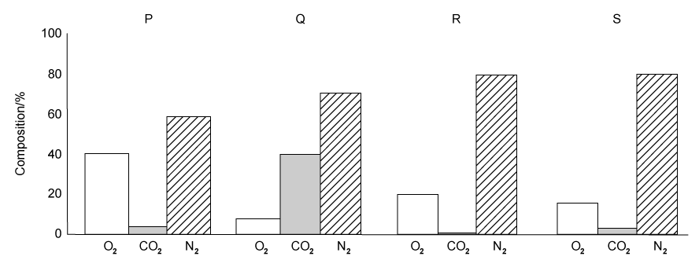
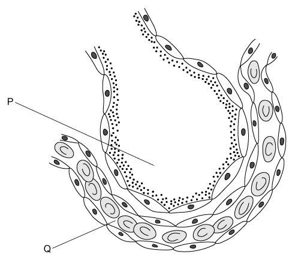

# Exam Questions — Gas Exchange in Humans
**11. Gas Exchange in Humans** · Cambridge (CIE) IGCSE science (0654 & 0973)
> Source: [https://www.savemyexams.com/igcse/science/cie/co-ordinated-sciences-double-award/23/biology/topic-questions/](https://www.savemyexams.com/igcse/science/cie/co-ordinated-sciences-double-award/23/biology/topic-questions/) · 12 questions across 1 sets

## Multiple Choice Questions (12 questions)

### Q1 — easy — 1 marks

**Q1** [1 mark]

Which of the following sequences show the correct path of oxygen as it enters the lungs?

### Q2 — medium — 1 marks

**Q2** [1 mark]

Compared to the composition of atmospheric air, the air exhaled by a man contains:

### Q3 — medium — 1 marks

**Q3** [1 mark]

The diagram shows the composition of four samples of air (O2 = oxygen, CO2 = carbon dioxide, N2 = nitrogen).

Which sample is inspired air and which sample is expired air?

|   | inspired air | expired air |
|---|---|---|
| **A** | R | S |
| **B** | P | R |
| **C** | Q | P |
| **D** | S | R |

### Q4 — easy — 1 marks

**Q4** [1 mark]

Which of the following sequences show the correct path of oxygen as it enters the lungs?

### Q5 — hard — 1 marks

**Q5** [1 mark]

A person exhales, and the air from their lungs is collected and placed in a gas jar. A second gas jar contains normal atmospheric air. A candle is set alight and is placed inside each gas jar as shown. The time taken for each flame to go out is measured with a stopwatch.

The table shows the results of this experiment.

| gas jar | time for candle flame to go out /s |
|---|---|
| 1 | 7 |
| 2 | 12 |

Which of the following is a correct explanation for the difference between the results in jars 1 and 2?

### Q6 — medium — 1 marks

**Q6** [1 mark]

**Extended Tier Only**

Some amphibians, such as frogs, can use their skin as a gas exchange surface.

What are the most likely characteristics of the surface of the skin in these amphibians?

|   | surface area | type of skin |
|---|---|---|
| **A** | small | thick |
| **B** | large | thick |
| **C** | small | thin |
| **D** | large | thin |

### Q7 — medium — 1 marks

**Q7** [1 mark]

**Extended Tier Only**

The diagram below shows a cross-section through an alveolus and a capillary.

Why does oxygen move from P to Q?

### Q8 — easy — 1 marks

**Q8** [1 mark]

What is the approximate percentage of carbon dioxide in expired air?

### Q9 — easy — 1 marks

**Q9** [1 mark]

Name the structures shown in the diagram.

|   | W | X | Y | Z |
|---|---|---|---|---|
| **A** | larynx | trachea | bronchi | bronchioles |
| **B** | trachea | larynx | bronchioles | bronchi |
| **C** | bronchi | trachea | bronchioles | larynx |
| **D** | larynx | bronchi | larynx | bronchioles |

### Q10 — easy — 1 marks

**Q10** [1 mark]

**Extended Tier Only**

What makes the alveoli suitable as a gas exchange surface in mammals?

| ** ** | a dense capillary network | large total surface area |
|---|---|---|
| **A** | **X** | **X** |
| **B** | ✓ | **X** |
| **C** | **X** | ✓ |
| **D** | ✓ | ✓ |

### Q11 — hard — 1 marks

**Q11** [1 mark]

The diagram shows part of the structure of a human lung.

Where would the concentration of carbon dioxide be highest?

### Q12 — hard — 1 marks

**Q12** [1 mark]

**Extended Tier Only**

Which of the following helps carbon dioxide to be excreted rapidly into the alveoli from the blood in the lungs?

1. Inhaled air has a lower concentration of carbon dioxide than the blood constantly pumping through the lungs.
2. Alveoli have thick walls and a large surface area.
3. Alveoli have thin walls and a large surface area.
4. The concentration of carbon dioxide in the blood is lower than in the alveoli.
