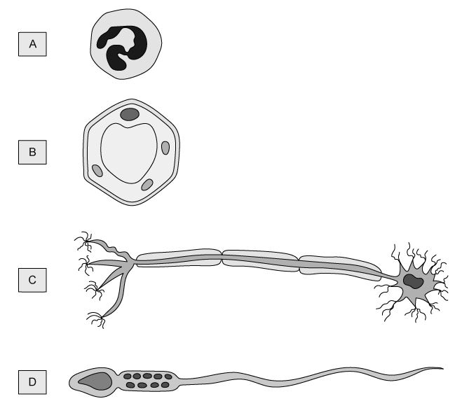

# Exam Questions — Inheritance, Genes & Cell Division
**16. Inheritance** · Cambridge (CIE) IGCSE science (0654 & 0973)
> Source: [https://www.savemyexams.com/igcse/science/cie/co-ordinated-sciences-double-award/23/biology/topic-questions/](https://www.savemyexams.com/igcse/science/cie/co-ordinated-sciences-double-award/23/biology/topic-questions/) · 15 questions across 1 sets

## Multiple Choice Questions (15 questions)

### Q1 — easy — 1 marks

**Q1** [1 mark]

Which shows the correct size order of structures, starting with the smallest?

### Q2 — easy — 1 marks

**Q2** [1 mark]

**Extended Tier Only**

What does the term haploid mean?

### Q3 — hard — 1 marks

**Q3** [1 mark]

**Extended Tier Only**

Which row in the table shows a comparison between meiosis and mitosis?

|   | mitosis | meiosis |
|---|---|---|
| **A** | produces 4 daughter cells | produces 2 daughter cells |
| **B** | produces genetically identical cells | produces cloned cells |
| **C** | daughter cells are diploid | daughter cells are haploid |
| **D** | two cell division occur | four cell divisions occur |

### Q4 — easy — 1 marks

**Q4** [1 mark]

A tall pea plant is crossed with a short pea plant. The tall gene is dominant over the short gene. The tall plant is heterozygous. The short plant is homozygous recessive

Which is the correct genetic diagram for this cross?

### Q5 — medium — 1 marks

**Q5** [1 mark]

**Extended Tier Only**

New cells are formed by the division of existing cells.

The diagram below shows four different cells.

Which one is formed by meiosis?

### Q6 — hard — 1 marks

**Q6** [1 mark]

A farmer is growing pea plants; the allele for tall plants is T and is dominant to the allele for dwarf plants, t.

She wants to know what cross she would need to carry out to produce a ratio of 1:1 tall to dwarf plants?

### Q7 — hard — 1 marks

**Q7** [1 mark]

Fruit flies can have orange or red eyes.

If two orange flies are crossed, all of the offspring will have orange eyes.

If two red eyed fruit flies are crossed, the offspring have either orange or red eyes.

What can be concluded from these observations?

### Q8 — hard — 1 marks

**Q8** [1 mark]

The inheritance of Huntington's disease is determined by a single gene. This gene has a dominant allele and a recessive allele. The allele for Huntington’s is dominant to the allele for non-sufferers of the condition.

The diagram shows the inheritance of Huntington’s in a family.

What is the probability that the next child from the same parents will have Huntington’s?

### Q9 — easy — 1 marks

**Q9** [1 mark]

Which shows the correct size order of structures, starting with the smallest?

### Q10 — medium — 1 marks

**Q10** [1 mark]

**Extended Tier Only**

The diagram below shows the process of sexual reproduction.

Which of the processes are shown by stages **Q **and **R**?

|   | **Q** | **R** |
|---|---|---|
| **A** | meiosis | mitosis |
| **B** | mitosis | mitosis |
| **C** | meiosis | meiosis |
| **D** | mitosis | meiosis |

### Q11 — hard — 1 marks

**Q11** [1 mark]

The diagram shows how the sex of the offspring can be determined.

What are the sex chromosomes in gamete **Q** and the son **R**?

|   | **Q** | **R** |
|---|---|---|
| **A** | X | XY |
| **B** | X | XX |
| **C** | Y | XY |
| **D** | Y | XX |

### Q12 — medium — 1 marks

**Q12** [1 mark]

Two individuals are crossed. One is homozygous dominant (TT), the other heterozygous.

What will the genotypes of the offspring be?

### Q13 — medium — 1 marks

**Q13** [1 mark]

Albinism is a condition where the pigment melanin does not get produced in the skin, hair and eyes. This is an inherited condition that is caused by a recessive allele.

If both parents have albinism what are the chances of the offspring being an albino child?

### Q14 — easy — 1 marks

**Q14** [1 mark]

**Extended Tier Only**

When a somatic (body) cell undergoes cell division, two daughter cells are produced with the same chromosome number as the parent cell.

Which type of division has taken place?

### Q15 — easy — 1 marks

**Q15** [1 mark]

Males and females have a unique set of chromosomes.

What is the correct combination of male and female chromosomes?
