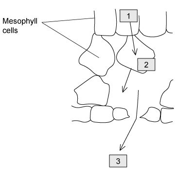
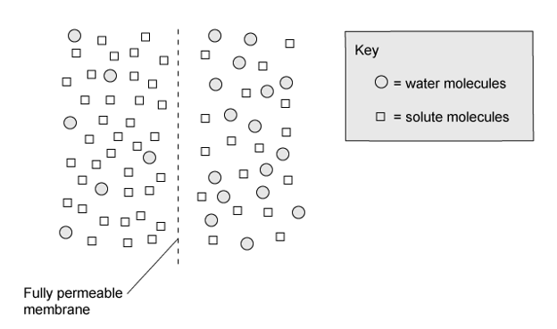

# Exam Questions — Diffusion, Osmosis & Active Transport
**3. Movement into & out of Cells** · Cambridge (CIE) IGCSE science (0654 & 0973)
> Source: [https://www.savemyexams.com/igcse/science/cie/co-ordinated-sciences-double-award/23/biology/topic-questions/](https://www.savemyexams.com/igcse/science/cie/co-ordinated-sciences-double-award/23/biology/topic-questions/) · 16 questions across 1 sets

## Multiple Choice Questions (16 questions)

### Q1 — medium — 1 marks

**Q1** [1 mark]

A number of red blood cells were immersed in pure water before being observed under a microscope. There was a dramatic change in their appearance.

Which row of the table below correctly describes what happened to the red blood cells?

|   | direction of water movement | from higher to lower solute concentration | from higher to lower water potential | effect |
|---|---|---|---|---|
| **A** | in | **✓** | **X** | cells burst |
| **B** | in | **X** | **✓** | cells burst |
| **C** | out | **✓** | **X** | cells shrink |
| **D** | out | **✓** | **✓** | cells shrink |

### Q2 — medium — 1 marks

**Q2** [1 mark]

The image below shows two solutions separated by a partially permeable membrane.

Which of the statements below would be true in relation to the image?

### Q3 — easy — 1 marks

**Q3** [1 mark]

**Extended Tier Only**

Which of the structures below is best adapted for diffusion?

### Q4 — hard — 1 marks

**Q4** [1 mark]

A group of students carried out an investigation into osmosis using cylinders of potato.

The results from their experiment are shown below.

| concentration of salt solution / mol dm-3 | mass of potato cylinder at start / g | mass of potato cylinder after 24 hours / g |
|---|---|---|
| 0.2 | 2.5 | 2.7 |

Which statement below correctly explains this change in mass?

|   | movement of water | cause of this movement |
|---|---|---|
| **A** | out of the potato cells | the salt solution has a lower water potential than the potato cells. |
| **B** | out of the potato cells | the salt solution has a higher water potential than the potato cells. |
| **C** | into the potato cells | the salt solution has a lower water potential than the potato cells. |
| **D** | into the potato cells | the salt solution has a higher water potential than the potato cells. |

### Q5 — hard — 1 marks

**Q5** [1 mark]

A group of students carried out an investigation into osmosis using cylinders of potato.

The results from their experiment are shown below.

| concentration of salt solution / mol dm-3 | length of potato cylinder at start / mm | length of potato cylinder after 24 hours / mm |
|---|---|---|
| ? | 35 | 33 |

Which statement below correctly explains this change in length and shows the concentration of the sugar solution?

|   | concentration of sugar solution | cause of this movement |
|---|---|---|
| **A** | 0.0 | the sugar solution is more concentrated than the solution inside the potato. |
| **B** | 0.6 | the solution in the potato is more dilute than the solution around the potato. |
| **C** | 0.6 | the solution in the potato is less dilute than the solution around the potato. |
| **D** | 0.0 | the sugar solution is less concentrated than the solution inside the potato. |

### Q6 — medium — 1 marks

**Q6** [1 mark]

**Extended Tier Only**

The image below shows two solutions separated by a partially permeable membrane.

Which of the statements below would be true in relation to the image?

### Q7 — hard — 1 marks

**Q7** [1 mark]

Two identical square pieces of beetroot are cut. Each square of beetroot has a mass of 3.0 g. One (S) is placed in a concentrated salt solution, the other (T) is placed in pure water.

What would the masses of the two pieces of beetroot be after 3 hours?

|   | mass of beetroot squares |   |
|---|---|---|
|   | S | T |
| **A** | 3.0 | 3.2 |
| **B** | 2.7 | 3.0 |
| **C** | 2.9 | 3.2 |
| **D** | 3.1 | 2.9 |

### Q8 — hard — 1 marks

**Q8** [1 mark]

The image below shows part of a cross-section through a leaf.

Which row of the table below correctly shows the movement of various substances?

|   | evaporation of water | movement of water by osmosis | diffusion of water vapour |
|---|---|---|---|
| **A** | 3 | 1 | 2 |
| **B** | 2 | 3 | 1 |
| **C** | 3 | 2 | 1 |
| **D** | 2 | 1 | 3 |

### Q9 — easy — 1 marks

**Q9** [1 mark]

What causes the diffusion of carbon dioxide out of a living cell?

### Q10 — easy — 1 marks

**Q10** [1 mark]

**Extended Tier Only**

The image below shows a leaf palisade cell:

What would the correct appearance of the leaf palisade cell be after it has been placed in a highly concentrated solution of sugar after an hour?

### Q11 — hard — 1 marks

**Q11** [1 mark]

**Extended Tier Only**

The image below shows molecules in two solutions separated by a membrane.

In which direction would there be movement?

|   | water molecules | solute molecules |
|---|---|---|
| **A** | right to left | no net movement |
| **B** | left to right | right to left |
| **C** | left to right | no net movement |
| **D** | right to left | left to right |

### Q12 — easy — 1 marks

**Q12** [1 mark]

How does a water vapour molecule move out of the air space of a leaf into the atmosphere on a dry day?

### Q13 — medium — 1 marks

**Q13** [1 mark]

Which of the following statements would be correct for both diffusion and osmosis?

|   | does not require energy from the cell | molecules must be separated by a partially permeable membrane | molecules move from a dilute to a more concentrated solution |
|---|---|---|---|
| **A** | **✓** | **✓** | **X** |
| **B** | **X** | **X** | **✓** |
| **C** | **✓** | **X** | **X** |
| **D** | **✓** | **X** | **✓** |

### Q14 — easy — 1 marks

**Q14** [1 mark]

**Extended Tier Only**

Osmosis is:

### Q15 — medium — 1 marks

**Q15** [1 mark]

**Extended Tier Only**

A number of red blood cells were immersed in a pure solution of water before being observed under a microscope.

There was a dramatic change in their appearance.

Which row of the table below correctly describes and explains what happened to the red blood cells?

|   | direction of water movement | from higher to lower concentration | from higher to lower water potential | effect |
|---|---|---|---|---|
| **A** | in | **✓** | **X** | cells burst |
| **B** | in | **X** | **✓** | cells burst |
| **C** | out | **✓** | **X** | cells shrink |
| **D** | out | **✓** | **✓** | cells shrink |

### Q16 — medium — 1 marks

**Q16** [1 mark]

**Extended Tier Only**

A plant absorbs a number of substances into its roots.

Which row of the table below correctly shows the substances absorbed by the roots and how these substances are absorbed?

|   | minerals | oxygen | water |
|---|---|---|---|
| **A** | active transport | diffusion | osmosis |
| **B** | active transport | not absorbed | transpiration |
| **C** | diffusion | diffusion | osmosis |
| **D** | active transport | not absorbed | osmosis |
