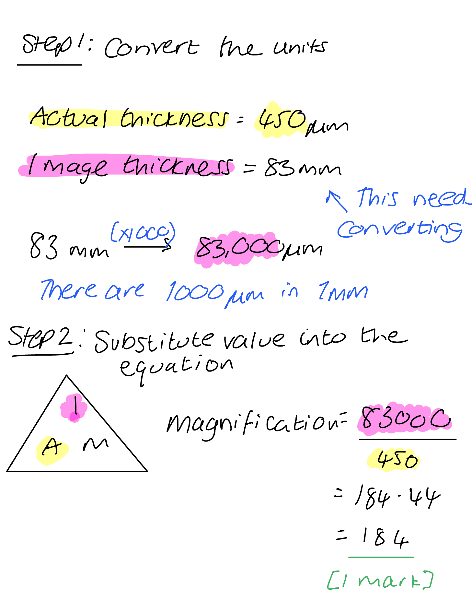
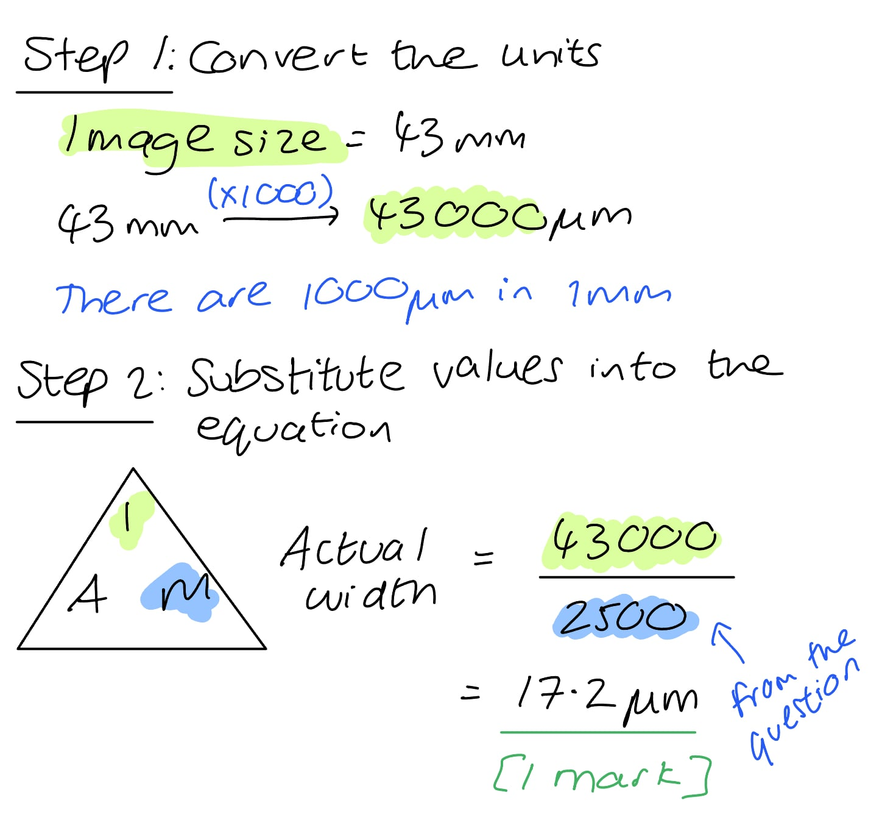

# Mark Schemes — Cell Structure & Size of Specimens
**2. Organisation of the Organism** · Cambridge (CIE) IGCSE science (0654 & 0973)

## Multiple Choice Questions (16 questions)

### Q1
**Final answer:** **The correct answer is ****C**

- All three structures in the question are organs. An organ is a group of two or more tissues working together to carry out a particular function.

**A** is incorrect because each of the leaves, stems and roots are made up of thousands of different cells all working together.

**B** is incorrect because the **leaf** is made from **palisade** & **spongy** mesophyll tissue, **epidermal** tissue and **vascular** tissue functioning together to allow a plant to photosynthesise. The **roots** and **stem** are made from **vascular** (transport) **tissue** which work together to transport substances around the plant.

**D** is incorrect because together plants have two organ systems. The** shoot organ system **in a plant is made from leaves, stems, buds, fruits and flowers. The **root organ system** of most plants are all the parts that are underground.

### Q2
**Final answer:** **The correct answer is ****A**

- Mitochondria are usually slightly smaller than chloroplasts and are found within the cytoplasm
- Mitochondria have a highly folded internal membrane, whereas chloroplasts look like they contain stacks of pancakes (sometimes!)

**B** is incorrect because mitochondria are not found within the cell wall; in fact, no organelles are found within the cell wall.

**C** is incorrect because mitochondria are not found within the vacuole.

**D** is incorrect because this cell is an animal cell. You can tell this because of the absence of a cell wall and vacuole.

### Q3
**Final answer:** **The correct answer is B**

- Bacterial cells possess a cell membrane and a cell wall
- They contain a relatively large circular chromosome that is not enclosed within a nucleus

**A** is incorrect as bacterial cells have a cell membrane and a chromosome

**C** is incorrect as bacterial cells contain a chromosome

**D** is incorrect as bacterial cells have a cell wall and do not have a nucleus

The diagram below shows a typical bacterial cell

### Q4
**Final answer:** **The correct answer is ****A ****because:**

- The cell membrane is partially permeable and controls the movement of substances into the cell by osmosis, diffusion and active transport
- The cell wall is fully permeable and therefore does not control the movement of any substances, all move through it
- The cell wall (in plants) is made of cellulose, a polysaccharide that forms fibres which criss-cross over each other to form a very strong support for the cell
- Mitochondria are where most energy is released in the cell (via respiration)

The other rows are incorrect as they do not correctly describe the functions of the components of the root hair cell.

### Q5
**Final answer:** **The correct answer is ****C ****because:**

Spongy mesophyll cells contain chloroplasts for photosynthesis and have a relatively large surface area for gas exchange with the air spaces in the leaf. They also lose water by transpiration; water evaporates from the surfaces of the spongy cells, diffusing into the air spaces and out of the stomata.

The other answers are incorrect because they do not correctly describe a spongy mesophyll cell.

The diagram below shows the structure of the leaf and the position of the spongy mesophyll cells within the leaf.

### Q6
**Final answer:** **The correct answer is ****D**** (mitochondria and ribosomes) because:**

- Salivary amylase is an **enzyme**; enzymes are made from **protein**. **Ribosomes** are the site of** protein synthesis** in all cells
- Production of proteins requires significant amounts of **energy** and therefore cells which manufacture digestive enzymes. that need to be made and then transported out of the cell would contain a lot of **mitochondria**, as this is where respiration takes place

**A **and **B** are incorrect because although mitochondria and ribosomes would be required in large numbers, each cell only ever possesses one nucleus.

**C** is incorrect because vacuoles are present in plant cells; salivary glands are animal cells.

### Q7
**Final answer:** **The correct answer is ****C**** (The liver is an organ, containing several tissues, which forms part of the digestive system) because:**

The **liver** is an organ composed of several different tissue types. It plays a vital role in digestion by producing bile which neutralises acidic gastric juice from the stomach.

- An **organ** is a structure made up of a group of tissues working together to perform a specific function
- A **tissue** is a group of cells with similar structures working together to perform a shared function
- An **organ** **system** is a group of organs with related functions working together to perform body functions

The other answers are incorrect because they do not correctly define what the liver is.

### Q8
**Final answer:** **The correct answer is ****C**** (organ) because:**

All three structures are organs. An organ is a group of two or more tissues working together to carry out a particular function.

**A** is incorrect because each of the leaves, stems and roots are made up of thousands of different cells all working together.

**B** is incorrect because the **leaf** is made from **palisade** & **spongy** mesophyll tissue, **epidermal** tissue and **vascular** tissue functioning together to allow a plant to photosynthesise. The **roots** and **stem** are made from **vascular** (transport) **tissue** which work together to transport substances around the plant.

**D** is incorrect because together plants have two orga*n *systems. The** shoot organ system **in a plant is made from leaves, stems, buds, fruits and flowers. The **root organ system** of most plants are all the parts that are underground.

### Q9
**Final answer:** **The correct answer is ****A**** (cell) because:**

The image shows a ciliated epithelial cell. These cells can be found lining the trachea and parts of the lungs. Cells are the basic functional units of all living organisms on Earth.

**B** is incorrect because organelle is a term used to describe subcellular structures within cells, such as mitochondria and chloroplasts.

**C** is incorrect because an organ is formed from two or more tissues working together. Tissues are made from groups of similar cells.

**D** is incorrect because an organ system is made from organs working together to perform a particular function.

### Q10
**Final answer:** **The correct answer is ****A ****because:**

- The phloem is a transport tissue in plants formed from a number of cell types; including conducting cells (responsible for moving sugars around the plant) and structural and support cells
- The small intestine is an organ because it is made from a number of different tissues; including muscular tissue, epithelial tissue and nervous tissue
- The digestive system is made from a number of organs involved in the breakdown of large insoluble molecules into small soluble molecules

**B** is incorrect because blood is a tissue, RBCs are one of the cells in the blood; the xylem is a tissue not an organ, and the stomach is an organ.

**C** is incorrect because the small intestine is an organ and the spermatozoa are cells.

**D** is incorrect because root hair cells are not tissue, the heart is an organ part of the circulatory system.

### Q11
**Final answer:** **The correct answer is ****C**** (stomach → red blood cell → nucleus → chromosome →  gene) because:**

- The stomach is an organ and so logically is the biggest structure listed
- Red blood cells do not contain nuclei, but they are bigger than them
- A chromosome is formed from a relatively long piece of double-stranded DNA; chromosomes are found inside the nucleus of cells and therefore must logically be smaller than a single cell
- Genes are the smallest structures shown; genes are ‘coding’ sections of DNA

### Q12
**Final answer:** **The correct answer is ****B ****because:**

Bacterial cells have a cell membrane and a cell wall. They contain a relatively large circular chromosome that is **not **bound inside a nucleus.

The other answers are incorrect because they do not show the correct structures present in bacterial cells.

The diagram below shows a typical bacterial cell.

### Q13
**Final answer:** **The correct answer is ****C ****because:**

- **X** is a chloroplast which contains chlorophyll, absorbing light for photosynthesis
- **Y** is the vacuole, storing a solution of salts and sugars
- **Z** is the nucleus where genetic information (in the form of chromosomes made from DNA) is stored

To distinguish between chloroplasts and mitochondria, you should look at the inner membranes. The inner membrane of the mitochondrion is highly folded inwards, whereas chloroplasts have a more regular internal structure with stacks of membranes called thylakoids - shown as boxes in the sketch above.

### Q14
**Final answer:** **The correct answer is ****B**** (× 184) because:**

- You need to use the magnification equation to calculate your answer
- Whenever you carry out a magnification calculation, you need to make sure that your image measurement and actual measurement have the same unit (either µm or mm)

### Q15
**Final answer:** **The correct answer is ****D**** (17.2 µm) because:**

This is because to calculate the actual size of an image you need to use the magnification equation.

### Q16
**Final answer:** **The correct answer is ****A ****because:**

Mitochondria are usually slightly smaller than chloroplasts and are found within the cytoplasm. Mitochondria have a highly folded internal membrane, whereas chloroplasts look like they contain stacks of pancakes (sometimes!).

**B** is incorrect because mitochondria are not found within the cell wall; in fact, no organelles are found within the cell wall.

**C** is incorrect because mitochondria are not found within the vacuole.

**D** is incorrect because this cell is an animal cell. You can tell this because of the absence of a cell wall and vacuole.
