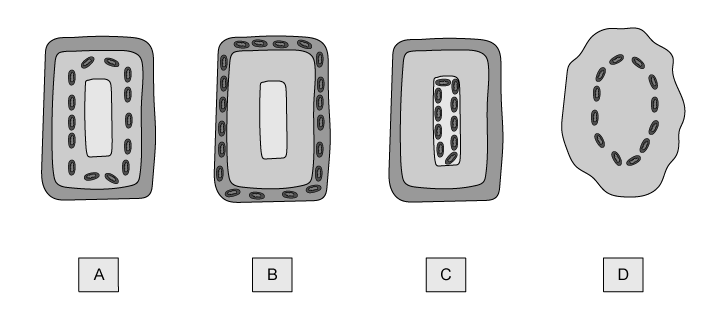
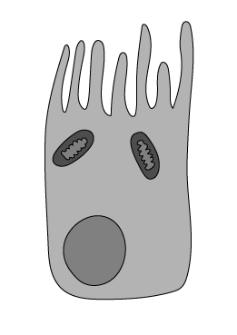
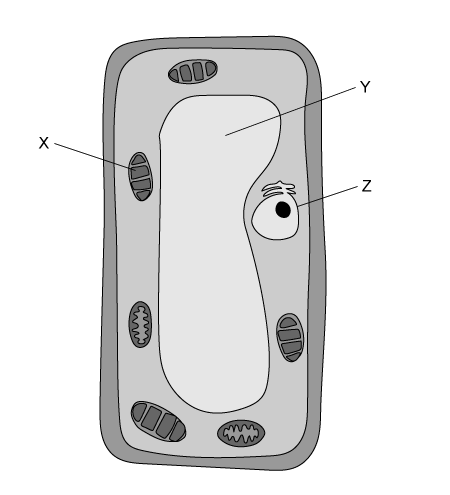

# Exam Questions — Cell Structure & Size of Specimens
**2. Organisation of the Organism** · Cambridge (CIE) IGCSE science (0654 & 0973)
> Source: [https://www.savemyexams.com/igcse/science/cie/co-ordinated-sciences-double-award/23/biology/topic-questions/](https://www.savemyexams.com/igcse/science/cie/co-ordinated-sciences-double-award/23/biology/topic-questions/) · 16 questions across 1 sets

## Multiple Choice Questions (16 questions)

### Q1 — easy — 1 marks

**Q1** [1 mark]

Which of the following terms would be correct to describe a leaf, a root and stem?

### Q2 — hard — 1 marks

**Q2** [1 mark]

Eukaryotic cells contain mitochondria (a mitochondrion is shown below).

Which diagram below correctly shows the position of mitochondria in a plant cell?

### Q3 — medium — 1 marks

**Q3** [1 mark]

Which row of the table below correctly describes the structures present in a bacterial cell?

| ** ** | cell membrane | cell wall | chromosome | nucleus |
|---|---|---|---|---|
| **A** | **✘** | **✔** | **✘** | **✘** |
| **B** | **✔** | **✔** | **✔** | **✘** |
| **C** | **✔** | **✔** | **✘** | **✘** |
| **D** | **✔** | **✘** | **✘** | **✔** |

### Q4 — medium — 1 marks

**Q4** [1 mark]

Which row of the table below correctly matches functions to components in a root hair cell?

| ** ** | cell wall | cell membrane | mitochondria |
|---|---|---|---|
| **A** | support | active transport | energy release |
| **B** | energy release | active transport | nutrition |
| **C** | support | active transport | nutrition |
| **D** | active transport | support | energy release |

### Q5 — medium — 1 marks

**Q5** [1 mark]

**Extended Tier Only**

Which row of the table below correctly describes a spongy mesophyll cell?

| ** ** | contains chloroplasts for photosynthesis | loses water by transpiration | ideal surface area for gas exchange |
|---|---|---|---|
| **A** | X | ✓ | ✓ |
| **B** | ✓ | ✓ | X |
| **C** | ✓ | ✓ | ✓ |
| **D** | ✓ | X | X |

### Q6 — medium — 1 marks

**Q6** [1 mark]

The salivary glands contain cells which are responsible for producing salivary amylase, a digestive enzyme.

Which organelles would be present in large numbers in cells of the salivary glands?

### Q7 — easy — 1 marks

**Q7** [1 mark]

Which description of the liver below is correct?

### Q8 — easy — 1 marks

**Q8** [1 mark]

Which of the following terms correctly describes a leaf, a root and a stem?

### Q9 — easy — 1 marks

**Q9** [1 mark]

The diagram below shows part of an organism.

Which term correctly describes the level of organisation of the structure in the diagram above?

### Q10 — easy — 1 marks

**Q10** [1 mark]

Which row of the table below correctly matches each structure to its level of organisation?

| ** ** | tissue | organ | system |
|---|---|---|---|
| **A** | phloem | small intestine | digestive |
| **B** | red blood cell | xylem | stomach |
| **C** | small intestine | sperm | digestive |
| **D** | root hair | leaf | heart |

### Q11 — easy — 1 marks

**Q11** [1 mark]

Which of the following correctly shows the listed structures in order of size from biggest to smallest?

### Q12 — medium — 1 marks

**Q12** [1 mark]

Which row of the table below correctly identifies the structures present in a bacterial cell?

| ** ** | cell membrane | cell wall | chromosome | nucleus |
|---|---|---|---|---|
| **A** | X | ✓ | X | X |
| **B** | ✓ | ✓ | ✓ | X |
| **C** | ✓ | ✓ | X | X |
| **D** | ✓ | X | X | ✓ |

### Q13 — hard — 1 marks

**Q13** [1 mark]

The image below shows a palisade mesophyll cell found in the leaves of plants.

Which row of the table below correctly identifies the structures labelled on the cell in the image above?

| ** ** | **X** | **Y** | **Z** |
|---|---|---|---|
| **A** | mitochondrion | vacuole | nucleus |
| **B** | chloroplast | nucleus | vacuole |
| **C** | chloroplast | vacuole | nucleus |
| **D** | mitochondrion | nucleus | vacuole |

### Q14 — hard — 1 marks

**Q14** [1 mark]

**Extended Tier Only**

An image of a leaf cross-section is printed in a biology textbook. The actual thickness of such a leaf is 450 µm, and the image in the textbook has a height of 83 mm.

What would be the correct magnification of the image?

### Q15 — hard — 1 marks

**Q15** [1 mark]

**Extended Tier Only**

A student looks at the image below in a textbook. The image is 43 mm wide and has been magnified 2500 times.

What is the actual width of the cell?

### Q16 — hard — 1 marks

**Q16** [1 mark]

Eukaryotic cells contain mitochondria (a mitochondrion is shown below).

Which diagram below correctly shows the position of mitochondria in a plant cell?

