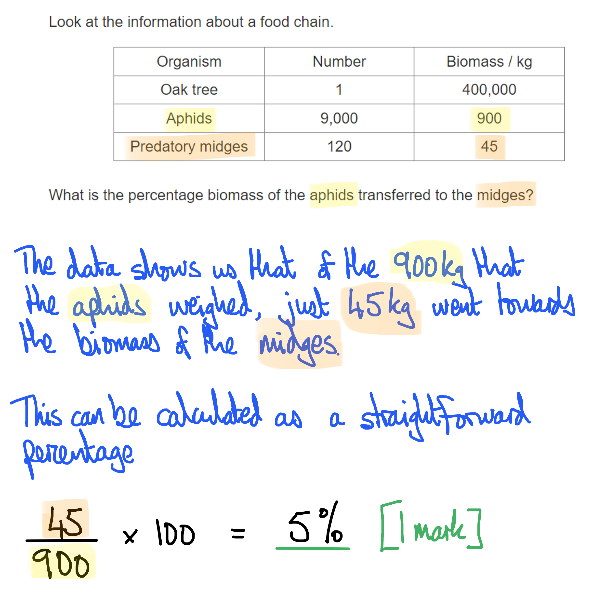

# Mark Schemes — Energy & Feeding Relationships
**18. Organisms & Their Environment** · Cambridge (CIE) IGCSE science (0654 & 0973)

## Multiple Choice Questions (6 questions)

### Q1
**Final answer:** **The correct answer is ****A**** because:**

As the carnivores have less food available the numbers will reduce over time. The reduction in numbers will be rapid as shown in graph A.

**B** is incorrect because this graph shows a gentle decline in the number of carnivores over time. The decline has also started before point X on the graph.

**C** and **D** are incorrect because both graphs show the numbers of carnivores increasing after point X.

### Q2
**Final answer:** **The correct answer is ****B**** because:**

- Energy from the sun is trapped by **chlorophyll**, the pigment found in chloroplasts. Light energy is then used to drive the synthesis of carbohydrates such as glucose (a **sugar**); in this sense an energy transfer occurs from light to chemical potential energy within the bonds of carbohydrate molecules
- The sugars produced in photosynthesis are then **stored **as more complex molecules such as starch in the plant

### Q3
**Final answer:** **The correct answer is ****D ****(there is a large amount of energy loss at each level so insufficient energy can be passed up to the sixth trophic level) because:**

Most tropic levels are less than 1% efficient; in other words, less than 1% of the energy in an organism is available to the organisms that eat it. If this inefficiency is extended along a food chain, very little energy reaches the top predator, which would make a further trophic level impossible to sustain.

**A** is incorrect because firstly, efficiency is never as high as 20%; even then the cumulative effects would be 20% of 20% of 20% (0.8%), not added up as shown in this statement.

**B **is incorrect because pyramids of numbers don't have to be pyramid-shaped. There does not have to be just one top predator; a habitat would be expected to sustain at least one mating **pair **to ensure that the species survives.

**C** is only partly correct because energy is the best consideration, not biomass; this statement is partially correct but the question asks for the <u>best</u> explanation.

### Q4
**Final answer:** **The correct answer is ****C**** (5%) because:**

The calculation can be completed as below:

### Q5
**Final answer:** **The correct answer is ****B**** (crabs) because:**

Crabs feed on mussels, lugworms and limpets. This gives them the largest range of food sources (3 in all) in this food web. This would mean that they have the greatest chance of survival if one of their food sources decreased in number.

**A** is incorrect because whelks only have one source of food, mussels.

**C** is incorrect because limpets only have one source of food, sea lettuce.

**D** is incorrect because mussels only have one source of food, small invertebrates.

### Q6
**Final answer:** **The correct answer is ****C**** (respiration) because:**

Decomposers release energy from their food (dead matter) by **respiration**. Essentially the source of food for a decomposer is a dead plant / animal and their consumption of dead matter leads to the recycling of nutrients back into the environment. They respire as they do this, releasing carbon dioxide.

**A** is incorrect because photosynthesis removes carbon dioxide from the atmosphere. This is shown by the arrow from carbon dioxide in the atmosphere to green plants.

**B** is incorrect because feeding is to take in food, this process is shown by the arrows from green plants to decomposers and green plants to animals.

**D** is incorrect because combustion releases carbon dioxide into the atmosphere. This is shown by the arrow from fossil fuels to carbon dioxide in the atmosphere.
