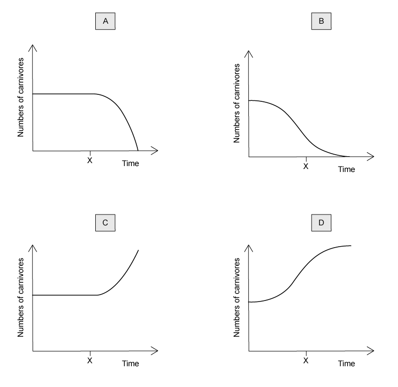
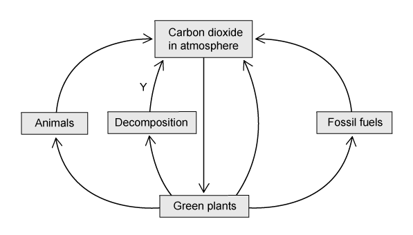

# Exam Questions — Energy & Feeding Relationships
**18. Organisms & Their Environment** · Cambridge (CIE) IGCSE science (0654 & 0973)
> Source: [https://www.savemyexams.com/igcse/science/cie/co-ordinated-sciences-double-award/23/biology/topic-questions/](https://www.savemyexams.com/igcse/science/cie/co-ordinated-sciences-double-award/23/biology/topic-questions/) · 6 questions across 1 sets

## Multiple Choice Questions (6 questions)

### Q1 — hard — 1 marks

**Q1** [1 mark]

The graphs below show how the number of carnivores change over a period of time in a habitat.

At point X the herbivores in the habitat are removed.

Which graph correctly shows the effect of this on the number of carnivores?

### Q2 — medium — 1 marks

**Q2** [1 mark]

Which letter shows the path of the energy from the sun?

### Q3 — hard — 1 marks

**Q3** [1 mark]

**Extended Tier Only**

Which statement gives the best explanation for why most food chains have no more than five trophic levels?

### Q4 — hard — 1 marks

**Q4** [1 mark]

Look at the information about a food chain.

| Organism | Number | Biomass / kg |
|---|---|---|
| Oak tree | 1 | 400,000 |
| Aphids | 9,000 | 900 |
| Predatory midges | 120 | 45 |

What is the percentage biomass of the aphids transferred to the midges?

### Q5 — medium — 1 marks

**Q5** [1 mark]

The image shows a food web.

Which organism, from the food web, feeds on the greatest variety of organisms?

### Q6 — easy — 1 marks

**Q6** [1 mark]

The diagram below illustrates part of the carbon cycle.

Which process is shown by the arrow labelled Y?
