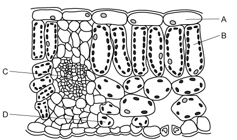
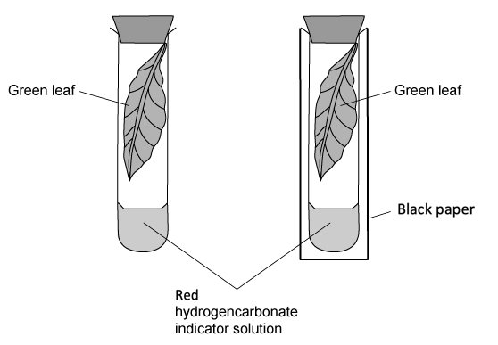

# Exam Questions — Photosynthesis & Leaf Structure
**6. Plant Nutrition** · Cambridge (CIE) IGCSE science (0654 & 0973)
> Source: [https://www.savemyexams.com/igcse/science/cie/co-ordinated-sciences-double-award/23/biology/topic-questions/](https://www.savemyexams.com/igcse/science/cie/co-ordinated-sciences-double-award/23/biology/topic-questions/) · 15 questions across 1 sets

## Multiple Choice Questions (15 questions)

### Q1 — medium — 1 marks

**Q1** [1 mark]

A student sets up an experiment to measure the rate of oxygen production of an aquatic plant when it is photosynthesising.

The student repeated the experiment several times to calculate the average amount of oxygen collected.

Which two factors should be kept constant during the student’s experiment?

### Q2 — easy — 1 marks

**Q2** [1 mark]

The diagram below shows a section through a leaf.

Which cell type would have the highest concentration of oxygen on a bright, sunny day?

### Q3 — medium — 1 marks

**Q3** [1 mark]

**Extended Tier Only**

Which of the following best describes the role of chlorophyll in photosynthesis?

### Q4 — easy — 1 marks

**Q4** [1 mark]

**Extended Tier Only**

In what form do glucose molecules store energy?

### Q5 — hard — 1 marks

**Q5** [1 mark]

**Extended Tier Only **

The following could be used to write a balanced symbol equation for photosynthesis.

1. 6CO2 + 6H2O
2. CO2 + 6H2O
3. Light and chlorophyll
4. C6H12O6 + 6O2
5. 6C6H12O6 + 6O2

Which of the following represents the correct balanced chemical equation for photosynthesis?

### Q6 — hard — 1 marks

**Q6** [1 mark]

A student sets up a photosynthesis experiment.

A plant with striped leaves (similar to the one shown below) was kept in bright light for four hours.

A leaf was removed from the plant and treated with ethanol in hot water to remove chlorophyll before iodine was used to test for starch.

Which diagram shows the result of the test?

### Q7 — medium — 1 marks

**Q7** [1 mark]

**Extended Tier Only**

Which row of the table below shows the correct effects of deficiencies of essential minerals for plant growth?

|   | effect of magnesium ion deficiency | effect of nitrate ion deficiency |
|---|---|---|
| **A** | yellow leaves | stunted growth |
| **B** | stunted growth | long roots |
| **C** | small leaves | yellow leaves |
| **D** | stunted growth | yellow leaves |

### Q8 — hard — 1 marks

**Q8** [1 mark]

The diagram below shows a cross-section through a leaf as seen under a microscope.

In which part of the leaf would the concentration of carbon dioxide be lowest on a warm, sunny day?

### Q9 — easy — 1 marks

**Q9** [1 mark]

**Extended Tier Only**

The diagram below shows a section through a leaf.

Which cell type would have the highest concentration of oxygen on a bright, sunny day?

### Q10 — medium — 1 marks

**Q10** [1 mark]

**Extended Tier Only**

The average number of chloroplasts found in four different types of cell from the leaf of a plant are shown in the bar chart below.

What are the names of the four types of cell?

|   | 1 | 2 | 3 | 4 |
|---|---|---|---|---|
| **A** | spongy mesophyll cell | epidermal cell | palisade mesophyll cell | guard cell |
| **B** | palisade mesophyll cell | guard cell | spongy mesophyll cell | epidermal cell |
| **C** | epidermal cell | spongy mesophyll cell | palisade mesophyll cell | guard cell |
| **D** | palisade mesophyll cell | spongy mesophyll cell | guard cell | epidermal cell |

### Q11 — medium — 1 marks

**Q11** [1 mark]

**Extended Tier Only**

Which of the following correctly identifies some of the molecules produced from the glucose synthesised by photosynthesis?

|   | 1 | 2 | 3 |
|---|---|---|---|
| **A** | cellulose for storage | fats and oils for  energy storage | starch to build cell walls |
| **B** | cellulose to build cell walls | fats and oils for energy storage | starch for storage |
| **C** | sucrose to be transported around the plant | fats and oils for energy storage | cellulose for storage |
| **D** | sucrose to be transported around the plant | starch to build cell walls | cellulose for storage |

### Q12 — hard — 1 marks

**Q12** [1 mark]

**Extended Tier Only**

Two test tubes are set up with two similar leaves inside them, as shown in the diagram below.

One test tube is exposed to light, while the other is kept in the dark.

The test tubes are left for 4 hours.

What colour will the hydrogencarbonate indicator solution be in each test tube?

|   | dark | light |
|---|---|---|
| **A** | purple | yellow |
| **B** | colourless | yellow |
| **C** | purple | colourless |
| **D** | yellow | purple |

### Q13 — medium — 1 marks

**Q13** [1 mark]

A student sets up an experiment to measure the rate of oxygen production of an aquatic plant when it is photosynthesising.

The student repeated the experiment several times to calculate the average amount of oxygen collected.

Which two factors should be kept constant during the student’s experiment?

### Q14 — easy — 1 marks

**Q14** [1 mark]

**Extended Tier Only**

An experiment is set up with four test tubes as shown in the diagram below.

All four test tubes are left in sunlight for 6 hours.

Which test tube would contain the least amount of dissolved carbon dioxide after 6 hours?

### Q15 — easy — 1 marks

**Q15** [1 mark]

Name the product of photosynthesis that diffuses out of a green leaf through its stomata.
