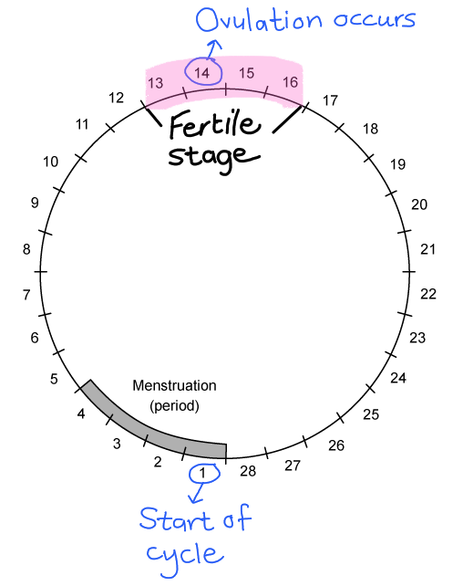

# Mark Schemes — Reproduction in Plants & Humans
**15. Reproduction** · Cambridge (CIE) IGCSE science (0654 & 0973)

## Multiple Choice Questions (13 questions)

### Q1
**Final answer:** **The correct answer is ****B**

- Testosterone is the male hormone that causes **secondary sexual characteristics **during **puberty**
- These include the development of stronger muscles and the voice to deepen

**A** is incorrect because while it does cause the voice to deepen, testosterone is not produced by the pancreas (it’s produced in the testes).

**C** is incorrect because while it does promote the development of stronger muscles and is primarily thought of as a male hormone, women do produce small amounts of testosterone but it is not involved in the control of egg maturation in the ovaries.

**D** is incorrect because even though this is a correct statement, it is not the **only** correct statement (the question is asking you for all the statements).

### Q2
**Final answer:** **The correct answer is ****C.**** (2 only) because:**

Pollen grains that are transferred by **insect pollinators** are larger and have a spiky surface to attach to insects.

The pollen in picture 1 has a larger surface area with ‘wings’ and in picture 3 are small and light. These two features are more likely to be seen in wind pollinated seeds.

### Q3
**Final answer:** **The correct answer is ****C ****because:**

The seedling is tall and green in this sample indicating that it received enough light for the leaves to photosynthesise. The temperature was high enough to allow for enzyme activity.

**A** is incorrect because this sample is short and yellow, showing that it was not photosynthesising so grown in the dark and at low temperatures so had a reduced enzyme activity. This would be sample 3.

**B** is incorrect because this sample is tall and yellow, showing it was grown in the dark but at a higher temperature. This would be sample 1.

**D** is incorrect because this sample is short and green, showing that it had light but not a high enough temperature for optimum enzyme activity. This would be sample 4.

### Q4
**Final answer:** **The correct answer is ****A.**** (Vagina →  cervix   → uterus  → oviduct) because:**

**Ejaculation** takes place in the vagina; from there sperm travels through the cervix, into the uterus and then to the oviduct where (if it has been released) an egg can be fertilised.

**B** and **D** are incorrect because they would both be correct paths of an egg that was not fertilised by a sperm cell.

**C** is incorrect because the sperm will need to go through the cervix before it can enter the uterus.

### Q5
**Final answer:** **The correct answer is ****C.**** (Days 13 - 16) because:**

- **Ovulation** happens after the LH surge which occurs around day 14 (if day 1 is the first day of a period in a new cycle)
- **Sperm** will survive in a woman's body for 2 -3 days so once the egg is released there may be sperm in the fallopian tube to fertilise the egg

**A** is incorrect because around this time the egg has not been released from the ovary.

**B** is incorrect because there is no egg released (it will be maturing at this point) and any sperm present at this time are unlikely to survive until the egg is released roughly 4 days later.

**D** is incorrect because the egg will have died by day 20 so there will be no egg for the sperm to fertilise.

### Q6
**Final answer:** **The correct answer is ****B.**** (2 and 4) because:**

Testosterone is the male hormone that causes **secondary sexual characteristics **during **puberty**. These include the development of stronger muscles and the voice to deepen.

**A** is incorrect because while it does cause the voice to deepen, testosterone is not produced by the pancreas (it’s produced in the testes).

**C** is incorrect because while it does promote the development of stronger muscles and is primarily thought of as a male hormone, women do produce small amounts of testosterone but it is not involved in the control of egg maturation in the ovaries.

**D** is incorrect because even though this is a correct statement, it is not the **only** correct statement (the question is asking you for all the statements).

### Q7
**Final answer:** **The correct answer is ****A.**** (Male and female gametes) because:**

- ‘Many, minute and motile’ refers to **sperm** cells. They are produced in very large numbers and are much smaller than the **ovum** (the egg) - they are much less energy intensive to produce which is why more of them can be made. They also have a** tail** to swim to the ovum
- ‘Few, fat and fixed’ refers to an ovum (egg cell). Generally, only one egg is released each month in the **menstrual cycle**. They are much larger than sperm cells and are unable to move independently, instead, they rely on the **ciliated** cells in the oviduct to waft them through to the **uterus**

A common misconception here is that these statements are referring to animal and plant cells, students often think of animal cells being smaller and motile and plant cells being large and fixed.

### Q8
**Final answer:** **The correct answer is ****C.**** (It leads to increased genetic variation within a population) because:**

Only one parent is required to produce the offspring during asexual reproduction, so there is no fusion of gametes and therefore no mixing of different genetic information that occurs. All the offspring will be genetically identical to each other and the parent.

**A**, **B** and **D** all represent the advantages of asexual reproduction.

### Q9
**Final answer:** **The correct answer is ****D.**** (1 and 3) because:**

- HIV infects **lymphocytes** (a type of white blood cell) eventually leading to a reduction in their number. As the **lymphocytes **produce **antibodies** which enhance an immune response to infection, the reduction in antibody production eventually results in a reduced ability to fight infection (at this point a person has AIDS)
- HIV is a sexually transmitted disease; that is the HIV virus is passed from one person to another via body fluids

**A** is incorrect because while HIV will reduce antibody production, it will not directly decrease the levels of red blood cells.

**B** is incorrect because neither of these statements would be correct for a direct effect of HIV.

**C** is incorrect because while HIV will reduce white blood cells it will not directly reduce the volume of plasma produced.

### Q10
**Final answer:** **The correct answer is ****B ****because:**

Three essential factors are needed for successful germination:

- **Water** - allows the seed to swell and start growing while also providing a solvent for essential nutrients to diffuse around the seed
- **Oxygen** - allows for aerobic respiration to release the energy from stored sugars (needed to fuel growth)
- **Warmth** - germination increases as the temperature increases (up to an optimum temperature), the number of successful collisions between enzymes and substrates increases

**A** is incorrect because the temperature is too low for successful collisions between **enzymes** and their **substrates.**

**C** is incorrect because there is no water for the stored sugars to dissolve in, and the temperature is too low.

**D** is incorrect because there is no oxygen for aerobic respiration to release energy to fuel growth.

### Q11
**Final answer:** **The correct answer is ****D ****because:**

- More **genetic variation** within a population / species means that the population / species is more likely to survive any changes in the environment due to **natural selection**. They may also be able to survive moving to new environments
- **Asexual reproduction** is faster as it only involves one parent, there is no need to find a suitable partner for reproduction

**A** is incorrect because while only one parent needed is an advantage of asexual reproduction, less population growth is not an advantage of sexual reproduction.

**B** and **C** are incorrect because none of these statements are scientifically correct.

### Q12
**Final answer:** **The correct answer is ****B.**** (They release energy for movement) because:**

Mitochondria are the site of aerobic respiration which releases the energy needed to power the tail of the sperm so that it can make its journey to the ovum in the oviduct.

**A** is incorrect because the nucleus contains the genetic information from the male.

**C** is incorrect because the sperm cell has enzymes in the head (in the acrosome) to help it digest the outer layer of the egg so that it can release its nucleus into the egg.

**D** is incorrect because ribosomes are the site of protein synthesis.

### Q13
**Final answer:** **The correct answer is ****D ****because:**

- Pollination has taken place as there are **pollen **grains on the tops of the **stigma** and a pollen tub has grown down the **style**
- Fertilisation hasn’t taken place as the **pollen tube** has not connected with the **ovum** and there is no pollen grain nucleus visible in the **ovary**
