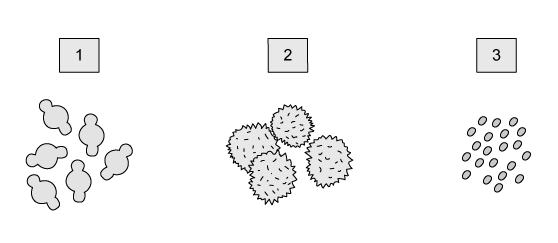
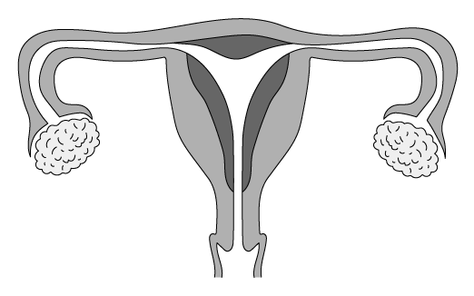
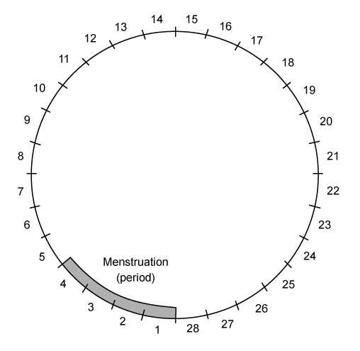
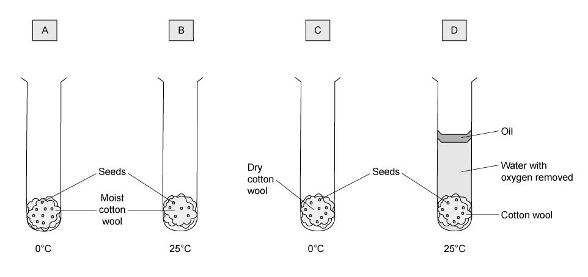
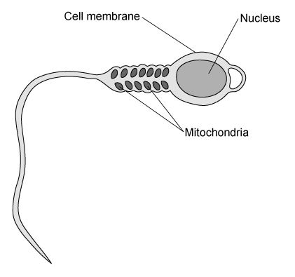

# Exam Questions — Reproduction in Plants & Humans
**15. Reproduction** · Cambridge (CIE) IGCSE science (0654 & 0973)
> Source: [https://www.savemyexams.com/igcse/science/cie/co-ordinated-sciences-double-award/23/biology/topic-questions/](https://www.savemyexams.com/igcse/science/cie/co-ordinated-sciences-double-award/23/biology/topic-questions/) · 13 questions across 1 sets

## Multiple Choice Questions (13 questions)

### Q1 — easy — 1 marks

**Q1** [1 mark]

The statements below are about different hormones in the human body.

1. Produced by the pancreas.
2. Causes the voice to deepen at puberty.
3. Causes an egg to mature in the menstrual cycle.
4. Promotes the development of stronger muscles.

Which of these statements are correct for testosterone?

### Q2 — medium — 1 marks

**Q2** [1 mark]

The diagrams show 3 different species of pollen grains as they appear under a microscope. The diagrams are all to the same scale.

Which pollen grains are involved in insect pollination?

### Q3 — hard — 1 marks

**Q3** [1 mark]

Germinating seeds were placed in different temperature and light conditions as shown in the table below.

| **sample** | **temperature / °C** | **light** |
|---|---|---|
| 1 | 20 | absent |
| 2 | 20 | present |
| 3 | 4 | absent |
| 4 | 4 | present |

A seedling was removed from each experiment after 7 days.

Which seedling was from sample 2?

### Q4 — medium — 1 marks

**Q4** [1 mark]

The diagram shows the female reproductive system.

After ejaculation, which pathway will the male gamete take to fuse with the egg?

### Q5 — hard — 1 marks

**Q5** [1 mark]

The diagram shows the menstrual cycle. This is a 28 day cycle.

Which time range in the cycle is the woman most likely to get pregnant?

### Q6 — easy — 1 marks

**Q6** [1 mark]

The statements below are about different hormones in the human body.

1. Produced by the pancreas.
2. Causes the voice to deepen at puberty.
3. Causes an egg to mature in the menstrual cycle.
4. Promotes the development of stronger muscles.

Which of these statements are correct for testosterone?

### Q7 — easy — 1 marks

**Q7** [1 mark]

Students were discussing how to remember the difference between two groups of cells, ‘many, minute and motile’ or ‘few, fat and fixed’.

What group of cells were they referring to?

### Q8 — easy — 1 marks

**Q8** [1 mark]

#### Extended only

Which of the following is **not** an advantage of asexual reproduction?

### Q9 — medium — 1 marks

**Q9** [1 mark]

HIV is an STI. The following statements are about changes that could occur in the body.

1. Reduced antibody production
2. Reduction in red blood cells
3. Reduction in white blood cells
4. Reduced volume of blood plasma

Which of these statements would be correct for HIV?

### Q10 — hard — 1 marks

**Q10** [1 mark]

An experiment was set up with four test tubes as shown in the diagram below and placed in the dark.

In which conditions would the seeds germinate first?

### Q11 — medium — 1 marks

**Q11** [1 mark]

**Extended Tier Only**

The table below shows some advantages and disadvantages of sexual and asexual reproduction.

Which row is correct?

|   | advantages of sexual reproduction | advantage of asexual reproduction |
|---|---|---|
| **A** | less population growth | only one parent needed |
| **B** | more energy efficient | gametes can be transferred by the environment |
| **C** | no transfer of gametes | does not compete with parent for nutrients |
| **D** | more genetic variation | faster |

### Q12 — easy — 1 marks

**Q12** [1 mark]

**Extended Tier Only**

The diagram shows a human sperm cell. The sperm cell has many mitochondria in the mid section.

How do the mitochondria help the sperm carry out its function?

### Q13 — hard — 1 marks

**Q13** [1 mark]

The diagram below shows a flower.

Which of these processes have taken place?

|   | **pollination** | **fertilisation** |
|---|---|---|
| **A** | no | no |
| **B** | no | yes |
| **C** | yes | yes |
| **D** | yes | no |
