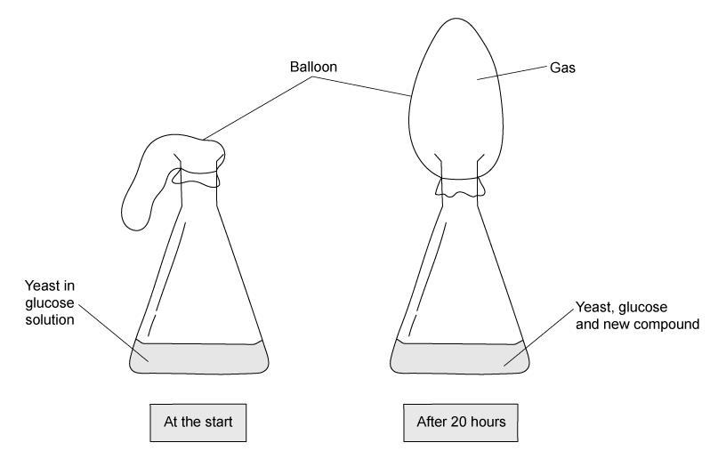

# Exam Questions — Respiration
**12. Respiration** · Cambridge (CIE) IGCSE science (0654 & 0973)
> Source: [https://www.savemyexams.com/igcse/science/cie/co-ordinated-sciences-double-award/23/biology/topic-questions/](https://www.savemyexams.com/igcse/science/cie/co-ordinated-sciences-double-award/23/biology/topic-questions/) · 16 questions across 1 sets

## Multiple Choice Questions (16 questions)

### Q1 — hard — 1 marks

**Q1** [1 mark]

In which conditions would the cells of a dicotyledonous green plant respire?

|   | mesophyll cell | root hair cell |   |   |
|---|---|---|---|---|
| darkness | bright light | darkness | bright light |   |
| **A** | ✓ | X | ✓ | X |
| **B** | X | ✓ | X | X |
| **C** | X | X | X | X |
| **D** | ✓ | ✓ | ✓ | ✓ |

### Q2 — medium — 1 marks

**Q2** [1 mark]

**Extended Tier Only**

The diagram below shows an experiment set up by a teacher to demonstrate how an investigation into anaerobic respiration in yeast cells can be carried out.

Predict what would happen to the coloured liquid in the glass tube.

### Q3 — medium — 1 marks

**Q3** [1 mark]

**Extended Tier Only**

The diagram below shows an experiment set up by a group of students to investigate respiration in yeast.

Which row of the table below correctly describes the contents of the flask after 20 hours?

|   | new compound | gas produced |
|---|---|---|
| **A** | ethanol (alcohol) | oxygen |
| **B** | ethanol (alcohol) | carbon dioxide |
| **C** | lactic acid | oxygen |
| **D** | lactic acid | carbon dioxide |

### Q4 — hard — 1 marks

**Q4** [1 mark]

**Extended Tier Only**

Four metabolic reactions that can occur in living organisms are shown below:

1. C6H12O6 + 6O2 → 6CO2+ 6H2O
2. glucose → lactic acid
3. 6CO2+ 6H2O → C6H12O6 + 6O2
4. glucose → ethanol + carbon dioxide

Which of the above reactions take place in yeast cells to release energy?

### Q5 — medium — 1 marks

**Q5** [1 mark]

**Extended Tier Only**

Which row in the table below shows the correct products produced by anaerobic respiration in yeast and in animals?

|   | animals | yeast |   |   |
|---|---|---|---|---|
| lactic acid | carbon dioxide | lactic acid | carbon dioxide |   |
| **A** | **X** | **✓** | **X** | **X** |
| **B** | **✓** | **X** | **X** | **✓** |
| **C** | **X** | **✓** | **✓** | **X** |
| **D** | **✓** | **✓** | **✓** | **X** |

### Q6 — easy — 1 marks

**Q6** [1 mark]

A student investigated respiration in yeast. They set up the experiment as shown in the diagram below.

Every 30 minutes they replaced the water with the same volume but it was 10 oC warmer and counted the bubbles given off in 2 minutes.

What are the independent and dependent variables in this experiment?

|   | independent | dependent |
|---|---|---|
| **A** | number of bubbles | time |
| **B** | time | number of bubbles |
| **C** | water temperature | number of bubbles |
| **D** | water temperature | volume of water |

### Q7 — easy — 1 marks

**Q7** [1 mark]

Which of the following do humans require energy for?

1. Producing proteins
2. Cell division
3. Generation of nerve impulses
4. Maintaining body temperature

### Q8 — easy — 1 marks

**Q8** [1 mark]

Which of the following processes require, and are dependent on, the activity of enzymes?

1. aerobic respiration
2. glucose → lactic acid
3. osmosis
4. anaerobic respiration in yeast

### Q9 — medium — 1 marks

**Q9** [1 mark]

The diagram below shows an experimental set-up which can be used to investigate gas exchange in a plant leaf.

In which direction would the ink drop move and for what reason?

|   | direction | reason |
|---|---|---|
| **A** | to the right | photosynthesis |
| **B** | to the left | photosynthesis |
| **C** | to the right | respiration |
| **D** | to the left | respiration |

### Q10 — easy — 1 marks

**Q10** [1 mark]

Glucose is broken down in the chemical processes of aerobic respiration.

Which row of the table below shows the correct products of this breakdown?

|   | energy | water | lactic acid | carbon dioxide |
|---|---|---|---|---|
| **A** | **X** | **X** | **✓** | **X** |
| **B** | **✓** | **X** | **X** | **✓** |
| **C** | **X** | **✓** | **X** | **✓** |
| **D** | **✓** | **✓** | **X** | **✓** |

### Q11 — hard — 1 marks

**Q11** [1 mark]

**Extended Tier Only**

The list below shows four metabolic processes that can occur in living cells.

1. carbon dioxide + water →  glucose + oxygen
2. glucose → lactic acid
3. glucose + oxygen →  carbon dioxide + water
4. glucose →  alcohol + carbon dioxide

Which row of the table correctly represents the processes that can occur in muscle cells and yeast cells.

|   | in muscles | in yeast |
|---|---|---|
| **A** | 3 only | 1 & 4 |
| **B** | 3 & 4 | 2 & 3 |
| **C** | 2 only | 1, 3 & 4 |
| **D** | 2 & 3 | 3 & 4 |

### Q12 — medium — 1 marks

**Q12** [1 mark]

**Extended Tier Only**

Why does anaerobic respiration of glucose release less energy in muscle cells than aerobic respiration?

1. Energy is lost in oxygen.
2. Energy remains trapped in the chemical bonds in the molecule lactic acid.
3. Energy remains trapped in the chemical bonds in the molecule ethanol.
4. Energy is lost in carbon dioxide.

### Q13 — hard — 1 marks

**Q13** [1 mark]

**Extended Tier Only**

Which of the following is the correct balanced symbol equation for aerobic respiration in yeast cells?

### Q14 — hard — 1 marks

**Q14** [1 mark]

Which of the following processes would release the most energy in a cell from one molecule of glucose?

1. Aerobic respiration in yeast
2. Aerobic respiration in animals
3. Aerobic respiration in plants

### Q15 — easy — 1 marks

**Q15** [1 mark]

Which of the following is the correct word equation for aerobic respiration in plants?

### Q16 — medium — 1 marks

**Q16** [1 mark]

**Extended Tier Only**

During vigorous exercise, such as cycling uphill, lactic acid builds up in the muscles.

How is this lactic acid removed during recovery?
