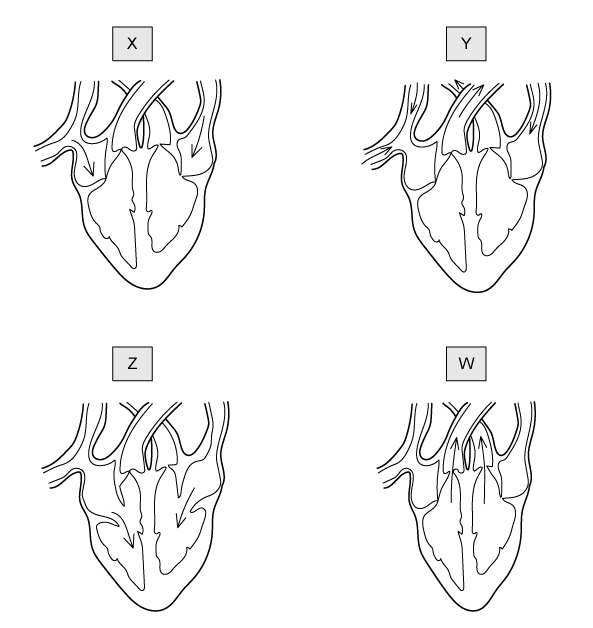
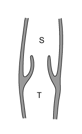
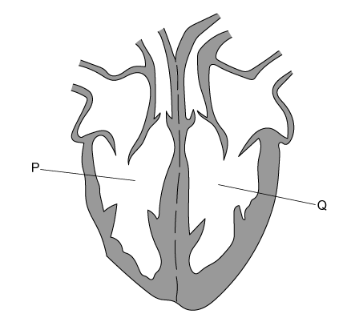
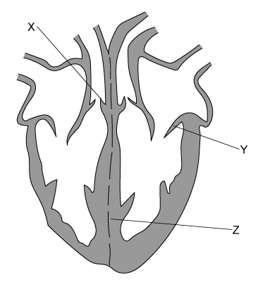
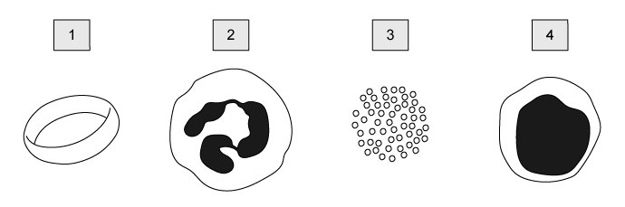

# Exam Questions — Circulatory Systems, Heart & Blood Vessels
**9. Transport in Animals** · Cambridge (CIE) IGCSE science (0654 & 0973)
> Source: [https://www.savemyexams.com/igcse/science/cie/co-ordinated-sciences-double-award/23/biology/topic-questions/](https://www.savemyexams.com/igcse/science/cie/co-ordinated-sciences-double-award/23/biology/topic-questions/) · 15 questions across 1 sets

## Multiple Choice Questions (15 questions)

### Q1 — hard — 1 marks

**Q1** [1 mark]

Four different stages in one heartbeat are shown in the diagram below.

Which of the following depicts a correct order of stages?

### Q2 — easy — 1 marks

**Q2** [1 mark]

Which row of the table below shows the correct chambers of the heart, from those with the thinnest walls to those with the thickest?

| ** ** | thinnest **→** thickest |   |   |
|---|---|---|---|
| **A** | left ventricle | right ventricle | left atrium |
| **B** | left atrium | left ventricle | right ventricle |
| **C** | right ventricle | left atrium | left ventricle |
| **D** | left atrium | right ventricle | left ventricle |

### Q3 — hard — 1 marks

**Q3** [1 mark]

**Extended Tier Only**

Four different stages in one heartbeat are shown in the diagram below.

Which of the following depicts a correct order of stages?

### Q4 — easy — 1 marks

**Q4** [1 mark]

Which row of the table below shows the correct chambers of the heart, from those with the thinnest walls to those with the thickest?

| ** ** | thinnest **→** thickest |   |   |
|---|---|---|---|
| **A** | left ventricle | right ventricle | left atrium |
| **B** | left atrium | left ventricle | right ventricle |
| **C** | right ventricle | left atrium | left ventricle |
| **D** | left atrium | right ventricle | left ventricle |

### Q5 — medium — 1 marks

**Q5** [1 mark]

The image below shows a cross-section of a blood vessel taken from an arm.

Which type of blood vessel is shown in the image, and in which direction will blood flow?

| ** ** | type of vessel | direction of flow | oxygenation of blood |
|---|---|---|---|
| **A** | capillary | S to T | low |
| **B** | vein | T to S | high |
| **C** | artery | S to T | high |
| **D** | vein | T to S | low |

### Q6 — hard — 1 marks

**Q6** [1 mark]

**Higher Tier Only**

Which of the following options lists three blood vessels that carry deoxygenated blood?

### Q7 — medium — 1 marks

**Q7** [1 mark]

**Extended Tier Only**

Which of the following is a correct explanation as to why mammals have a double circulatory system?

### Q8 — medium — 1 marks

**Q8** [1 mark]

**Extended Tier Only**

The diagram below shows the human heart and some of the blood vessels associated with it.

Before blood in P reaches Q, what must it do?

### Q9 — easy — 1 marks

**Q9** [1 mark]

Which of the following statements would be incorrect for most of the veins in the human body?

### Q10 — medium — 1 marks

**Q10** [1 mark]

**Extended Tier Only**

The diagram below shows a vertical section through a human heart.

Which row of the following table has the correct names for the structures labelled in the diagram?

| ** ** | X | Y | Z |
|---|---|---|---|
| **A** | atrioventricular valve | semilunar valve | septum |
| **B** | semilunar valve | atrioventricular valve | septum |
| **C** | semilunar valve | semilunar valve | atrioventricular valve |
| **D** | atrioventricular valve | atrioventricular valve | septum |

### Q11 — hard — 1 marks

**Q11** [1 mark]

**Extended Tier Only**

Which blood vessel has a relatively low carbon dioxide concentration, a high oxygen concentration and a low blood pressure?

### Q12 — hard — 1 marks

**Q12** [1 mark]

Which of the following would be found dissolved in the blood plasma of a human?

### Q13 — easy — 1 marks

**Q13** [1 mark]

Which of the following is a method that a doctor would suggest to a patient to reduce their risk of developing coronary heart disease?

### Q14 — easy — 1 marks

**Q14** [1 mark]

**Extended Tier Only**

The blood contains lymphocytes.

What is their purpose?

### Q15 — medium — 1 marks

**Q15** [1 mark]

**Extended Tier Only**

Some components of the blood of a mammal are shown in the image below.

Which row of the table has the correct cells from the image above assigned to their names?

| ** ** | lymphocyte | phagocyte | platelets |
|---|---|---|---|
| **A** | 4 | 2 | 3 |
| **B** | 2 | 4 | 3 |
| **C** | 1 | 2 | 1 |
| **D** | 2 | 4 | 1 |
