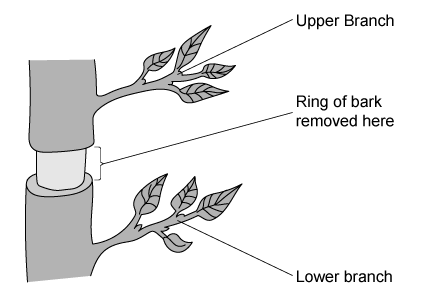
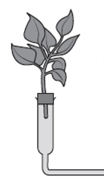
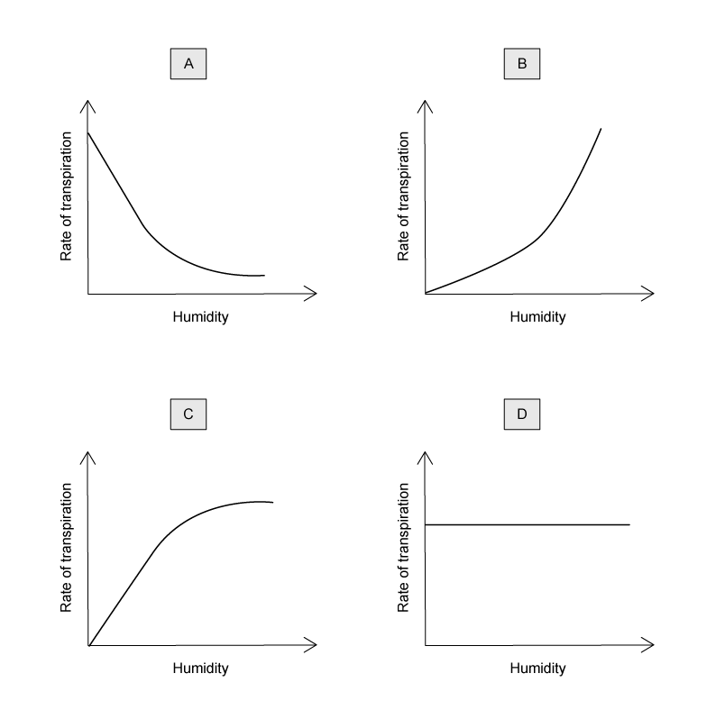
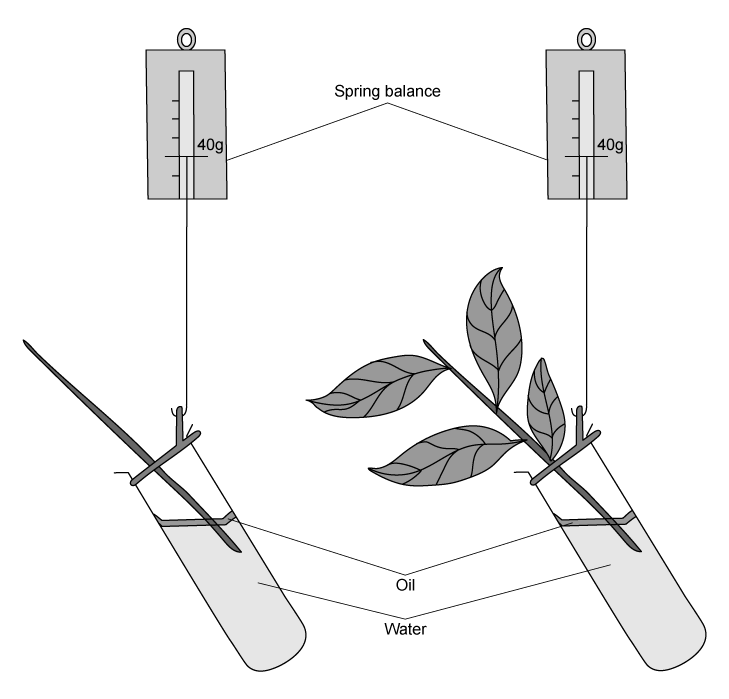

# Exam Questions — Transport in Plants
**8. Transport in Plants** · Cambridge (CIE) IGCSE science (0654 & 0973)
> Source: [https://www.savemyexams.com/igcse/science/cie/co-ordinated-sciences-double-award/23/biology/topic-questions/](https://www.savemyexams.com/igcse/science/cie/co-ordinated-sciences-double-award/23/biology/topic-questions/) · 18 questions across 1 sets

## Multiple Choice Questions (18 questions)

### Q1 — medium — 1 marks

**Q1** [1 mark]

A student collected some of the solution from the phloem in the stem of a plant.

Which of the following would be present in the liquid?

### Q2 — medium — 1 marks

**Q2** [1 mark]

Which of the following processes is/are involved in the loss of water from the leaves of plants?

1. diffusion
2. osmosis
3. condensation
4. evaporation

### Q3 — medium — 1 marks

**Q3** [1 mark]

Which of the following processes is/are involved in the loss of water from the leaves of plants?

1. diffusion
2. osmosis
3. condensation
4. evaporation

### Q4 — easy — 1 marks

**Q4** [1 mark]

**Extended Tier Only**

Which of the following is a correct explanation of the process of translocation in a plant?

### Q5 — easy — 1 marks

**Q5** [1 mark]

The diagram shows a simplified water cycle.

Which of the processes listed below would be involved in the loss of water from the tree?

### Q6 — medium — 1 marks

**Q6** [1 mark]

Which of the following is a correct explanation of the effect of root hairs on absorption?

### Q7 — hard — 1 marks

**Q7** [1 mark]

**Extended Tier Only**

The diagram below shows part of the trunk of a small dicotyledonous tree with a ring of bark removed.

Removing the ring of bark removes one type of transport tissue but leaves the other type intact.

What effect does removing the bark have on the two branches?

|   | **upper branch** | **lower branch** |   |   |
|---|---|---|---|---|
| **leaves** | **growth** | **leaves** | **growth** |   |
| **A** | normal | normal | normal | reduced |
| **B** | wilted | normal | wilted | normal |
| **C** | wilted | reduced | normal | normal |
| **D** | normal | reduced | wilted | reduced |

### Q8 — easy — 1 marks

**Q8** [1 mark]

**Extended Tier Only**

The diagram below shows a potted plant and the same plant 48 hours later.

What has caused the plant’s appearance to change?

### Q9 — medium — 1 marks

**Q9** [1 mark]

**Extended Tier Only**

A dicot plant is placed into a bowl of water coloured with red dye.

After 1 hour, a cross section of one of the roots is cut.

After 4 hours, a cross section is cut from the stem.

Which labelled regions would be stained red in each case?

### Q10 — easy — 1 marks

**Q10** [1 mark]

Which order below is correct in describing the pathway of water as it travels from the roots through a plant?

### Q11 — medium — 1 marks

**Q11** [1 mark]

A **decrease **in which of the following factors would normally cause the transpiration rate to **increase**?

### Q12 — medium — 1 marks

**Q12** [1 mark]

**Extended Tier Only**

Which environmental factor is most likely to be responsible for a plant to wilt?

### Q13 — easy — 1 marks

**Q13** [1 mark]

A potometer can be used to measure the rate that a piece of plant transpires under various conditions.

Part of a potometer is shown in the diagram below.

Which statement, relating to how a potometer works, is **false**?

### Q14 — medium — 1 marks

**Q14** [1 mark]

**Extended Tier Only**

A student collected some of the solution from the phloem in the stem of a plant.

Which of the following would be present in the liquid?

### Q15 — hard — 1 marks

**Q15** [1 mark]

The table below shows some characteristics of four different plants.

The plants are growing in the same environmental conditions.

Which plant will have the **lowest **rate of transpiration?

|   | **number of leaves on plant** | **average surface area of one leaf / cm****2** | **average density of stomata on leaves / stomata per mm****2** | **average diameter of one stoma / µm** |
|---|---|---|---|---|
| **A** | 36 | 53 | 276 | 19 |
| **B** | 21 | 51 | 247 | 18 |
| **C** | 24 | 45 | 249 | 15 |
| **D** | 17 | 40 | 151 | 16 |

### Q16 — hard — 1 marks

**Q16** [1 mark]

**Extended Tier Only**

Which of the following graphs shows most clearly what would happen to the rate of transpiration as humidity decreases?

### Q17 — hard — 1 marks

**Q17** [1 mark]

The diagram below shows two shoots at the start of an experiment set up by a group of students.

What are the most likely readings on the spring balances after four days?

|   | **Spring balance readings / g** |   |
|---|---|---|
| **shoot A** | **shoot B** |   |
| **A** | 40 | 40 |
| **B** | 40 | 34 |
| **C** | 34 | 40 |
| **D** | 34 | 34 |

### Q18 — hard — 1 marks

**Q18** [1 mark]

**Extended Tier Only**

Which row of the table below shows substances transported through the phloem and xylem, and the direction of transport, correctly?

|   | **phloem** | **direction of transport** | **xylem** | **direction of transport** |
|---|---|---|---|---|
| **A** | sucrose and amino acids | bi-directional (up and down) | water and mineral ions | bi-directional (up and down) |
| **B** | sucrose | unidirectional (up) | water and mineral ions | bi-directional (up and down) |
| **C** | sucrose | bi-directional (up and down) | water | unidirectional (up) |
| **D** | sucrose and amino acids | unidirectional (up) | water | unidirectional (up) |
