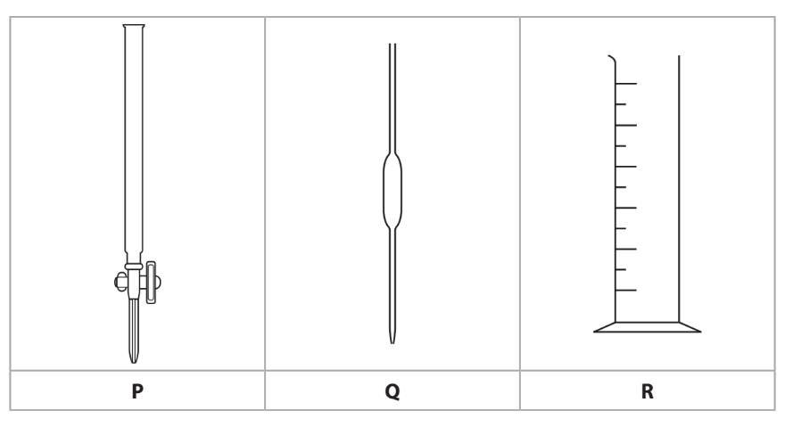

# Exam Questions — Preparation of Salts
**7. Acids, Bases & Salts** · Cambridge (CIE) IGCSE science (0654 & 0973)
> Source: [https://www.savemyexams.com/igcse/science/cie/co-ordinated-sciences-double-award/23/chemistry/topic-questions/](https://www.savemyexams.com/igcse/science/cie/co-ordinated-sciences-double-award/23/chemistry/topic-questions/) · 12 questions across 1 sets

## Multiple Choice Questions (12 questions)

### Q1 — easy — 1 marks

**Q1** [1 mark]

A student prepares pure hydrated copper(II) sulfate crystals from copper(II) oxide and dilute sulfuric acid.

Which row shows the correct order of steps for this preparation?

### Q2 — hard — 1 marks

**Q2** [1 mark]

**Extended tier only**

Silver chloride can be prepared by the reaction of silver nitrate solution with potassium chloride solution.

Which statement about the preparation is correct?

### Q3 — hard — 1 marks

**Q3** [1 mark]

A substance reacts with dilute H2SO4 to form a salt which is separated by filtration.

What is the substance?

### Q4 — hard — 1 marks

**Q4** [1 mark]

A student is provided with solutions of dilute hydrochloric acid, dilute sulfuric acid, solid magnesium oxide, zinc carbonate and copper.

How many different salts could the student make?

### Q5 — medium — 1 marks

**Q5** [1 mark]

Copper(II) sulfate can be prepared by reacting solid copper(II) carbonate with hot sulfuric acid. The alkali solid is always added in excess.

Why is the solid reactant added in excess?

### Q6 — medium — 1 marks

**Q6** [1 mark]

**Extended tier only**

Which of the following methods to prepare a salt can be achieved using a burette and a pipette?

### Q7 — medium — 1 marks

**Q7** [1 mark]

A student wanted to prepare copper(II) sulfate crystals by reacting solid copper(II) oxide to a solution of hot sulfuric acid.

An extract from the method section of the experimental handout is shown below:

Add the copper(II) oxide in small amounts to the hot acid in the reaction flask and stir until it is …..**1**…... When the reaction has gone to completion the copper(II) oxide will no longer …..**2**……, …..**3**….. and …..**4**….. the solution to obtain the copper(II) sulfate crystals.

|   | **1** | **2** | **3** | **4** |
|---|---|---|---|---|
| **A** | in excess | precipitate | cool | dissolve |
| **B** | in excess | dissolve | filter | cool |
| **C** | reacting | dissolve | cool | filter |
| **D** | reacting | precipitate | filter | cool |

### Q8 — medium — 1 marks

**Q8** [1 mark]

**Extended tier only**

What is the correct sequence of steps for the preparation of a pure sample of lead(II) iodide from solid potassium iodide and lead(II) nitrate ?

### Q9 — easy — 1 marks

**Q9** [1 mark]

When an aqueous salt is crystallised, some water can be retained within the structure of the salt.

What is the name given to the type of salt that forms?

| **A** | anhydrous salt |
|---|---|
| **B** | dehydrated salt |
| **C** | hydrated salt |
| **D** | soluble salt |

### Q10 — easy — 1 marks

**Q10** [1 mark]

A student making copper sulfate crystals used the method shown.

Unreacted copper carbonate was left over as it had been added in excess.

What is the reason for adding it in excess and what would step 3 be of this method?

| ** ** | **reason for adding in excess** | **step 3** |
|---|---|---|
| ** A** | to produce a greater amount of salt crystals | filtration |
| ** B** | to improve the colour intensity of the crystals | crystallisation |
| ** C** | to ensure all the acid reacts | filtration |
| ** D** | to increase the rate of reaction | evaporation |

### Q11 — easy — 1 marks

**Q11** [1 mark]

Different salts can be prepared by titrating an alkali with an aqueous acid.

Three pieces of apparatus, **P**, **Q** and **R**, used to measure volumes of liquid are shown below.

What are the names of the three pieces of apparatus, **P**, **Q** and **R**?

| ** ** | **P** | **Q** | **R** |
|---|---|---|---|
| ** A** | pipette | burette | measuring cylinder |
| ** B** | burette | pipette | conical flask |
| ** C** | pipette | volumetric flask | burette |
| ** D** | burette | pipette | measuring cylinder |

### Q12 — easy — 1 marks

**Q12** [1 mark]

When solid sodium chloride is mixed with water, sodium chloride solution forms.

What name is given to the process of mixing a solid with water to form a solution?

| **A** | Crystallising |
|---|---|
| **B** | Diluting |
| **C** | Dissolving |
| **D** | Melting |
