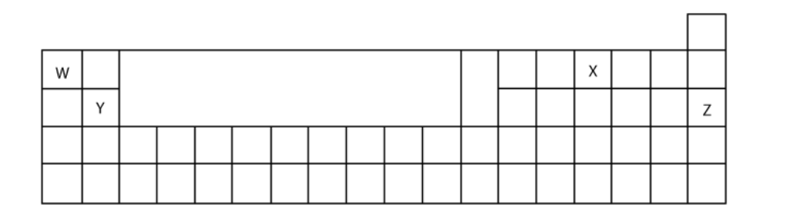

# Exam Questions — Atomic Structure & the Periodic Table
**2. Atoms, Elements & Compounds** · Cambridge (CIE) IGCSE science (0654 & 0973)
> Source: [https://www.savemyexams.com/igcse/science/cie/co-ordinated-sciences-double-award/23/chemistry/topic-questions/](https://www.savemyexams.com/igcse/science/cie/co-ordinated-sciences-double-award/23/chemistry/topic-questions/) · 15 questions across 1 sets

## Multiple Choice Questions (15 questions)

### Q1 — medium — 1 marks

**Q1** [1 mark]

Two atoms, X and Y** **can be represented as shown

`straight X presubscript 3 presuperscript 7 space space space space space space space space space space space space space space straight Y presubscript 3 presuperscript 8`

Which row is correct for both atoms?

|   | electron configuration of X | electron configuration of Y | Is Y an isotope of X? |
|---|---|---|---|
| **A** | 2,1 | 2,1 | Yes |
| **B** | 2,1 | 2,6 | Yes |
| **C** | 2,5 | 2,1 | No |
| **D** | 2,5 | 2,6 | No |

### Q2 — hard — 1 marks

**Q2** [1 mark]

Which row of the table correctly describes the link between outer shell electrons, Group number and Period number?

|   | **outer electrons same as** | **group number same as** | **period number same as** |
|---|---|---|---|
| **A** | group number | period number | outer electrons |
| **B** | period number | group number | outer electrons |
| **C** | group number | outer electrons | number of electron shells |
| **D** | outer electrons | group number | number of electron shells |

### Q3 — hard — 1 marks

**Q3** [1 mark]

The X+ ion of element X has 16 electrons and a nucleon number of 37.

What is the correct Group number for element X?

### Q4 — hard — 1 marks

**Q4** [1 mark]

**Extended tier only**

Which row correctly describes the number of outer shell electrons and properties of isotopes?

|   | **Number of electrons** | **Chemical properties** |
|---|---|---|
| **A** | same | same |
| **B** | same | different |
| **C** | different | same |
| **D** | different | different |

### Q5 — hard — 1 marks

**Q5** [1 mark]

A selenide ion has the following notation.

`Se presubscript 34 presuperscript 79 superscript 2 minus end superscript`

Which row correctly describes the subatomic particles in a selenide ion?

|   | **Protons** | **Neutrons** | **Electrons** |
|---|---|---|---|
| **A** | 79 | 34 | 34 |
| **B** | 34 | 45 | 34 |
| **C** | 34 | 45 | 36 |
| **D** | 45 | 34 | 32 |

### Q6 — medium — 1 marks

**Q6** [1 mark]

Element X contains 12 of each sub-atomic particle.

What is the correct Group number for element X?

### Q7 — medium — 1 marks

**Q7** [1 mark]

The structure of four particles is described in the table.

| Particle | Number of protons | Number of neutrons | Number of electrons |
|---|---|---|---|
| Li | 3 | X | 3 |
| Li+ | 3 | 4 | 2 |
| F | Y | 10 | 9 |
| F- | 9 | 10 | Z |

What are the correct values for X, Y and Z?

|   | X | Y | Z |
|---|---|---|---|
| **A** | 4 | 7 | 9 |
| **B** | 3 | 9 | 9 |
| **C** | 4 | 9 | 10 |
| **D** | 3 | 7 | 10 |

### Q8 — medium — 1 marks

**Q8** [1 mark]

Element X contains 4 electrons in its outer shell and 125 neutrons in its nucleus. What is element X?

### Q9 — medium — 1 marks

**Q9** [1 mark]

Potassium fluoride is an ionic compound formed when one atom of potassium bonds with one atom of fluorine.

Which row correctly describes the charge and electronic configuration of each ion in the compound?

|   | Potassium ion | Fluorine ion |   |   |
|---|---|---|---|---|
| **A** | 1 - | 2, 8, 8 | 1 + | 2, 8 |
| **B** | 1 + | 2, 8, 8 | 1 - | 2, 8 |
| **C** | 1 + | 2, 8, 8 ,1 | 1 - | 2, 7 |
| **D** | 1 - | 2, 8, 8, 2 | 1 + | 2, 6 |

### Q10 — medium — 1 marks

**Q10** [1 mark]

A section of the Periodic Table is shown below.

The electronic structure of elements W, X, Y and Z are shown in the table.

|   | Electronic structure |
|---|---|
| **W** | 2, 1 |
| **X** | 2, 4 |
| **Y** | 2, 8, 2 |
| **Z** | 2, 8 |

Which elements have the correct electronic structure?

| **A** | W and X |
|---|---|
| **B** | Y and Z |
| **C** | W and Y |
| **D** | X and Z |

### Q11 — easy — 1 marks

**Q11** [1 mark]

Substances can be broadly classified into three categories which are elements, compounds and mixtures.

Which of the following statements is correct?

### Q12 — easy — 1 marks

**Q12** [1 mark]

The diagram shows the atomic structure of an element.

Which element is it?

### Q13 — easy — 1 marks

**Q13** [1 mark]

Which option correctly describes the relative charges and masses of the subatomic particles?

|   | Proton | Neutron | Electron | Relative mass of proton |
|---|---|---|---|---|
| **A** | +1 | 0 | 0 | 0.00054 |
| **B** | 0 | +1 | +1 | 1 |
| **C** | 0 | +1 | -1 | 0.00054 |
| **D** | +1 | 0 | -1 | 1 |

### Q14 — easy — 1 marks

**Q14** [1 mark]

The atomic structure of atoms Q, R, S and T are shown in the table.

| Atom | Number of protons | Number of neutrons | Number of electrons |
|---|---|---|---|
| Q | 6 | 7 | 6 |
| R | 7 | 7 | 7 |
| S | 6 | 8 | 6 |
| T | 8 | 8 | 8 |

Which two atoms are isotopes?

| **A** | Q and S |
|---|---|
| **B** | Q and T |
| **C** | R and T |
| **D** | R and S |

### Q15 — easy — 1 marks

**Q15** [1 mark]

The atomic number of element Q is 9 and its mass number is 19.

In which group of the Periodic Table should element Q be placed?
