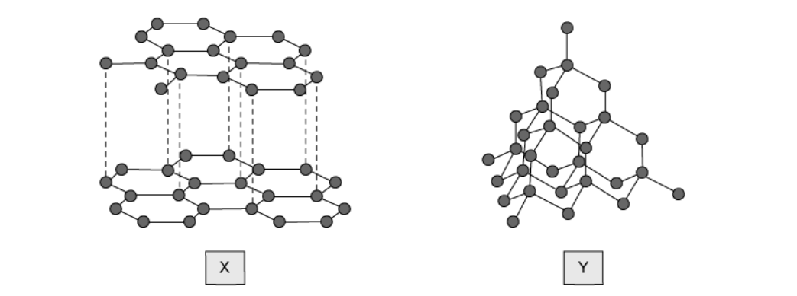

# Exam Questions — Giant Structures
**2. Atoms, Elements & Compounds** · Cambridge (CIE) IGCSE science (0654 & 0973)
> Source: [https://www.savemyexams.com/igcse/science/cie/co-ordinated-sciences-double-award/23/chemistry/topic-questions/](https://www.savemyexams.com/igcse/science/cie/co-ordinated-sciences-double-award/23/chemistry/topic-questions/) · 12 questions across 1 sets

## Multiple Choice Questions (12 questions)

### Q1 — medium — 1 marks

**Q1** [1 mark]

Silicon(IV) oxide and phosphorus oxide (P2O5) are oxides of elements in Period 3 of the Periodic Table.

Which row describes the correct properties of these two oxides?

|   | nature of the oxides | type of bonding | melting point of silicon(IV) oxide | melting point of phosphorus(V) oxide |
|---|---|---|---|---|
| A | acidic | covalent | high | low |
| B | acidic | covalent | low | low |
| C | basic | ionic | high | low |
| D | basic | ionic | low | low |

### Q2 — hard — 1 marks

**Q2** [1 mark]

**Extended tier only**

Metallic bonds are very strong and give metals their properties. Which of the following definitions is correct for a metallic bond?

### Q3 — hard — 1 marks

**Q3** [1 mark]

**Extended tier only**

Metals are malleable and ductile and can be hammered and pulled into useful shapes.

Which statement correctly explains these properties?

### Q4 — medium — 1 marks

**Q4** [1 mark]

Which statement about graphite and diamond is not correct?

### Q5 — medium — 1 marks

**Q5** [1 mark]

Statements 1, 2 and 3 are about diamond and graphite.

1   They have atoms that form three equally strong bonds

2   They each conduct electricity

3   They are both formed from the same element

Which statements are **not **correct?

### Q6 — medium — 1 marks

**Q6** [1 mark]

Which of the following statements about graphite and diamond are incorrect?

| **1** | They are allotropes of carbon. |
|---|---|
| **2** | They both conduct electricity. |
| **3** | They form different numbers of bonds within their structures. |
| **4** | They have different uses. |

### Q7 — medium — 1 marks

**Q7** [1 mark]

Which statement correctly describes the structure of macromolecules?

### Q8 — easy — 1 marks

**Q8** [1 mark]

The structures of two solids X and Y are shown below.

What are the correct uses of these structures?

|   | **X** | **Y** |
|---|---|---|
| **A** | industrial lubricating | glass cutters |
| **B** | industrial lubricating | industrial lubricating |
| **C** | glass cutters | industrial lubricating |
| **D** | glass cutters | glass cutters |

### Q9 — easy — 1 marks

**Q9** [1 mark]

**Extended tier only**

Which statement correctly describes the bonding in metals?

### Q10 — easy — 1 marks

**Q10** [1 mark]

Graphite is used to produce electrodes due to its ability to conduct electricity.

What other property does graphite have that makes it useful for this application?

### Q11 — easy — 1 marks

**Q11** [1 mark]

Graphite is used extensively as a lubricating material. It is also used in pencils and in the manufacture of electrodes for electrolysis.

Which row describes how graphite can be used in electrolysis?

|   | **property** | **use** |
|---|---|---|
| **A** | delocalised electrons | conducts electricity |
| **B** | delocalised electrons | acts as an insulator |
| **C** | low melting point | acts as an insulator |
| **D** | low melting point | conducts electricity |

### Q12 — easy — 1 marks

**Q12** [1 mark]

**Extended tier only**

Which row provides a correct description of the properties of metals?

|   | **melting point** | **boiling point** | **conducts electricity** |
|---|---|---|---|
| **A** | high | low | $\times$ |
| **B** | low | high | `✓` |
| **C** | low | low | $\times$ |
| **D** | high | high | `✓` |
