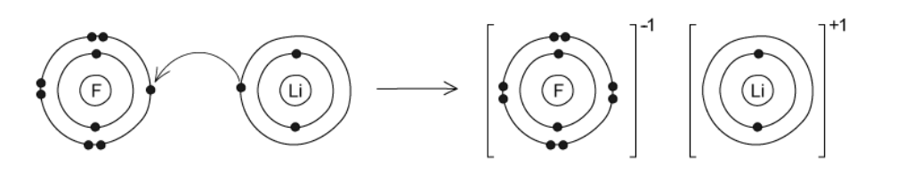
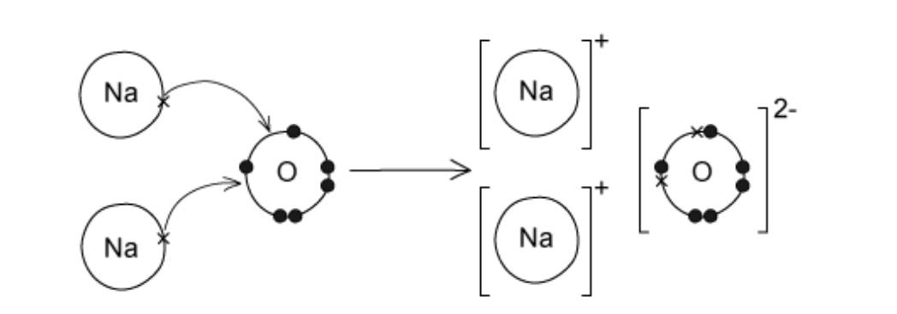
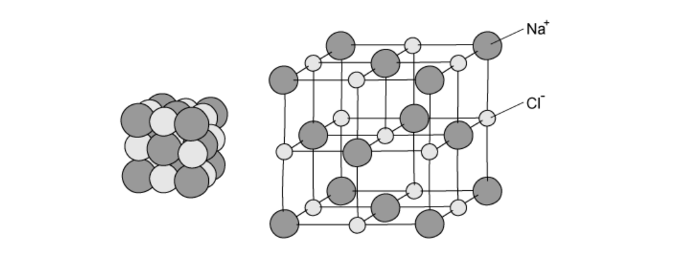

# Mark Schemes — Ions & Ionic Bonds
**2. Atoms, Elements & Compounds** · Cambridge (CIE) IGCSE science (0654 & 0973)

## Multiple Choice Questions (22 questions)

### Q1
**Final answer:** **The correct answer is B**

- Statement 1 is incorrect

  - Sodium chloride has a giant ionic lattice
  - An ionic lattice is a **highly stable **structure in which oppositely charged ions are **strongly attracted**
  
    - It has a **high melting point** because a large amount of thermal energy is required to overcome the strong electrostatic forces of attraction
- Statement 2 is correct

  - When an ionic compound is dissolved in water (aqueous), the lattice breaks down and the ions become mobile (free to move)
  - The free movement of ions allows sodium chloride to conduct electricity
- Statement 3 is incorrect

  - Ionic compounds **do not conduct electricity in the solid **state because the ions are held tightly in fixed positions within the lattice
  - Since ions cannot move, they cannot carry the electric charge

### Q2
**Final answer:** **The correct answer is C**

- **Non-metals**, such as chlorine, **gain electrons **when forming ionic compounds
- Chlorine is in **Group VII**, so it needs to **gain one electron **to reach a stable noble gas electron configuration

  - Therefore, the answer is Cl-

**A** and **D** are incorrect because magnesium is the element that will lose electrons to form an ionic bond with chlorine

**B** is incorrect because chlorine cannot acquire a 2- charge because **it just needs one electron to have a full outer shell. **

> **[exam-tip]**
> Magnesium loses two electrons to become Mg2+. Each chlorine atom gains one electron to become Cl-.
> 
> **Chlorine (atom)** is not the same as **chloride (ion)**. This mix-up is very common in exams and it can lead you to loose easy marks. **Always double check the names**

### Q3
**Final answer:** **The correct answer is ****A**** because:**

- **Q** is carbon; **R **is neon; **S** is sodium and** T** is chlorine.
- Each atom of sodium has **1** outer shell electron and each atom of chlorine has **7** outer electrons.
- A sodium atom donates **one** electron to a chlorine atom and they form the ionic compound **sodium chloride** (NaCl) where each obtains a full outer shell.

**B **and** C **are** **incorrect as these options contain R which is neon, a **noble gas** that does not combine with other elements.

**D **is incorrect as carbon and chlorine are both nonmetals and combine via** covalent** bonds, not ionic.

### Q4
**Final answer:** **The correct answer is ****D**** because:**

- In ionic compounds the nonmetal atom **gains** an **electron(s)** by complete transfer from the **metal** atom.
- **Electrostatic forces** of attraction bind the ions together, forming the ionic bond.

**A **and** B **are** **incorrect as in ionic compounds the nonmetal atom **gains** the electron(s).

**C **is** **incorrect** **as electron sharing occurs in **covalent** bonding, not in ionic bonding.

### Q5
**Final answer:** **The correct answer is ****B**** because:**

- **Q** is potassium; **R** is chlorine; **S** is silicon and** T** is argon.
- Potassium (K) has **1 **outer shell electron and chlorine (Cl) has** 7** outer electrons.
- Potassium donates **one** electron to chlorine and they form the ionic compound KCl where each atom obtains a full outer shell.

**A **and** D **are** **incorrect as these options contain T which is argon, a **noble gas** that does not combine with other elements.

**C **is incorrect as silicon and chlorine are both nonmetals and would combine via** covalent** bonds, not ionic.

### Q6
**Final answer:** **The correct answer is ****C**** because:**

- Ionic compounds are formed when electron transfer creates **oppositely charged** ions.
- These are held together by **strong electrostatic forces** which require a lot of energy to be overcome for melting to occur.

**A** and **B** are incorrect as ionic compounds are formed from metals and nonmetals.

**D** is incorrect as intermolecular forces occur in between the molecules of **covalent** substances and are very **weak.**

### Q7
**Final answer:** **The correct answer is ****D**** because:**

- **X** is fluorine (*A*r = 9) which has **7 **outer shell electrons and **Y** is lithium (*A*r = 3) which has **1 **outer shell electron.
- **One Li **atom transfers its outer electron to the **F** atom, thereby achieving a **full **outer shell with the configuration** 2**.
- The **F **atom gains **1 **electron and also achieves a **full **outer shell configuration of **2.8.**
- The ionic compound** LiF **is thus formed, which is depicted by the formula** XY.**

**A, B **and **C** are incorrect as the atoms do not combine in these ratios as they would not achieve a full outer shell configuration.

### Q8
**Final answer:** **The correct answer is ****C**** because:**

- Beryllium is a metal in **Group II** and thus has **metallic** bonding, not **covalent.**

**A **is incorrect as fluorine is a diatomic nonmetal molecule with covalent bonding.

**B **and **D **are incorrect as both of these compounds are **ionic compounds** formed from a metal and a nonmetal.

### Q9
**Final answer:** **The correct answer is ****C**** because:**

- The **ionic** **lattice** is a** giant structure** held together by **ionic** bonds formed by the electrostatic attraction between oppositely charged ions.
- **The electrostatic forces act in all directions.**

**A** and **B **are** **incorrect** **as ionic compounds form **giant lattice **structures.

**D **is** **incorrect** **as the electrostatic forces act in **all directions** in the lattice.

### Q10
**Final answer:** **The correct answer is ****A**** because:**

- **X** is sodium (*A*r = 11) which has **1 **outer shell electron and **Y** is oxygen (*A*r = 8) which has **6 **outer shell electrons.
- Two Na atoms transfer their outer electron to the O atom, thereby achieving a **full **outer shell with the configuration** 2**.**8**.
- The oxygen atom gains **2** electrons and also achieves a **full **outer shell configuration of **2.8**.
- The ionic compound **Na**2**O** is thus formed, which is depicted by the formula **X**2**Y**.

**B, C** and **D **are** **incorrect as the atoms do not combine in these ratios as they would not achieve the full outer shell configuration.

### Q11
**Final answer:** **The correct answer is ****B**** because:**

- Ionic compounds consist of **lattice **structures which have a **regular** and **repeating** **pattern**.
- The pattern is an **alternating** arrangement of **positive** and **negative** ions.

**A **is incorrect as the structure is based on a regular repeating pattern, not irregular.

**C **and** D **are** **incorrect as ionic structures are regular, not random.

### Q12
**Final answer:** **The correct answer is ****A**** because:**

- The **metal** atom transfers an electron(s) to the nonmetal atom.
- The **opposite ions attract **each other holding the ions close together in the lattice.

**B **is incorrect as opposite ions attract each other, they don’t repel.

**C **is incorrect as ionic compounds involve a metal and a nonmetal.

**D **is incorrect as the metal is the atom that transfers the electron and the nonmetal gains the electron.

### Q13
**Final answer:** **The correct answer is ****A**** because:**

- Lithium is a Group 1 metal so has one electron in its outer shell

  - It will lose one outer electron to another atom to gain a full outer shell of electrons
  - A positive lithium ion with the charge 1+ is formed
  - It now has 2 electrons in its outer shell which is complete as the shell closest to the nucleus can hold a maximum of 2 electrons
- Sulfur is a Group 6 non-metal so will need to gain two electrons to have a full outer shell of electrons

  - One electron will be transferred from the outer shell of a lithium atom to the outer shell of the sulfur atom
  - A second electron will be transferred from the outer shell of another lithium atom to the outer shell of the sulfur atom
  - A sulfur atom will gain two electrons to form a negatively charged sulfide ion with a charge of 2-

### Q14
**Final answer:** **The correct answer is ****D**** because:**

- The electronic structure of neon is **2**,**8**.
- Chlorine gains one electron, forming a Chloride ion with an electronic structure of **2**, **8**, **8**, the same as argon, not neon.

**A **is incorrect as a magnesium atom with **12** electrons loses two electrons to form a positive magnesium ion with the electronic structure **2,8**

**B **is incorrect as a fluorine atom with **9** electrons gains 1 electron to form a negative fluoride ion with the electronic structure **2,8**

**C **is incorrect as** **a sodium atom with **11** electrons loses 1 electron to form a positive sodium ion with the electronic structure **2,8**

### Q15
**Final answer:** **The correct answer is ****C**** because:**

- An electronic configuration of **2.8.8** has **18** **electrons** and as an ion it has **more **or **less electrons** than **protons**.
- The atomic number of S is **16** while Ca has an atomic number of **20**.
- The S ion is **S****2**- so it has **2** electrons **more** than the atomic number (**16**), therefore S2- has **18 electrons**.
- The Ca ion is **Ca****2+** so it has **2** electrons **less** than the atomic number (**20**), so  Ca2+ also has **18 electrons**.

**A, B **and** D **are** **incorrect as **2**.**8**.**8** is the electronic configuration of both Ca2+ and S2-.

### Q16
**Final answer:** **The correct answer is ****B**** because:**

- Ionic substances have high melting and boiling points due to the presence of strong electrostatic forces acting between the oppositely charged ions
- These forces act in all directions and a lot of energy is required to overcome them
- Ionic compounds can conduct electricity in the molten state as they have ions that can move and carry charge
- They cannot conduct electricity in the solid state as the ions are in fixed positions within the lattice and are unable to move

**A** is incorrect as substance **W** can conduct electricity when solid. Ionic compounds are unable to conduct when solid as the ions are unable to move

**C** and **D** are incorrect as substances **Y** and **Z** are unable to conduct electricity when liquid. Ionic compounds can conduct electricity when liquid as the ions can move

### Q17
**The correct answer is ****D**** because** calcium atoms have **20 electrons**, with two electrons in its outermost shell. It **loses** these **two** electrons to form a 2+ positive ion.

**A **is incorrect as calcium ions do not lose electrons, calcium atoms do.

**B **and **C** are incorrect as calcium atoms need to **lose** 2 electrons to form positive ions.

### Q18
**Final answer:** **The correct answer is ****C**** because:**

- Atoms have equal numbers of positive protons and negative electrons.
- To form a **negative** **ion**, an atom has to **gain** at least one negative **electron** so that it has more negative electrons than positive protons.

**A **is incorrect as an atom that loses electrons would have more protons than electrons, and would therefore have an overall positive charge.

**B **and **D** are incorrect as atoms do not lose or gain protons - protons are in the nucleus and play no part in bonding.

### Q19
**Final answer:** **The correct answer is ****B**** because:**

- In an ionic lattice of sodium chloride there is a regular arrangement of alternating cations and anions
- There are strong electrostatic forces of attraction between oppositely charged ions, this is the ionic bond
- The ions are held firmly in position by these forces of attraction so do not slide over each other easily

### Q20
**Final answer:** **The correct answer is ****B**** because:**

- In forming ionic compounds, metal atoms **lose** at least one **electron **from its outer shell.
- Electrons are completely **transferred** from the metal atom to the non-metal atom.

**A** and **C **are** **incorrect as in forming ionic compounds the metal atom **loses** its electron(s).

**D **is incorrect as electron sharing occurs in **covalent** bonding, not in ionic bonding.

### Q21
**Final answer:** **The correct answer is ****C**** because:**

- Magnesium is a **metal **so loses its outer shell electrons to form an ionic bond.
- It is a **Group II** metal so loses its **2** outer electrons to form the ion **Mg****2**+.
- Chlorine is a **Group VII **element so has **7** outer electrons.
- One magnesium atom donates both of its outer electrons, **1** each to **two **chlorine atoms, forming **MgCl****2**.

**A, B** and **D **are** **incorrect as the atoms do not combine in these ratios as they would not achieve the full outer shell configuration.

### Q22
**Final answer:** **The correct answer is ****C**** because:**

- The positive and negatively charged ions are held together by the strong electrostatic forces of attraction
- This is what holds ionic compounds together
