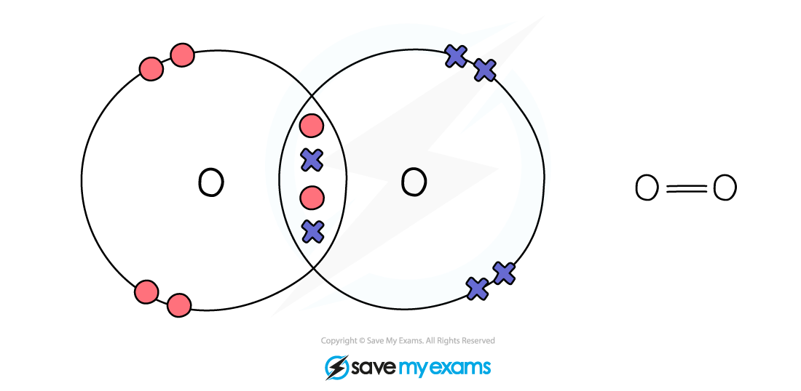
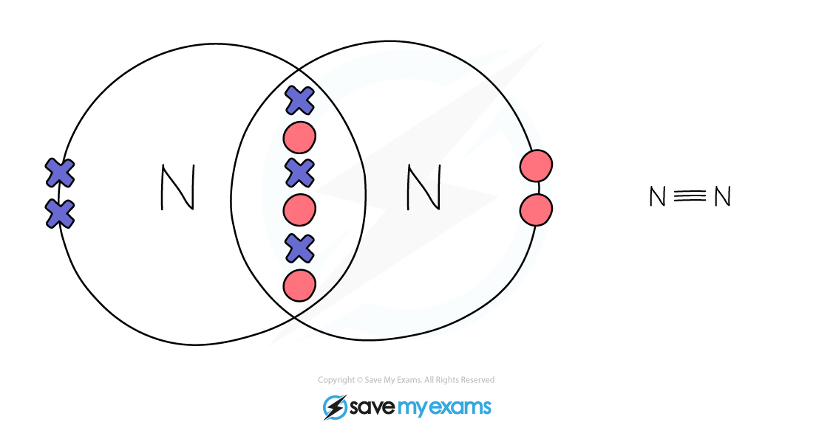
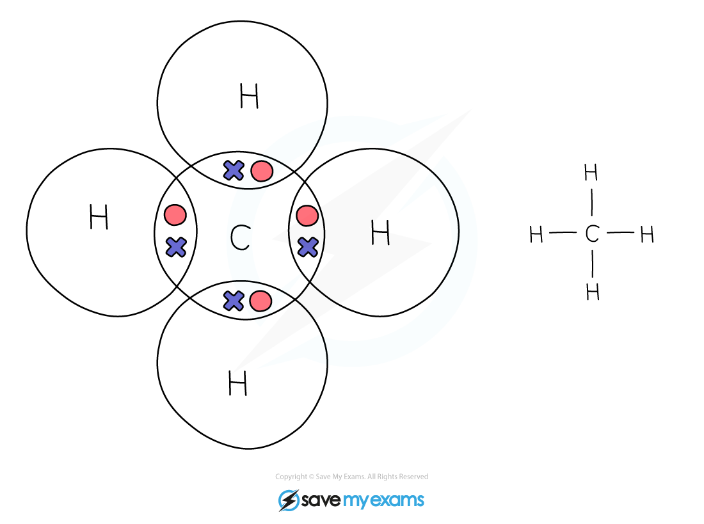
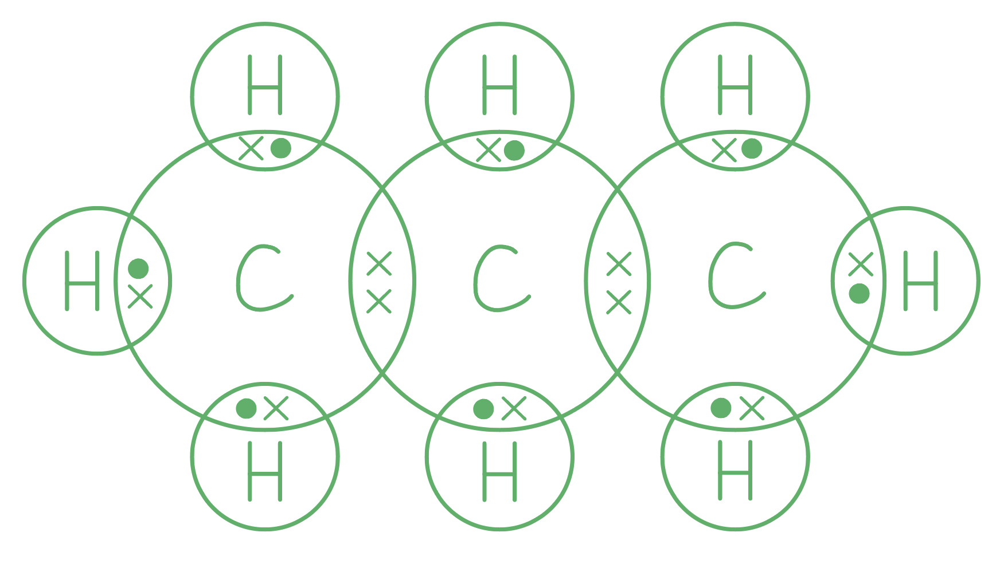

# Mark Schemes — Simple Molecules & Covalent Bonds
**2. Atoms, Elements & Compounds** · Cambridge (CIE) IGCSE science (0654 & 0973)

## Multiple Choice Questions (16 questions)

### Q1
**Final answer:** **The correct answer is A**

- The dot-and-cross diagram for water does not have mistakes

  - Oxygen is in Group VI of the Periodic Table
  
    - It has 6 outer shell electrons represented by the crosses
    - Two of these electrons will form single covalent bonds with hydrogen
  - Hydrogen is in Group I of the Periodic Table
  
    - Both hydrogen atoms have one electron in the outer shell forming a single covalent bond with oxygen
- The dot-and cross diagram for methane have mistakes

  - Hydrogen can only have one electron in its outer shell
  - All four hydrogen atoms have an additional pair of electron in their outer shell
  
    - Therefore, the hydrogen atoms do not have a noble gas electron configuration
- The **correct dot-and-cross diagram** for methane is shown in the diagram below
- Each hydrogen shares one electron to carbon forming a single covalent bond
- All atoms complete a noble gas electron configuration 

### Q2
**The correct answer is**** C**** because** the drawing correctly represents the number of electrons in ethene and how they are shared.

**A** is incorrect as each carbon atom donates 2 electrons to the carbon-carbon bond, forming a **double covalent** bond with 4 electrons being shared between the two atoms in ethene.

**B** is incorrect as each carbon and hydrogen atom donate **1** **electron** each to form the C-H bonds.

**D **is incorrect as the total number of shared electrons in ethene is **12**.

### Q3
**Final answer:** **The correct answer is**** A**** because:**

- Chlorine atoms have **seven **electrons in their outer shell
- They bond with another chlorine atom to achieves a full outer shell by each sharing one electron So, option A shown for Cl2 is incorrect as the left hand chlorine does not have 7 electrons
- The correct diagram for options A is:

**B**,** C** and **D **are incorrect as diagrams **correctly** depict the covalent bonding in HCl, H2 and CO2 respectively.

### Q4
**Final answer:** **The correct answer is**** D**** because:**

- **Carbon** is a Group **IV** element and **oxygen** is a Group **VI **element.
- In the CO2 molecule, the central carbon atom shares two electrons with each of the two oxygen atoms.
- Each oxygen atom also donates two electrons to form covalent bonds with the carbon atom, with the remaining two **nonbonding** **electron** **pairs** on the outer shell of each oxygen atom.
- Each atom now has a full outer shell with **two pairs of electrons** involved in each double covalent bond.
- This scenario is described correctly in the diagram for option **D** only.

**A**,** B** and **C **are incorrect as these dot and cross diagrams do not correctly display the arrangement of the outer electrons in CO2.

### Q5
**Final answer:** **The correct answer is ****C ****because:**

- Methane, CH4, is a simple molecular compound
- It has strong covalent bonds between the carbon and hydrogen atoms but only weak intermolecular forces between molecules
- The strong covalent bonds are not broken, just the intermolecular forces
- These require little energy to overcome, so the melting and boiling point of methane is low

**A** is incorrect as the melting point of methane is low

**B** is incorrect as covalent bonds between atoms are strong and not broken at the melting point

**D** is incorrect as the boiling point is low due to weak intermolecular forces

### Q6
**Final answer:** **The correct answer is ****B**** because:**

- Oxygen contains two shared pairs of electrons so four in total

**A** is incorrect as  carbon dioxide has 8 shared electrons

**C** is incorrect as  nitrogen has 6shared electrons

**D **is incorrect as  methane has 8 shared electrons

### Q7
**Final answer:** **The correct answer is**** B**** because:**

- Element **P** is hydrogen and **Q** is nitrogen, both are non-metals.
- Nitrogen has **5** outer electrons and requires **3** more to have an **octet**.
- Hydrogen has 1 electron in its outer shell, but since it's the first shell it requires only 2 electrons to be full, therefore each hydrogen atom requires just **1 more **electron to achieve a full outer shell.
- 3 atoms of H combine with 1 N and both atoms achieve full outer shells as shown.

**A**, **C** and **D** are incorrect as the combinations in these formulae do not provide a full outer shell for each atom.

### Q8
**Final answer:** **The correct answer is**** D**** because:**

- Element Z is a **Group 6** element since it has 6 electrons in its outer shell.
- Group **6** elements are nonmetals and metalloids that form covalent bonds by sharing electrons.
- By sharing **2** electrons with **2 **from another atom it achieves a full outer shell configuration.

**A**,** B **and** C **are incorrect as the combinations in these formulae do not provide a full outer shell for each atom.

### Q9
**Final answer:** **The correct answer is**** D**** because:**

- Elements **X** is carbon, element **Y** is fluorine and element **Z** is oxygen.
- These elements are all **nonmetals** and thus form covalent compounds.

**A**,** B** and **C** are incorrect as element **W** has 1 electron in its outer shell so it is in Group I, hence it is a metal. Metals form ionic bonds by electron transfer with non-metal elements (and metallic bonds when elements where they lose their outer shell electrons and attraction between positive metal ions and the delocalised electrons holds metallic structures together).

### Q10
**Final answer:** **The correct answer is**** B ****because:**

- A single covalent bond is formed when each atom donates **one electron** to be shared.
- Fluorine is in Group 7 and requires only **one** more electron to complete its outer shell.
- Each fluorine atom thus donates one electron to the bond forming a single covalent bond.

**A** is incorrect as nitrogen forms a **triple covalent bond** in the N2 molecule.

**C **is incorrect as oxygen forms a **double covalent bond** in the O2 molecule.

**D **is incorrect as in CO2 each carbon forms a double covalent bond with the oxygen atom, so overall there are **two double covalent bonds** present.

### Q11
**The correct answer is**** C**** because ****oxygen **in water and **chlorine** in hydrogen chloride both have nonbonding electron pairs in their outer shells whereas methane does not as shown.

**A, B **and** D** are incorrect as in these options; there is either **carbon or hydrogen, **both of these atoms used all of their outer shell electrons in bonding.

### Q12
**Final answer:** **The correct answer is**** D**** because:**

- Simple covalent compounds have **low melting points **and **low** **boiling points** due to **weak intermolecular forces** between individual molecules holding them together.

**A**,** B** and **C **are incorrect as these options do not correctly describe the characteristics of simple covalent compounds.

### Q13
**The correct answer is**** C**** because **statement **C** is **incorrect** as **covalent** bonding involves the **sharing of electrons **between atoms where ions are not formed.

**A**,** B** and **D** are incorrect as these statements correctly describe covalent bonding, the question asked for an incorrect statement.

### Q14
**Final answer:** **The correct answer is**** B**** because:**

- In covalent compounds, hydrogen has one electron in its outer shell which means that it will share this electron with an electron from another element to form a shared pair of electrons / covalent bond.
- Nitrogen has **five** electrons in its outer shell and needs three more to have a complete outer shell.
- Two of the five electrons form a non-bonding electron pair.
- One each of the three remaining electrons form **three **bonding electron pairs with an electron from each of the hydrogen atoms.

**A** is incorrect as there are **three **shared pairs of electrons in an NH3 molecule..

**C **is incorrect as the hydrogen atoms are **not** bonded to each other in NH3.

**D **is incorrect as each hydrogen atom provides a **single electron **to the shared pair of electrons / covalent bond.

### Q15
**Final answer:** **The correct answer is**** A**** because:**

- Electron sharing is a characteristic of **covalent bonding** where the sharing of electron pairs between atoms occurs.
- Propane (C3H8) and carbon dioxide (CO2) both contain nonmetals only and so bond covalently.

**B, C** and **D** are incorrect as potassium and lithium are both metals and do not bond covalently. Metals donate electrons to nonmetals to form ionic compounds like potassium fluoride and lithium bromide.

### Q16
**Final answer:** **The correct answer is ****C**** because:**

- There are no free electrons in propane that are able to move and carry a charge

  - This is the case with simple molecules
- The dot cross diagram shows this

**A** is incorrect as weak intermolecular forces cause a low melting and boiling point in simple molecules

**B** is incorrect as the covalent bonds are strong, but this does not explain why propane can not conduct electricity

**D** is incorrect as propane does have a low boiling point, but this does not explain why propane can not conduct electricity
