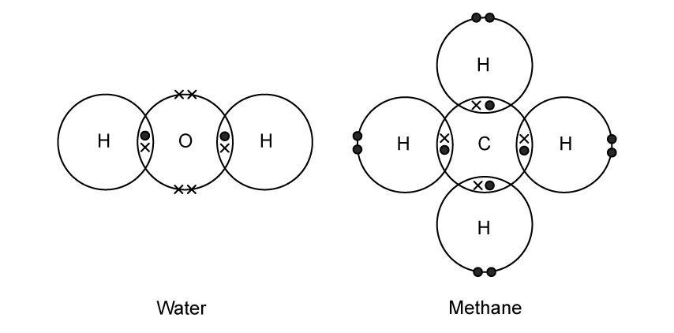
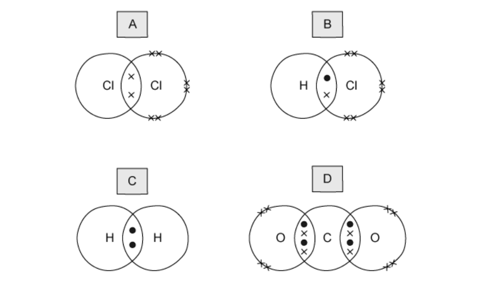
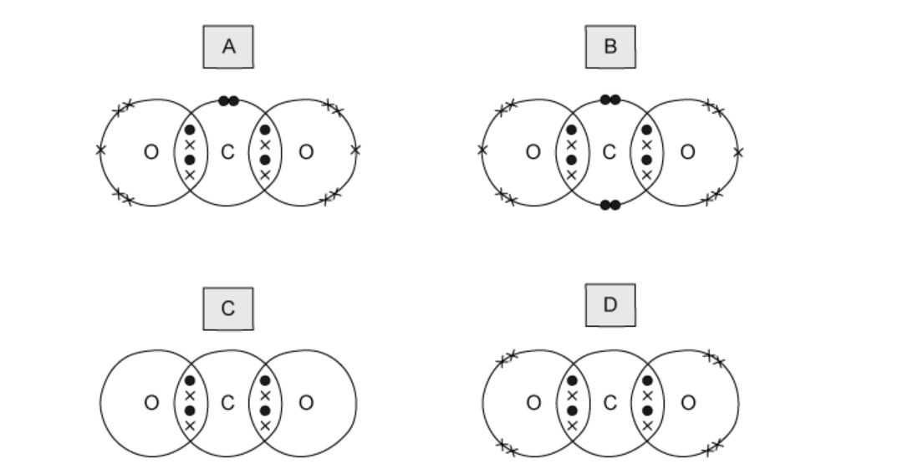
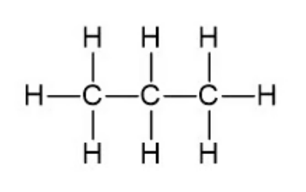

# Exam Questions — Simple Molecules & Covalent Bonds
**2. Atoms, Elements & Compounds** · Cambridge (CIE) IGCSE science (0654 & 0973)
> Source: [https://www.savemyexams.com/igcse/science/cie/co-ordinated-sciences-double-award/23/chemistry/topic-questions/](https://www.savemyexams.com/igcse/science/cie/co-ordinated-sciences-double-award/23/chemistry/topic-questions/) · 16 questions across 1 sets

## Multiple Choice Questions (16 questions)

### Q1 — medium — 1 marks

**Q1** [1 mark]

Diagrams 1 and 2 show the electron arrangements in molecules of water and methane.

Which row describes the diagrams?

|   | water diagram | methane diagram |
|---|---|---|
| **A** | correct | incorrect |
| **B** | correct | correct |
| **C** | incorrect | incorrect |
| **D** | incorrect | correct |

### Q2 — hard — 1 marks

**Q2** [1 mark]

**Extended tier only**

A student has drawn a dot and cross diagram to represent a molecule of ethene, C2H4, as shown below.

What is wrong with the students drawing?

### Q3 — hard — 1 marks

**Q3** [1 mark]

**Extended tier only**

Dot and cross diagrams for four covalent molecules are shown below.

Which diagram is incorrect?

### Q4 — hard — 1 marks

**Q4** [1 mark]

**Extended tier only**

Carbon dioxide is a simple molecular substance in which the molecules are formed by covalent bonding between one carbon atom and two oxygen atoms.

Which dot and cross diagram below shows the correct outer shell arrangement of electrons in a molecule of CO2?

### Q5 — hard — 1 marks

**Q5** [1 mark]

**Extended tier only**

Which statement about methane is correct?

### Q6 — hard — 1 marks

**Q6** [1 mark]

**Extended tier only**

A covalent molecule M contains a total of four shared electrons.

What is M?

### Q7 — medium — 1 marks

**Q7** [1 mark]

Atoms P and Q have electronic structures as shown in the diagram. They react together to form a covalent compound.

What is the formula of the compound?

### Q8 — medium — 1 marks

**Q8** [1 mark]

The atom of element Z has 6 electrons in its outer shell. How would this element react?

### Q9 — medium — 1 marks

**Q9** [1 mark]

The electronic configurations of four different atoms are shown below.

Which atoms form covalent compounds?

### Q10 — medium — 1 marks

**Q10** [1 mark]

**Extended tier only**

Which of the following molecules contains only single covalent bonds?

### Q11 — medium — 1 marks

**Q11** [1 mark]

CH4, H2O and HCl are covalent compounds.

Which atoms in these compounds do not use all of their outer shell electrons in bonding?

### Q12 — easy — 1 marks

**Q12** [1 mark]

Which row correctly describes a simple covalent compound?

|   | low melting point | high boiling point |
|---|---|---|
| **A** | `✓` | `✓` |
| **B** | $\times$ | `✓` |
| **C** | $\times$ | $\times$ |
| **D** | `✓` | $\times$ |

### Q13 — easy — 1 marks

**Q13** [1 mark]

Which statement about bonding is not correct?

### Q14 — easy — 1 marks

**Q14** [1 mark]

Ammonia is a covalent compound consisting of one nitrogen atom bonded to three hydrogen atoms.

Which statement is correct for a molecule of ammonia?

### Q15 — easy — 1 marks

**Q15** [1 mark]

Which of the following compounds are formed by covalent bonding?

| **1** | Potassium fluoride |
|---|---|
| **2** | Propane |
| **3** | Carbon dioxide |
| **4** | Lithium bromide |

### Q16 — easy — 1 marks

**Q16** [1 mark]

**Extended tier only**

The structure of propane is shown below

Which correctly explains why propane can not conduct electricity?
