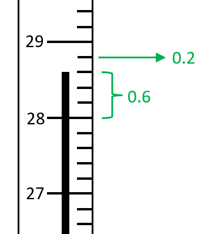

# Mark Schemes — Exothermic & Endothermic Reactions
**5. Chemical Energetics** · Cambridge (CIE) IGCSE science (0654 & 0973)

## Multiple Choice Questions (12 questions)

### Q1
**Final answer:** **The correct answer is A**

There is an **increase in temperature **in **exothermic **reactions, while there is a **decrease in temperature **in **endothermic **reactions

- Work out the change in temperature for each reaction `c h a n g e i n t e m p e r a t u r e ( increment T ) = f i n a l t e m p e r a t u r e - i n i t i a l t e m p e r a t u r e`
- Temperature change for W `c h a n g e i n t e m p e r a t u r e ( increment T ) = 20 - 10 = 10 deg C`
- Temperature change for X `c h a n g e i n t e m p e r a t u r e ( increment T ) = 25 - 23 = 2 deg C`
- Temperature change for Y `c h a n g e i n t e m p e r a t u r e ( increment T ) = 13 - 15 = - 2 deg C`
- Temperature change for Z `c h a n g e i n t e m p e r a t u r e ( increment T ) = 12 - 22 = - 10 deg C`
- W has the **largest positive temperature increase** (**+10 °C**), so it releases the most amount of energy to the surroundings
- Therefore, **W is the most exothermic reaction**

**B** is incorrect because both W and X increase in temperature, so they are exothermic, not endothermic

**C **is incorrect because Z has a temperature decrease (−10°C), so it is endothermic

**D **is incorrect because both Y and Z decrease in temperature, so they are endothermic, not exothermic

### Q2
**Final answer:** **The correct answer is**** D**** because:**

- Point 1 represents the **activation energy **which is the minimum energy that the reactant particles must have** **to be able to react.
- Point 2 represents the **overall energy change** between the reactants and the products.
- Point 3 represents the energy of the products. The energy level diagram represents an **endothermic reaction** as the products have **less** **energy** than the reactants.

**A**,** B** and **C **are incorrect as these options do not correctly label the diagram.

### Q3
**Final answer:** **The correct answer is**** B**** because:**

- Energy is **required** to break a chemical bond
- The energy is **absorbed** from the surroundings, hence it is an **endothermic** process.

**A **is incorrect as exothermic processes release energy into the surroundings.

**C **and** D **are incorrect as bond breaking requires energy as it is an endothermic process.

### Q4
**Final answer:** **The correct answer is**** A**** because:**

- In an exothermic reaction the energy transferred from the reacting chemicals heats up the surroundings and results in a rise in temperature

**B **is incorrect as the energy flow and temperature change are the wrong way around for an exothermic reaction

**C** is incorrect as the energy flow is the wrong way around for an endothermic reaction

**D** is incorrect as the temperature change is the wrong away around

### Q5
**Final answer:** **The correct answer is ****C**** because:**

- The activation energy is the distance from the reactants, N2 + O2, to the top of the energy 'hill'
- This distance is 180 + 140  = 320 kJ
- The energy arrows point upwards so energy is increasing which corresponds to a positive sign

### Q6
**Final answer:** **The correct answer is ****C ****because:**

- Most sports injury cold packs contain ammonium nitrate and water which react endothermically when mixed

**A** is incorrect as these are endothermic reactions and absorb energy from the injury to reduce swelling

**B** is incorrect as the reactions are not reversible so the packs can only be used once

**D** is incorrect as the temperature of the surroundings will decrease when the pack is activated

### Q7
**Final answer:** **The correct answer is**** C**** because:**

- The distillation of crude oil **requires energy** as the oil must first be heated up to vaporise the molecules.
- Energy is taken into the system from the surroundings so the process is **endothermic**.

**A, B** and **D** are incorrect as these processes all give out energy hence they are exothermic.

### Q8
**Final answer:** **The correct answer is**** C**** because:**

- In **exothermic** reactions the energy level of the reactants is **higher** than the products.
- In an energy profile diagram, this is seen as a **drop** in energy from the reactants to the products.
- This occurs because some of the reactant´s enthalpy is released into the surroundings, usually in the form of heat.

**A** and** B** are incorrect as the energy level diagram represents an exothermic reaction.

**D **is incorrect as heat energy is released in exothermic processes, not absorbed.

### Q9
**Final answer:** **The correct answer is**** B**** because:**

- Each small division is 0.2 so the level reads to 0.6, making the reading 28.6

### Q10
**Final answer:** **The correct answer is**** D**** because:**

- The temperature has decreased which means that heat energy has been **taken in** from the surroundings.
- This indicates that the reaction is **endothermic**.

**A** and **B** are incorrect as heat energy is released during exothermic reactions.

**C** is incorrect as heat is absorbed during endothermic reactions.

### Q11
**Final answer:** **The correct answer is**** B**** because:**

- In **exothermic** reactions the energy of the products is less than that of the reactants as **energy** has been **lost** to the surroundings.
- On an energy level diagram this is shown by having the line representing the energy level of the products **below** that of the reactants, as is the case in the diagram.

**A**,** C** and **D** are incorrect as these options describe exothermic reactions, matching the energy level diagram in the question.

### Q12
**Final answer:** **The correct answer is ****A**** because:**

- Activation energy is the energy hill that must be overcome for a reaction to take place
- It is the difference between the starting level (reactants) and the top of the 'hill'
- The location of the other answer options is shown below

