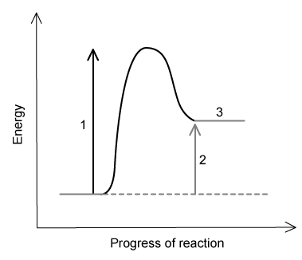
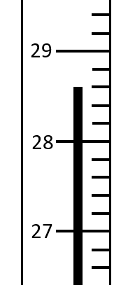

# Exam Questions — Exothermic & Endothermic Reactions
**5. Chemical Energetics** · Cambridge (CIE) IGCSE science (0654 & 0973)
> Source: [https://www.savemyexams.com/igcse/science/cie/co-ordinated-sciences-double-award/23/chemistry/topic-questions/](https://www.savemyexams.com/igcse/science/cie/co-ordinated-sciences-double-award/23/chemistry/topic-questions/) · 12 questions across 1 sets

## Multiple Choice Questions (12 questions)

### Q1 — medium — 1 marks

**Q1** [1 mark]

The table shows the change in temperature of four different reactions W, X, Y and Z.

|   | initial  temperature / ** **°C | final  temperature / ** **°C |
|---|---|---|
| **W** | 10 | 20 |
| **X** | 23 | 25 |
| **Y** | 15 | 13 |
| **Z** | 22 | 12 |

Which row  is correct?

### Q2 — hard — 1 marks

**Q2** [1 mark]

**Extended tier only**

An energy level diagram is shown below.

Which row is correct for the points labelled 1, 2 and 3?

|   | **1** | **2** | **3** |
|---|---|---|---|
| **A** | activation energy | energy change | reactants |
| **B** | energy change | activation energy | products |
| **C** | energy change | activation energy | reactants |
| **D** | activation energy | energy change | products |

### Q3 — medium — 1 marks

**Q3** [1 mark]

**Extended tier only**

In all chemical reactions, bonds in the reactant species are broken and new bonds are formed in the products. Which statement is correct?

### Q4 — medium — 1 marks

**Q4** [1 mark]

Which is true about chemical energy changes?

|   | ** Reaction type** | **Energy flows** | **Temperature of surroundings** |
|---|---|---|---|
| **A** | exothermic | to the surroundings | increases |
| **B** | exothermic | from the surroundings | decreases |
| **C** | endothermic | to the surroundings | decreases |
| **D** | endothermic | from the surroundings | increases |

### Q5 — medium — 1 marks

**Q5** [1 mark]

**Extended tier only**

The reaction profile for making nitrogen monoxide, NO, is shown below:

What is the activation energy for this reaction?

### Q6 — medium — 1 marks

**Q6** [1 mark]

Endothermic reactions can be used in emergency sports injury treatment packs.

What is true about these packs?

### Q7 — medium — 1 marks

**Q7** [1 mark]

Which of the following processes is endothermic?

### Q8 — easy — 1 marks

**Q8** [1 mark]

The energy level diagram below shows the relative energies of the reactants and products in a reaction.

Which row correctly describes the type of reaction and corresponding energy change?

|   | **type of reaction** | **energy change** |
|---|---|---|
| **A** | endothermic | heat is released |
| **B** | endothermic | heat is absorbed |
| **C** | exothermic | heat is released |
| **D** | exothermic | heat is absorbed |

### Q9 — easy — 1 marks

**Q9** [1 mark]

What is the reading on the following thermometer?

### Q10 — easy — 1 marks

**Q10** [1 mark]

A student adds a small amount of ammonium chloride to a beaker of water. The temperature of the water decreases from 21 oC to 17 oC.

Which type of reaction has occurred and why?

|   | **type of reaction** | **reason** |
|---|---|---|
| **A** | exothermic | heat is released |
| **B** | exothermic | heat is absorbed |
| **C** | endothermic | heat is released |
| **D** | endothermic | heat is absorbed |

### Q11 — easy — 1 marks

**Q11** [1 mark]

Calcium and hydrochloric acid react to produce calcium chloride and hydrogen gas. The energy level diagram for the reaction is shown below.

Which statement about this reaction is **not **correct?

### Q12 — easy — 1 marks

**Q12** [1 mark]

**Extended tier only**

The graph below shows a reaction profile for the reaction between methane and oxygen.

What does the label **X** represent?
