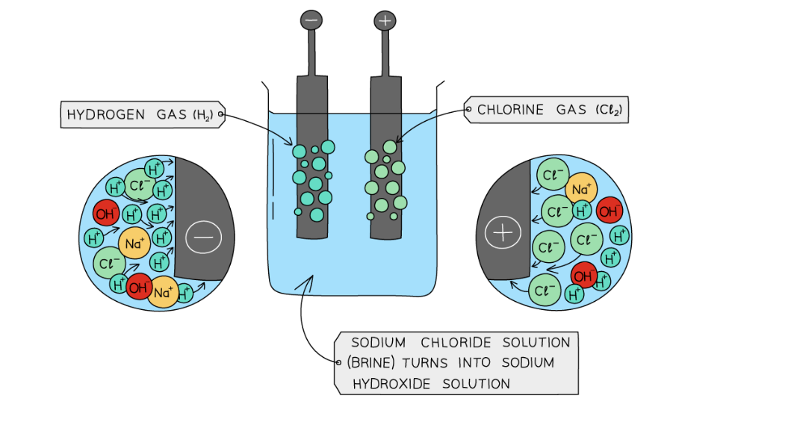

# Mark Schemes — Electrochemistry
**4. Electrochemistry** · Cambridge (CIE) IGCSE science (0654 & 0973)

## Multiple Choice Questions (26 questions)

### Q1
**Final answer:** **The correct answer is B**

- At the cathode (−), H+ ions from the acid are attracted and gain electrons, so hydrogen gas is produced
- At the anode (+), OH- ions from the water are attracted and lose electrons, so oxygen gas is produced

**A** is incorrect as sulfate ions (SO42-) are not discharged during electrolysis — they remain in solution, so sulfur is not produced

**C** is incorrect as the products are assigned to the wrong electrodes — hydrogen is produced at the cathode (reduction), not the anode

**D** is incorrect as sulfur is not produced at either electrode during the electrolysis of dilute sulfuric acid

> **[exam-tip]**
> Dilute sulfuric acid is one of the three named aqueous electrolysis examples in the specification.
> 
> Remember: H+ ions go to the cathode (hydrogen gas) and OH- ions go to the anode (oxygen gas). The sulfate ions remain in solution. The volume of hydrogen collected is twice that of oxygen (2H2O → 2H2 + O2)

### Q2
**Final answer:** **The correct answer is B**

- **Statement 1 is incorrect:**

  - While combustion and the formation of water are both  exothermic processes that releases energy, exothermic reactions always have a **negative** enthalpy change (Δ*H*)
- **Statement 2 is correct:**

  - Hydrogen-oxygen fuel cells use hydrogen and oxygen to produce electricity, with **water as the only chemical product**
  - In contrast, the incomplete combustion of carbon-containing fuels (like gasoline) releases particulates and carbon monoxide, which is a toxic gas
- **Statement 3 is incorrect:**

  - Hydrogen is a gas at room temperature and pressure
  - It requires heavy, high-pressure tanks or very low temperatures to store it as a liquid, making it significantly **more difficult and expensive to store** than liquid gasoline

### Q3
**Final answer:** **The correct answer is C**

- Statement 1 is incorrect

  - During the electrolysis, **bromine gas **is produced at the **anode **(**positive electrode**)
  - Bromine gas is **red-brown**
  
    - A green gas refers to chlorine
- Statement 2 is correct

  - At the **cathode **(**negative electrode**), lead ions (Pb2+ ) from the the molten lead bromide will gain two electrons
  - When lead is formed a **shiny grey liquid **will be produced at the electrode
- Statement 3 is correct

  - The electrodes must be inert materials, such as graphite, so they **do not react **during the electrolysis

> **[exam-tip]**
> Use the PANIC mnemonic to remember which electrode is the positive and which is the negative:
> 
> **Positive (is) Anode Negative Is Cathode **

### Q4
**Final answer:** **The correct answer is ****A**** because: **

- **During the electrolysis of molten sodium oxide, sodium and oxygen are formed**
- **At the anode:**

  - **Negatively charged oxide ions are attracted due to their opposite charges**
  - **They lose electrons and are oxidised to form oxygen, a colourless gas**

**2O****2- ****→ O****2 ****+ 4e****-**

- **At the cathode:**

  - **Positively charged sodium ions are attracted due to their opposite charges**
  - **They gain electrons and are reduced to form sodium metal**

**Na****+**** + e****-**** **** ****→ Na**

> *B** is incorrect as the green gas described is chlorine. Chloride ions would be attracted to the anode not the cathode*

> *C** is incorrect as lead ions are positively charged and will be attracted to the cathode*

> *D** is incorrect as hydrogen gas is formed at the cathode due to hydrogen ions being less reactive than the other positively charged ion, sodium*

### Q5
**Final answer:** **The correct answer is ****B**** because:**

- During the electrolysis of aqueous sodium chloride, chlorine is produced at the anode and hydrogen is produced at the cathode
- The correct gas test for hydrogen is using a burning splint and a squeaky pop sound being made

**A **is incorrect as this is the test for oxygen gas

**C** is incorrect as this is the test for chlorine (which is produced at the anode)

**D** is incorrect as an alkali would turn red litmus paper blue

### Q6
**Final answer:** **The correct answer is ****D**** because:**

- **During the electrolysis of concentrated aqueous sodium chloride, ****positively**** ****charged**** ****hydrogen**** ****ions**** are attracted to the ****negative**** ****cathode**** where they are reduced to form hydrogen gas.**
- **At the ****positive**** ****anode****, the Cl****-**** ions are oxidized to form chlorine gas.**
- **The ions that remain in solution are Na****+**** ions and the OH****-**** ions.**
- **These produce an ****alkaline**** solution so at the ****cathode**** the colour is ****blue****.**
- **At the ****anode**** the solution is surprisingly colourless. This is because chlorine gas is a powerful bleaching agent and removes the colour from litmus.**

> *A, B** and **C **are incorrect as these colours do not match with the correct results.*

### Q7
**Final answer:** **The correct answer is ****B**** because:**

- In experiment 1, oxygen gas is formed at the anode and hydrogen gas at the cathode.
- In experiment 2, copper electrodes are used rather than carbon. Copper is a metal and although unreactive it does influence the outcome at each electrode.
- The negative sulfate ions SO42- from the copper sulfate and OH- ions from the water are attracted to the anode but both are too stable and so remain in solution.
- The copper anode is oxidised in preference and releases Cu2+ copper ions into solution hence there is no observable product formed at the anode in experiment 2.
- The end result is a transfer of copper ions from the anode to the cathode which is why this method is used to purify copper.
- In experiment 3, chlorine gas is formed at the anode which is a yellow green colour and hydrogen gas is evolved at the cathode.
- In experiment 4 oxygen gas is formed at the anode and hydrogen gas at the cathode.

A colourless gas is formed at the anode in experiment 1 and 4 only so B is correct.

You might think that since the cathode is the negative electrode then the electrons would not move towards it as like charges repel. The cathode is the negative electrode because it is where reduction takes place (electrons are gained). When it comes to direction of electron flow in electrolysis, remember that they flow in alphabetical order: from the **A**node to the **C**athode.

### Q8
**Final answer:** **The correct answer is ****B**** because:**

- The ions present in the dilute sulfuric acid are H+ and OH- (from the water) and H+ and SO42- (from the sulfuric acid)
- During electrolysis, hydrogen gas is produced at the cathode and oxygen is produced at the anode
- At the cathode: 4H+ + 4e- →  2H2
- At the anode: 4OH- → O2 + 2H2O + 4e-
- For every 4 electrons flowing through the circuit, 1 molecule of oxygen is produced and 2 molecules of hydrogen are produced
- Therefore, the ratio of the volume of hydrogen gas to oxygen gas is roughly 2:1
- Twice the volume of gas is produced at the cathode than the anode

**A** is incorrect as no gas is formed at the cathode, instead zinc would be formed

**C** is incorrect as hydrogen and bromine gas are formed in equal quantities

**D **is incorrect as hydrogen and chlorine gas are formed in equal quantities

### Q9
**Final answer:** **The correct answer is ****C**** because:**

- Positively charged hydrogen ions are attracted to the negative electrode (cathode) so hydrogen gas, H2, is formed at the cathode.
- Hydrogen ions are reduced, meaning they gain electrons, therefore electrons must on the left hand side of the equation.

**A** and **B **are incorrect as chlorine gas would form at the anode.

**D **is incorrect as the electrons must be on the left hand side of the equation since the hydrogen ions are reduced.

### Q10
**Final answer:** **The correct answer is ****C**** because:**

- Hydrogen and oxygen are used in a hydrogen-oxygen fuel cell to produce a voltage
- The only product is water

**A **is incorrect as this is the reaction that occurs at the anode in a hydrogen-oxygen fuel cell

**B** is incorrect as this is the reaction that occurs at the cathode in a hydrogen-oxygen fuel cell

**D** is incorrect as this does not show the formation of water

### Q11
**Final answer:** **The correct answer is ****C**** because:**

- The following products are made at the electrode for each experiment:

|   | **Anode** | **Cathode ** |
|---|---|---|
| ** Experiment 1:  **concentrated aqueous sodium chloride | chlorine | hydrogen |
| ** Experiment 2:  **dilute sulfuric acid | oxygen | hydrogen |
| ** Experiment 3:  **lead bromide | bromine | lead |

- The gas hydrogen was produced at the cathode for experiment 1 and 2 only as lead was produced in experiment 3

**A** is incorrect as metal ions are positive so would only form at the cathode

**B **is incorrect as hydrogen is produced instead of sodium at the cathode in experiment 1

**D** is incorrect as chlorine gas is also produced in experiment 1 at the anode

### Q12
**Final answer:** **The correct answer is ****B**** because:**

- The **anode** is the **positive electrode** and so attracts the negative **Br****-**** **and** OH****-**** **anions.
- The **cathode** is the **negative electrode **and so attracts the positive **K****+** and **H****+**** **cations
- The** K****+**** **and** Br****-** ions come from the potassium bromide and the **H****+** and **OH****-**** **ions are produced by the dissociation of water (H2O) in aqueous solutions.

**A, C** and **D **are incorrect as only option B correctly describes the movement of the ions.

### Q13
**Final answer:** **The correct answer is ****B**** because:**

- In electrolysis the electrons move toward the cathode in the external circuit.
- In the diagram below the arrows indicate the direction of movement of electrons.

You might think that since the cathode is the negative electrode then the electrons would not move towards it since like charges repel. The cathode is the negative electrode because it is where reduction takes place (electrons are gained). When it comes to direction of electron flow in electrolysis, remember that they flow in alphabetical order: from the Anode to the Cathode.

### Q14
**Final answer:** **The correct answer is ****A**** because:**

- Hydrogen is formed at the cathode as sodium ions are much higher than  hydrogen on the reactivity series and will stay in solution.
- Chlorine is formed at the anode as it is a halide in a concentrated solution.
- Cl- is a simple ion which will discharge instead of the oxygen from the OH- ion, as is the case when the ion is more complex such as NO3- or SO42-.

**B **is incorrect as chlorine gas is formed at the anode over oxygen.

**C** and **D **are incorrect as sodium is not formed at the cathode.

### Q15
**Final answer:** **The correct answer is ****D**** because:**

- The ions present in the electrolysis of aqueous copper(II) sulfate are: H+ and OH- (from the aqueous solution), Cu2+  and SO42-
- The H+ and Cu2+ ions are attracted to the cathode and the OH- and SO42- ions are attracted to the anode.
- At the cathode (negative electrode) the Cu2+ ions are less reactive than the hydrogen  ions and are reduced to copper metal:

  - Cu2+ + 2 e- → Cu
- At the anode (positive electrode) the OH- ions are less reactive than SO42- ions are oxidised to produce oxygen and water:

  - 4 OH- → O2 + H2O + 4 e-

**A **is incorrect as copper ions are positive so copper metal is produced at the negative electrode (the cathode), not the positive electrode.

**B **is incorrect as electrons in the external circuit begin at the negative terminal of the  battery and flow around the circuit and back to the positive terminal.

**C **is incorrect as the electrons do not flow in the electrolyte, it is the ions that move and carry the current.

### Q16
**Final answer:** **The correct answer is**** A**** because:**

- Hydrogen fuel cells are much simpler devices than internal combustion engines which are designed to run off petrol or diesel.
- There are much less moving parts, so power loss is minimal.

**B** is incorrect as hydrogen fuel cells contain less moving parts.

**C **and** D** are incorrect as hydrogen fuel cells produce only water.

### Q17
**Final answer:** **The correct answer is ****A**** because:**

- Hydrogen-oxygen fuel cells use hydrogen and oxygen to produce a voltage
- The overall equation for a hydrogen-oxygen fuel cells is:

hydrogen   +   oxygen   →   water

- Therefore the only product is water

### Q18
**Final answer:** **The correct answer is ****C**** because:**

- During the electrolysis of concentrated aqueous sodium chloride, negatively charged chlorine ions are attracted to the positive anode where they are oxidised to form chlorine gas.
- The electrons must be on the right hand side of the equation as electrons are lost.

**A** and **D **are incorrect as chlorine gas exists as a molecule, Cl2.

**B **is incorrect as the electrons are on the left hand side of the equation.

### Q19
**Final answer:** **The correct answer is ****D ****because:**

- The ions present in sulfuric acid are H+ and SO42-
- The ions present in water are H+ and OH- 
- The positive hydrogen ions are attracted to the cathode (negative electrode) where they gain electrons to form hydrogen gas

2H+  +   2e-    ⟶   H2

- At the anode, oxygen is produced unless a halide ion is present in which case a halogen is produced

4OH–    ⟶    O2   +   2H2O   +   4e–

**A** is incorrect as the oxygen is made at the anode, not the cathode and sulfur is not made at the anode

**B **is incorrect as sulfur is not produced at the anode

**C** is incorrect as the products are correct but they have been formed at the incorrect electrode

### Q20
**Final answer:** **The correct answer is ****D**** because:**

- Hydrogen forms positive ions and is attracted to the cathode.
- Cathodes are the negatively charged electrodes.
- In the electrolysis of concentrated HCl, hydrogen is formed at the electrode 2 as  hydrogen is the only positive ion formed and migrates towards the negatively charged cathode.
- In the electrolysis of aqueous substances, the H+ and OH- ions formed from the water compete with the ions from the substance dissolved at the electrodes, where only 1 product can be formed.
- A more reactive metal will remain in the ion form as it does not accept electrons as readily as the less reactive H+ ions do.
- In the electrolysis of aqueous NaCl, hydrogen is formed at electrode 4 as sodium is higher on the reactivity series than hydrogen.

### Q21
**Final answer:** **The correct answer is ****B**** because:**

- The cathode is the negatively charged electrode.
- It attracts the positive H+ ions.
- The H+ ions receive electrons, producing elemental hydrogen gas.
- The reaction at the cathode is:

  - $2H^{+}+2e^{-}\rightarrowH_{2}$

### Q22
**Final answer:** **The correct answer is ****A**** because:**

- Solid zinc chloride will not conduct electricity because the ions cannot move freely and carry a charge
- The solid zinc chloride either needs to be molten or in solution to enable the ions to move

### Q23
**Final answer:** **The correct answer is ****A**** because:**

- Molten metal bromides consist of positive metal ions and negative bromide ions
- The positive metal ion will be discharged at the cathode (negative electrode) where they will gain electrons to form the metal
- The negative bromide ions will be discharged at the anode (positive electrode) where they will lose electrons to form bromine

**B**, **C** and **D** are incorrect as the products at the electrodes are incorrect

### Q24
**Final answer:** **The correct answer is ****C**** because:**

- In a hydrogen-oxygen fuel cell, hydrogen and oxygen react together to form water
- The unbalanced equation is:

  - H2 + O2 → H2O
- Balance the oxygen atoms by putting a 2 in front of H2O:

  - H2 + O2 → **2**H2O
- Now balance the hydrogen atoms:

  - **2**H2 + O2 → 2H2O

**A** is incorrect as water is not a reactant and hydrogen and oxygen are not products. The equation is also unbalanced

**B** is incorrect as the equation is unbalanced as there are not enough H atoms on the left-hand side

**D** is incorrect as the equation is the original unbalanced equation for the reaction

### Q25
**Final answer:** **The correct answer is ****B**** because:**

- The electrolyte is a concentrated aqueous solution of sodium chloride.
- Chlorine gas is the main product formed at the anode and hydrogen gas is formed at the cathode.

**A **is incorrect as hydrogen ions are positive and chloride ions are negative.

**C** and **D **are incorrect as sodium ions do not form at either electrode, they remain in solution.

### Q26
**Final answer:** **The correct answer is ****B**** because:**

- Hydrogen and oxygen are the reactants in a fuel cell and contain energy locked up in chemical bonds so it is classed as chemical energy
- When the reaction takes place between hydrogen and oxygen that energy is released usually as heat and light
- However, in a fuel cell, the energy is converted into electrical energy and is more useful than heat and light

**A** is incorrect as electrical energy is produced not consumed in a fuel cell and heat is not produced

**C** is incorrect as potential energy is not consumed in a fuel cell and chemical energy is not produced

**D** is incorrect as heat is not produced in a fuel cell, only when hydrogen burns

- Sometimes people refer to chemical energy as a type of potential energy
- Potential energy just means stored energy and is usually a term that refers to the energy held by an object relative to others
- However, it should be clear from the context here it is the wrong conversion in option** C**
