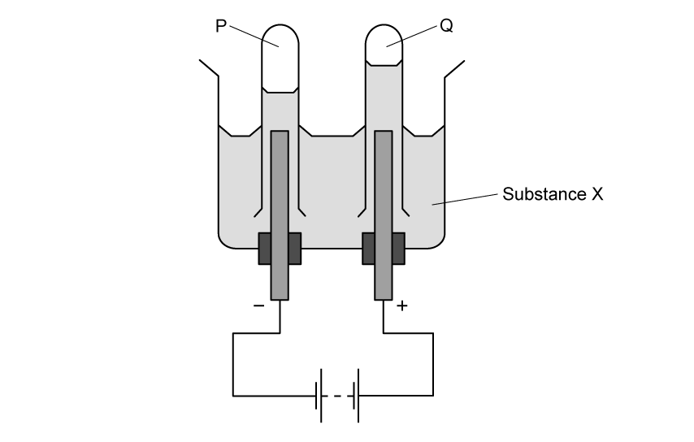
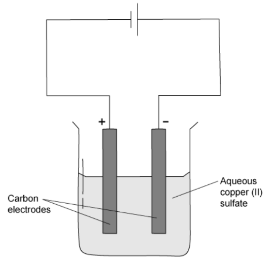
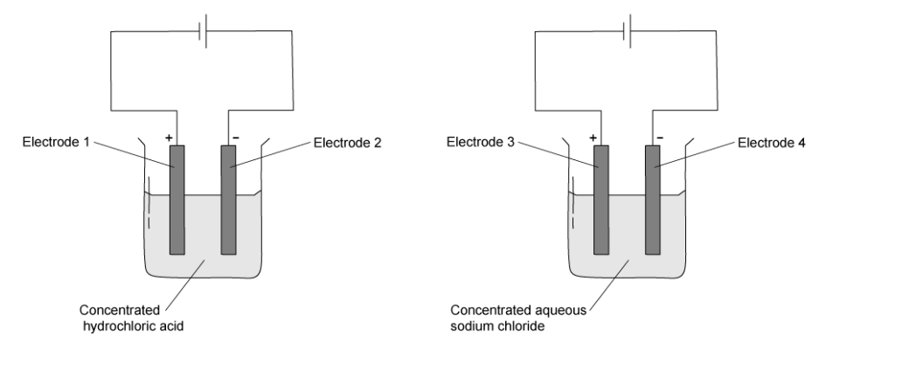
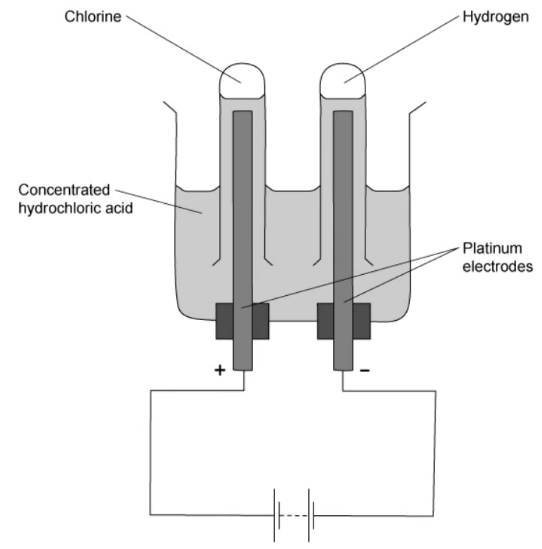

# Exam Questions — Electrochemistry
**4. Electrochemistry** · Cambridge (CIE) IGCSE science (0654 & 0973)
> Source: [https://www.savemyexams.com/igcse/science/cie/co-ordinated-sciences-double-award/23/chemistry/topic-questions/](https://www.savemyexams.com/igcse/science/cie/co-ordinated-sciences-double-award/23/chemistry/topic-questions/) · 26 questions across 1 sets

## Multiple Choice Questions (26 questions)

### Q1 — medium — 1 marks

**Q1** [1 mark]

Dilute sulfuric acid is electrolysed using inert platinum electrodes.

Which row correctly identifies the products at the cathode and at the anode?

|   | product at cathode | product at anode |
|---|---|---|
| **A** | hydrogen | sulfur |
| **B** | hydrogen | oxygen |
| **C** | oxygen | hydrogen |
| **D** | sulfur | oxygen |

### Q2 — easy — 1 marks

**Q2** [1 mark]

Three statements comparing gasoline (petrol) combustion engines with hydrogen-oxygen fuel cells are shown

1. The combustion of gasoline and the formation of water are both exothermic processes with a positive enthalpy change, Δ*H.*
2. Combustion engines are more polluting than fuel cells because incomplete combustion produces carbon monoxide and particulates.
3. Gasoline is more difficult and expensive to store in a vehicle than hydrogen.

Which statements are correct?

### Q3 — medium — 1 marks

**Q3** [1 mark]

Three statements about the electrolysis of molten lead (II) bromide are listed.

1. A green gas is produced at the negative electrode.
2. Lead ions will gain electrons at the cathode.
3. The electrodes for the electrolysis must be from an inert material, such as graphite.

Which statements are correct?

### Q4 — hard — 1 marks

**Q4** [1 mark]

**Extended tier only**

Four substances are electrolysed. The substances are concentrated aqueous sodium chloride, concentrated hydrochloric acid, molten lead(II) bromide and molten sodium oxide.

Which statement about these electrolysis reactions is correct?

### Q5 — hard — 1 marks

**Q5** [1 mark]

A student wants to identify the gas produced at the negative electrode during the electrolysis of aqueous sodium chloride.

What is the correct test for the gas produced?

### Q6 — hard — 1 marks

**Q6** [1 mark]

The diagram shows the electrolysis of concentrated aqueous sodium chloride.

What is the colour of the litmus at each electrode after five minutes?

|   | **colour at anode** | **colour at cathode** |
|---|---|---|
| **A** | blue | red |
| **B** | red | blue |
| **C** | red | colourless |
| **D** | colourless | blue |

### Q7 — hard — 1 marks

**Q7** [1 mark]

**Extended tier only**

Four solutions are separately electrolysed.

| **experiment** | **solution** | **electrodes** |
|---|---|---|
| **1** | dilute aqueous sodium chloride | carbon |
| **2** | aqueous copper(II) sulfate | copper |
| **3** | concentrated hydrochloric acid | carbon |
| **4** | dilute sulfuric acid | carbon |

In which two experiments is a colourless gas evolved at the anode?

### Q8 — hard — 1 marks

**Q8** [1 mark]

The amount of gases P and Q are formed when substance X is electrolysed.

What is substance X?

### Q9 — hard — 1 marks

**Q9** [1 mark]

**Extended tier only**

During electrolysis of brine, a gas is produced at the cathode. What is the half-equation for the reaction on the cathode?

### Q10 — hard — 1 marks

**Q10** [1 mark]

What is the correct balanced symbol equation for the overall reaction in a hydrogen-oxygen fuel cell?

### Q11 — hard — 1 marks

**Q11** [1 mark]

Concentrated aqueous sodium chloride, dilute sulfuric acid and molten lead bromide were electrolysed separately in experiments 1, 2 and 3.

Which statement about the electrode products is correct?

### Q12 — medium — 1 marks

**Q12** [1 mark]

**Extended tier only**

Concentrated aqueous potassium bromide solution is electrolysed using inert electrodes. The ions present in the solution are K+, Br–, H+ and OH–.

To which electrodes are the ions attracted during this electrolysis?

|   | **attracted to anode** | **attracted to cathode** |
|---|---|---|
| **A** | Br– and K+ | H+ and OH– |
| **B** | Br– and OH– | H+ and K+ |
| **C** | H+ and K+ | Br– and OH– |
| **D** | H+ and OH– | Br– and K+ |

### Q13 — medium — 1 marks

**Q13** [1 mark]

**Extended tier only**

Which statement about electrolysis is correct?

### Q14 — medium — 1 marks

**Q14** [1 mark]

Electricity is passed through concentrated aqueous sodium chloride. Inert electrodes are used.

Which products are formed at the electrodes?

|   | **cathode** | **anode** |
|---|---|---|
| **A** | hydrogen | chlorine |
| **B** | hydrogen | oxygen |
| **C** | sodium | chlorine |
| **D** | sodium | oxygen |

### Q15 — medium — 1 marks

**Q15** [1 mark]

**Extended tier only**

The diagram shows the electrolysis of aqueous copper(II) sulfate.

Which statement is correct?

### Q16 — medium — 1 marks

**Q16** [1 mark]

**Extended tier only**

Which of the following are advantages of a hydrogen fuel cell to power a car?

### Q17 — medium — 1 marks

**Q17** [1 mark]

What are the products made by a hydrogen-oxygen fuel cell?

1    Water

2    Oxygen

3    Hydrogen

### Q18 — medium — 1 marks

**Q18** [1 mark]

**Extended tier only**

Which is the correct equation for the formation of chlorine gas at the anode during the electrolysis of concentrated sodium chloride solution?

### Q19 — medium — 1 marks

**Q19** [1 mark]

Dilute sulfuric acid is electrolysed using inert electrodes.

What are the products of this electrolysis?

|   | **cathode** | **anode** |
|---|---|---|
| **A** | oxygen | sulfur |
| **B** | hydrogen | sulfur dioxide |
| **C** | oxygen | hydrogen |
| **D** | hydrogen | oxygen |

### Q20 — easy — 1 marks

**Q20** [1 mark]

**Extended tier only**

The diagram shows the electrolysis of concentrated hydrochloric acid and concentrated aqueous sodium chloride using carbon electrodes.

At which electrode(s) is hydrogen produced?

### Q21 — easy — 1 marks

**Q21** [1 mark]

The electrolysis of concentrated hydrochloric acid is shown.

Which statement describes what happens to the electrons during the electrolysis?

### Q22 — easy — 1 marks

**Q22** [1 mark]

A student was investigating the electrolysis of zinc chloride.

What is the correct reason for electrolysis not working?

### Q23 — easy — 1 marks

**Q23** [1 mark]

Solid lead(II) bromide is heated until it is molten. The molten lead (II) bromide then undergoes electrolysis.

Which substances are formed at each electrode?

|   | **anode** | **cathode** |
|---|---|---|
| **A** | bromine | lead |
| **B** | lead | bromine |
| **C** | bromine | hydrogen |
| **D** | hydrogen | lead |

### Q24 — easy — 1 marks

**Q24** [1 mark]

Hydrogen-oxygen fuel cells can be used to power motor vehicles.

What is the correct balanced symbol equation for the reaction that occurs in a hydrogen-oxygen fuel cell?

### Q25 — easy — 1 marks

**Q25** [1 mark]

Concentrated aqueous sodium chloride can be electrolysed.

Which statement is correct?

### Q26 — easy — 1 marks

**Q26** [1 mark]

In a fuel cell ............**1**........... energy is converted to ..................**2**................ energy.

|   | **1** | **2** |
|---|---|---|
| **A** | electrical | heat |
| **B** | chemical | electrical |
| **C** | potential | chemical |
| **D** | chemical | heat |
