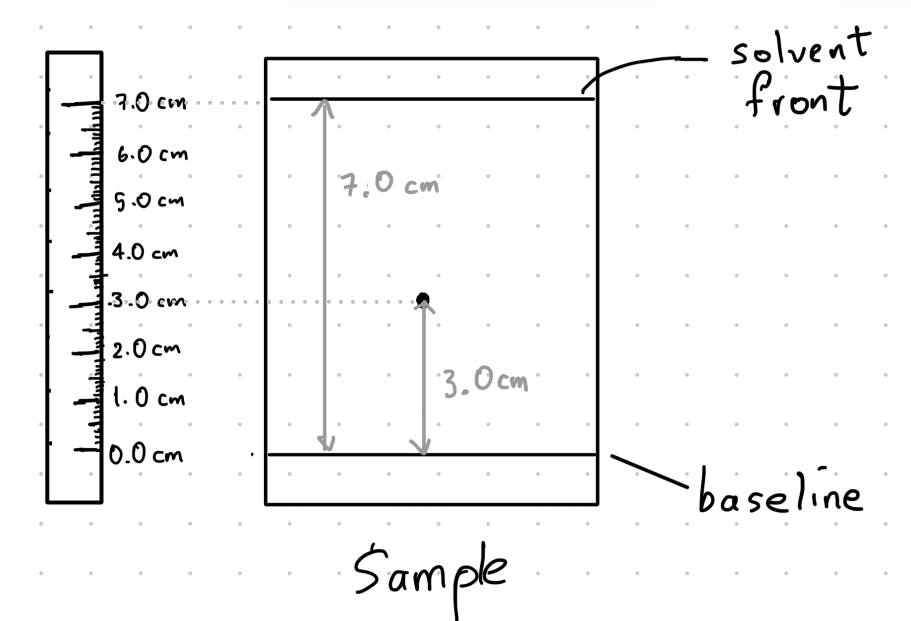

# Mark Schemes — Separation & Purification
**12. Experimental Techniques & Chemical Analysis** · Cambridge (CIE) IGCSE science (0654 & 0973)

## Multiple Choice Questions (14 questions)

### Q1
**Final answer:** **The correct answer is A**

- To identify the pigment, you must calculate the *R*f value of the unknown spot using the formula:

$R_{f}=\frac{\mathrm{distance} \mathrm{travelled} \mathrm{by} \mathrm{substance}}{\mathrm{distance} \mathrm{travelled} \mathrm{by} \mathrm{solvent}}$

- Using the diagram:

- Distance travelled by substance = 3.0 cm
- Distance travelled by solvent (solvent front) = 7.0 cm

$R_{f}=\frac{3.0}{7.0}=0.428..=0.43$

- Comparing this to the table, the unknown sample matches **pigment P **

> **[exam-tip]**
> Always measure the distance from the **baseline to the centre of the spot**, not the top or bottom. Using the centre of the spot ensures accurate **Rf values** and avoids losing marks for measurement errors.

### Q2
**Final answer:** **The correct answer is**** A**** because:**

- Measure the distance from the baseline to each sample spot.
- Measure the distance from the baseline to the solvent front.
- Use the equation for the retention factor: *R*f = $\frac{distancetravelledbyspot}{distancetravelledbysolventfront}$
- Determine which sample spot produces an answer of 0.7.

**B**,** C **and** D **are incorrect as these dyes do not produce an *R*f value of 0.7.

### Q3
**Final answer:** **The correct answer is**** D**** because:**

- Crystallisation is a separation technique used to separate a **soluble solid** from a  solution.
- It involves evaporating the solution to a much smaller volume and then leaving it to cool.
- As the solution cools, crystals of the solid form.

**A **is incorrect as neutralisation is the reaction between an **acid **and a **base** and is not a separation technique.

**B **is incorrect as chromatography is useful for separating a mixture of **dissolved** substances.

**C** is incorrect as distillation is used to separate a **pure liquid **from a **solution **or a **mixture **of liquids.

### Q4
**Final answer:** **The correct answer is**** B**** because:**

- X and Y **both** produce a spot at 0.18 cm which corresponds to pure paracetamol.
- The **impurity** in sample X is visible at 0.27 cm and this is the value which must be used to calculate the retention factor for the chemical.
- Use the equation for the retention factor: *R*f =  $\frac{distancetravelledbyspot}{distancetravelledbysolventfront}$
- Rf = $\frac{0.27}{0.36}=0.75$

**A, C **and** D **are incorrect as these *R*f values are not correct.
**Final answer:** **The correct answer is ****C**** because:**

- Sugars are colourless substances
- Locating agents are sprayed onto the chromatogram once the experiment has been carried out and allow the positions of the sugars to be observed

**A**, **B **and **D** are incorrect as these are not the purpose of the locating agent

### Q5
**Final answer:** **The correct answer is**** B**** because:**

- The apparatus shown is for **distillation**.
- Distillation is used to **separate **two or more liquids from each other if they have **different boiling **points.
- The boiling point of ethanol is 78ºC and water is 100oC, ethanol therefore boils **before **the water does.
- It is then **cooled **and **condensed **back into the liquid form.

**A** is incorrect as filtration is the technique required for this mixture.

**C **and **D **are incorrect as aqueous and organic liquids are immiscible and so can be separated using a **separating funnel**.

### Q6
**Final answer:** **The correct answer is ****D**** because**

- The substance is a **solid** at room temperature which is 20  °C.
- Its melting point must be above this temperature but must also be a **specific** number and **not a range** as the question states that the substance is pure.

**A** is incorrect as its melting point must be **above** room temperature so it has to be above 20 °C.

**B** and **C** are incorrect as pure substances boil at a **specific** temperature so their melting point would also be a specific temperature i.e. not a range of temperatures.

### Q7
**Final answer:** **The correct answer is**** D**** because:**

- Impure substances have melting points and boiling points that fall in a **range of  temperatures** while pure substances have **exact **and** sharp** melting and boiling  points.
- Solid P has an **exact** melting point and boiling point hence it is a pure substance.
- Paper chromatography of solid Q produces two spots, indicating it must contain more than one substance.

**A **and** B **are incorrect as solid Q contains **more than one** substance.

**C **is incorrect as solid P contains only** one** substance.

### Q8
**Final answer:** **The correct answer is**** A ****because: **

- The first fold requires that the filter paper adopts a** semi-circular shape**.
- This is then folded again to form a cone that fits inside the funnel.

**B**,** C **and** D **are incorrect as these diagrams do not correctly illustrate the final step to obtain the required shape.

### Q9
**Final answer:** **The correct answer is**** A**** because:**

- Potassium chloride in water is an **impurity** which affects its physical properties.
- Pure water boils at 100 ºC and freezes at 0 ºC.
- In water, potassium chloride causes the boiling point to** increase **and the freezing point to **decrease**.
- This is why salt is used to prevent icing on roads as it lowers the freezing point, making it more difficult for ice to form at temperature close to 0 ºC.

**B **and** D **are incorrect as the freezing point of water **decreases **when potassium chloride is added to it.

**C **is incorrect as the boiling point of water **increases **when potassium chloride is added to it.

### Q10
**Final answer:** **The correct answer is ****B**** because:**

- Water enters at the bottom of the condenser in order to **fill** the entire condenser.
- It then flows out at the top once the condenser is **full** of water as shown in the diagram.

**A**,** C **and** D **are incorrect as if the water enters at the top of the condenser it will pour straight out and the condenser would not fill up.

### Q11
**Final answer:** **The correct answer is ****D**** because:**

- Filtration is the process of using a filter funnel and filter paper to separate an insoluble solid from a solution or liquid

  - The solid is unable to pass through the filter paper and becomes the residue
  - The solution / liquid that is collected in the flask is called the filtrate

**A**, **B** and **C** are incorrect as all three of these methods require heating

### Q12
**Final answer:** **The correct answer is ****C**** because:**

- Water is added to the rocksalt to dissolve the sodium chloride
- The mixture is then filtered to remove and separate the insoluble sand
- The filtrate contains sodium chloride dissolved in water
- The sodium chloride can be separated / removed from the water by crystallisation

**A** and **B** are incorrect as melting will not separate the sodium chloride, it will produce molten sodium chloride with sand mixed in

**D** is incorrect as dissolving gets the sodium chloride into solution but it still contains sand Subsequent crystallising then undoes this physical change

### Q13
**Final answer:** **The correct answer is**** B**** because:**

- Compare the chromatogram for X by using a ruler and carefully identifying the spots which are the same distance from the baseline as X.
- Only foodstuff **B** matches so B is the one that contains X.
- **A**, **C** and** D** do not match and so do not contain the banned dye.

**A, C **and** D **are incorrect as the chromatogram from these foodstuffs do not match with that of X and so do not contain the banned preservative.

### Q14
**Final answer:** **The correct answer is**** A**** because:**

- In paper chromatography the sample spots should all go onto the **base line**.
- This is always made with a** pencil **as to use ink would contaminate the samples being analysed.

**B **is incorrect as the samples would dissolve in the solvent.

**C **and** D** are incorrect as the base line is used to measure the distances to calculate the *R*f value. If the spots are above or below this line then the calculations will be **inaccurate**.
