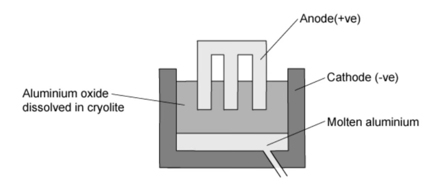
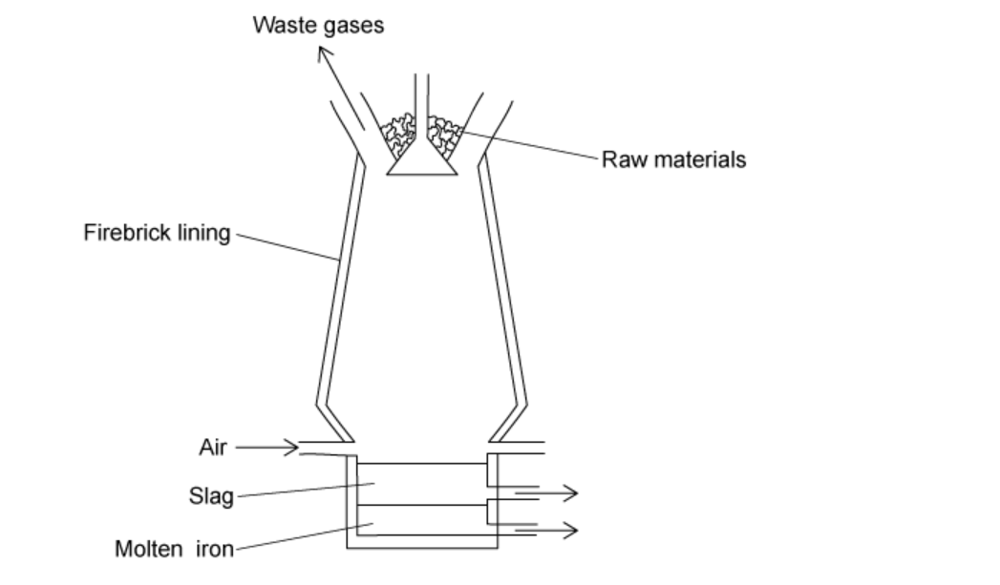

# Exam Questions — Extraction of Metals
**9. Metals** · Cambridge (CIE) IGCSE science (0654 & 0973)
> Source: [https://www.savemyexams.com/igcse/science/cie/co-ordinated-sciences-double-award/23/chemistry/topic-questions/](https://www.savemyexams.com/igcse/science/cie/co-ordinated-sciences-double-award/23/chemistry/topic-questions/) · 12 questions across 1 sets

## Multiple Choice Questions (12 questions)

### Q1 — hard — 1 marks

**Q1** [1 mark]

Iron is produced in a blast furnace.

This process involves blowing oxygen into impure molten iron and adding calcium oxide.

What are the reasons for blowing in oxygen and adding calcium oxide?

|   | **blowing in oxygen** | **adding calcium oxide** |
|---|---|---|
| **A** | reacts with carbon so removes it | removes basic impurities making slag |
| **B** | oxygen reacts with iron | reacts with slag and so removes it |
| **C** | oxygen reacts with iron | removes acidic impurities making slag |
| **D** | reacts with carbon so removes it | removes acidic impurities making slag |

### Q2 — hard — 1 marks

**Q2** [1 mark]

Tin is less reactive than iron and the metal is extracted from its ore cassiterite, SnO2.

Which of the following statements are correct?

1. Tin does not conduct electricity.
2. Tin is hard and shiny
3. Tn can be extracted from cassiterite using carbon.

### Q3 — hard — 1 marks

**Q3** [1 mark]

The three statements about aluminium are all correct.

| **1** | Aluminium has an oxide ore. |
|---|---|
| **2** | Aluminium is extracted from its ore by electrolysis. |
| **3** | Aluminium is used to make cooking utensils. |

Which of the statements would still be correct if aluminium was replaced with iron?

|   | **1** | **2** | **3** |
|---|---|---|---|
| **A** | $\times$ | `✓` | `✓` |
| **B** | `✓` | $\times$ | `✓` |
| **C** | `✓` | `✓` | `✓` |
| **D** | `✓` | $\times$ | $\times$ |

### Q4 — medium — 1 marks

**Q4** [1 mark]

Aluminium is extracted from its oxide by electrolysis.

The oxide is dissolved in ……**1**…… cryolite and aluminium is deposited at the ……**2**……

Which words correctly complete gaps 1 and 2?

|   | **1** | **2** |
|---|---|---|
| **A** | aqueous | cathode |
| **B** | aqueous | anode |
| **C** | molten | cathode |
| **D** | molten | anode |

### Q5 — medium — 1 marks

**Q5** [1 mark]

Which statement about the extraction of iron from its ore is **not **correct?

### Q6 — medium — 1 marks

**Q6** [1 mark]

In a blast furnace, iron (III) oxide is converted into iron and carbon monoxide is converted into carbon dioxide, as shown in the equation:

Fe2O3  + 3CO → 2 Fe + 3 CO2

What happens to each of these reactants?

### Q7 — medium — 1 marks

**Q7** [1 mark]

What are the products at each electrode in the extraction of aluminium?

|   | **cathode** | **anode** |
|---|---|---|
| **A** | oxygen | aluminium |
| **B** | chlorine | aluminium |
| **C** | aluminium | chlorine |
| **D** | aluminium | oxygen |

### Q8 — medium — 1 marks

**Q8** [1 mark]

The diagram shows how aluminium is manufactured by electrolysis.

What are the anode and cathode made of?

|   | **anode** | **cathode** |
|---|---|---|
| **A** | aluminium | aluminium |
| **B** | aluminium | graphite |
| **C** | graphite | aluminium |
| **D** | graphite | graphite |

### Q9 — easy — 1 marks

**Q9** [1 mark]

Iron is extracted from hematite, Fe2O3, in a blast furnace. Limestone is also added to the furnace.

What is the purpose of the limestone?

### Q10 — easy — 1 marks

**Q10** [1 mark]

**Extended tier only **

The blast furnace is used to extract iron from haematite.

The haematite contains silica as an impurity

What is used to react with the impurity and remove it?

### Q11 — easy — 1 marks

**Q11** [1 mark]

Which of the following metals can **not** be extracted from its ore by reduction?

### Q12 — easy — 1 marks

**Q12** [1 mark]

Many metals can be extracted from their ores by heating the metal oxide with carbon.

Which of these metals can’t be extracted using carbon?
