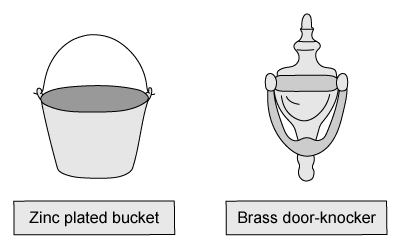
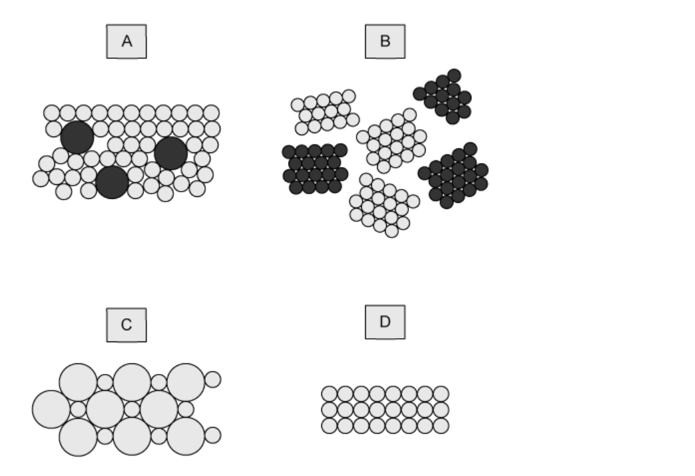

# Exam Questions — Properties, Uses & Alloys of Metals
**9. Metals** · Cambridge (CIE) IGCSE science (0654 & 0973)
> Source: [https://www.savemyexams.com/igcse/science/cie/co-ordinated-sciences-double-award/23/chemistry/topic-questions/](https://www.savemyexams.com/igcse/science/cie/co-ordinated-sciences-double-award/23/chemistry/topic-questions/) · 15 questions across 1 sets

## Multiple Choice Questions (15 questions)

### Q1 — hard — 1 marks

**Q1** [1 mark]

Some properties of elements **K**, **L**, **M** and **N** are given.

| 1 | **K** acts as a catalyst and its oxide reacts with hydrochloric acid |
|---|---|
| 2 | **L** is a dull dark grey solid that conducts electricity and has a melting point of 3600 oC |
| 3 | **M** is easily hammered into shape and has a high density |
| 4 | **N** has a melting point of 113 oC and forms an acidic oxide |

Which of the elements are metals?

### Q2 — hard — 1 marks

**Q2** [1 mark]

Brass is an alloy of two metals

.

Which is the correct statement?

### Q3 — hard — 1 marks

**Q3** [1 mark]

The three statements below about aluminium are all correct.

| 1 | Aluminium reacts readily to form aluminium oxide |
|---|---|
| 2 | Aluminium is extracted from its ore by electrolysis as it cannot be extracted by reduction with carbon |
| 3 | Aluminium is used in electrical wiring because of its good electrical conductivity |

In which of these statements can '**aluminium**' be replaced by '**copper**' and still be correct?

|   | **1** | **2** | **3** |
|---|---|---|---|
| **A** | **✓** | **✓** | **✓** |
| **B** | **✗** | **✓** | **✗** |
| **C** | **✓** | **✗** | **✓** |
| **D** | **✗** | **✗** | **✓** |

### Q4 — hard — 1 marks

**Q4** [1 mark]

Properties of four elements are shown below.

Which of these elements is a metal?

|   | **electrical conductivity when solid** | **electrical conductivity when liquid** | **melting point ℃** |
|---|---|---|---|
| **A** | low | low | -7 |
| **B** | high | low | 801 |
| **C** | high | high | 1535 |
| **D** | low | low | 3550 |

### Q5 — hard — 1 marks

**Q5** [1 mark]

Element **Y** is malleable and ductile.

Which correctly describes the properties of element **Y**?

|   | **Electrical conductivity (solid)** | **Electrical conductivity (molten)** | **Melting Point / ****o****C** |
|---|---|---|---|
| **1** | ✓ | ✓ | 2861 |
| **2** | ✓ | ✓ | 63 |
| **3** | ✗ | ✓ | 801 |

### Q6 — medium — 1 marks

**Q6** [1 mark]

Brass is an alloy of two metals.

Which row describes the correct use of the two metals that brass is made from?

|   | **metal 1** | **metal 2** |
|---|---|---|
| **A** | galvanising steel | making aircraft |
| **B** | electrical wiring | galvanising steel |
| **C** | making aircraft | making cutlery |
| **D** | making cooking pans | electrical wiring |

### Q7 — medium — 1 marks

**Q7** [1 mark]

A sample of element Y is shiny and can be shaped by hammering.

Which row of the table corresponds to the properties of element Y?

|   | **conducts electricity** | **melts below 25℃** |
|---|---|---|
| **A** | $\times$ | `✓` |
| **B** | $\times$ | $\times$ |
| **C** | `✓` | `✓` |
| **D** | `✓` | $\times$ |

### Q8 — medium — 1 marks

**Q8** [1 mark]

Some of the properties of four different elements Q, P, R and S are listed below:

| **1** | Q melts at 1410 °C and forms an acidic oxide. |
|---|---|
| **2** | P has a high density and is easily drawn into wires. |
| **3** | R acts as a catalyst and its oxide reacts with acids |
| **4** | S is a red-brown solid used to make alloys. |

Which of the elements are metals?

### Q9 — medium — 1 marks

**Q9** [1 mark]

The table shows some properties of four metals

Which of the four metals would be the most suitable for aircraft construction?

|   | **density** | **strength** | **resistance to corrosion** |
|---|---|---|---|
| **A** | high | low | low |
| **B** | low | high | high |
| **C** | high | high | low |
| **D** | low | low | high |

### Q10 — medium — 1 marks

**Q10** [1 mark]

**Extended tier only**

The structure of an alloy is shown below. Alloys are mixtures of metals with other metals or non-metals.

They are usually much stronger and harder than pure metals. Which statement explains these features?

### Q11 — easy — 1 marks

**Q11** [1 mark]

**Extended tier only**

Zinc has many uses in the home. The diagram shows two items that contain zinc.

In which of these items is zinc used as an alloy?

|   | **bucket** | **door-knocker** |
|---|---|---|
| **A** | $\times$ | `✓` |
| **B** | `✓` | `✓` |
| **C** | $\times$ | $\times$ |
| **D** | `✓` | $\times$ |

### Q12 — easy — 1 marks

**Q12** [1 mark]

Which diagram shows an alloy?

### Q13 — easy — 1 marks

**Q13** [1 mark]

Copper is sometimes used to make cooking utensils and pans.

Three properties of copper are shown below:

| **1** | Good conductor of electricity. |
|---|---|
| **2** | Corrosion resistant. |
| **3** | Good conductor of heat. |

Which of these properties make it good for making cooking utensils?

### Q14 — easy — 1 marks

**Q14** [1 mark]

**Extended tier only**

Why are alloys harder than the pure metals from which they are made?

| **A** | There are stronger bonds between the atoms |
|---|---|
| **B** | The atoms are all the same size |
| **C** | The layers of atoms are distorted |
| **D** | The properties of each element have combined |

### Q15 — easy — 1 marks

**Q15** [1 mark]

Most of the elements on the Periodic Table are metals. Metals can be distinguished from non-metals by differences in their physical properties.

Which row correctly describes a metal?

|   | **Malleability** | **Heat & electrical conductivity** |
|---|---|---|
| **A** | $\times$ | `✓` |
| **B** | `✓` | $\times$ |
| **C** | `✓` | `✓` |
| **D** | $\times$ | $\times$ |
