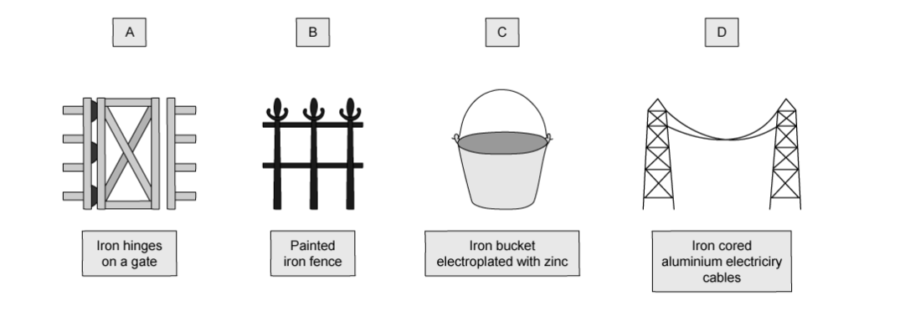

# Exam Questions — Reactivity Series & Corrosion of Metals
**9. Metals** · Cambridge (CIE) IGCSE science (0654 & 0973)
> Source: [https://www.savemyexams.com/igcse/science/cie/co-ordinated-sciences-double-award/23/chemistry/topic-questions/](https://www.savemyexams.com/igcse/science/cie/co-ordinated-sciences-double-award/23/chemistry/topic-questions/) · 17 questions across 1 sets

## Multiple Choice Questions (17 questions)

### Q1 — easy — 1 marks

**Q1** [1 mark]

Four metals, **P**, **Q**, **R**, and **S**, are each placed in separate test tubes containing dilute hydrochloric acid. The observations are recorded in the table below.

| **metal** | **observation with dilute hydrochloric acid** |
|---|---|
| **P** | no reaction |
| **Q** | slow bubbles of gas produced |
| **R** | rapid bubbling, test tube becomes warm |
| **S** | moderate bubbles of gas produced |

Which row shows the correct order of reactivity **and** correctly identifies the metal that is copper?

|   | **order of reactivity (most  to least)** | **copper** |
|---|---|---|
| **A** | R, S, Q, P | P |
| **B** | R, S, Q, P | Q |
| **C** | P, Q, S, R | P |
| **D** | R, Q, S, P | P |

### Q2 — easy — 1 marks

**Q2** [1 mark]

Which word equation represents the rusting of iron?

### Q3 — hard — 1 marks

**Q3** [1 mark]

**Extended tier only**

Four different metals **P**, **Q**, **R** and** S** were added to different aqueous solutions of their ions.

The results are shown in the table below.

| **Metal** | P2+ | Q2+ | R2+ | S2+ |
|---|---|---|---|---|
| **P** | ✗ | ✗ | ✓ | ✓ |
| **Q** | ✓ | ✗ | ✓ | ✓ |
| **R** | ✗ | ✗ | ✗ | ✗ |
| **S** | ✗ | ✗ | ✓ | ✗ |

Key: **✗** = no reaction, **✓** = reaction

What is the order of reactivity of the metals from most reactive to least reactive?

|   | **most reactive** | **→** | **→** | **least reactive** |
|---|---|---|---|---|
| **A** | Q | P | S | R |
| **B** | Q | S | P | R |
| **C** | R | P | S | Q |
| **D** | R | S | P | Q |

### Q4 — hard — 1 marks

**Q4** [1 mark]

**Extended tier only**

Small blocks of zinc are attached to ship hulls which are commonly made from steel, an alloy of iron. This is done to prevent the hull from rusting.

Which statement explains this process?

### Q5 — hard — 1 marks

**Q5** [1 mark]

**Extended tier only**

The following section of the reactivity series shows a newly discovered element, Y. The only oxide of Y has the formula YO.

Ca

Mg

Fe

Y

H

Cu

Which of the equations shows a reaction which would take place?

### Q6 — hard — 1 marks

**Q6** [1 mark]

Five different metals **P**, **Q**, **R**, **S** and** T** were reacted with dilute hydrochloric acid.

The volume of hydrogen gas produced after one minute was measured. The results are shown in the bar chart below:

What is the order of reactivity of the metals?

|   | **most reactive** | **→** | **→** | **→** | **least reactive** |
|---|---|---|---|---|---|
| **A** | P | Q | R | S | T |
| **B** | R | P | S | Q | T |
| **C** | T | Q | S | P | R |
| **D** | T | S | R | Q | P |

### Q7 — hard — 1 marks

**Q7** [1 mark]

Reactions of three metals and their oxides are shown in the table.

| **metal** | **reacts with cold water** | **metal oxide reacts with carbon** |
|---|---|---|
| P | no | no |
| Q | no | yes |
| R | yes | no |

What is the order of reactivity of the metals?

|   | **Least reactive** | → | **Most reactive** |
|---|---|---|---|
| **A** | P | Q | R |
| **B** | Q | P | R |
| **C** | Q | R | P |
| **D** | R | P | Q |

### Q8 — medium — 1 marks

**Q8** [1 mark]

Which row in the table below shows how the metal will react?

|   | **metal** | **reacts with dilute acid** | **reacts rapidly with cold water** | **reacts with steam** |
|---|---|---|---|---|
| **A** | copper | `✓` | $\times$ | $\times$ |
| **B** | calcium | $\times$ | `✓` | `✓` |
| **C** | zinc | `✓` | $\times$ | $\times$ |
| **D** | magnesium | `✓` | $\times$ | `✓` |

### Q9 — medium — 1 marks

**Q9** [1 mark]

**Q**, **R** and **S** are metals.

| **Metal** | **Reacts with cold water** | **Reacts with steam** | **Reacts with dilute hydrochloric acid** |
|---|---|---|---|
| **Q** | yes | yes | violently |
| **R** | very slowly | slowly | less strongly |
| **S** | no | no | no |

What are the possible identities of the metals **Q**, **R** and **S**?

|   | **Q** | **R** | **S** |
|---|---|---|---|
| **A** | Potassium | Iron | Magnesium |
| **B** | Sodium | Zinc | Copper |
| **C** | Silver | Aluminium | Iron |
| **D** | Calcium | Copper | Gold |

### Q10 — medium — 1 marks

**Q10** [1 mark]

Calcium, copper, iron and magnesium are metals. They can be placed in order of reactivity.

Which of the following statements about these metals is correct?

### Q11 — medium — 1 marks

**Q11** [1 mark]

Compound Y is thermally decomposed with carbon using the apparatus below:

A brown solid is formed in the reaction tube and the limewater turns cloudy.

What is compound Y?

### Q12 — medium — 1 marks

**Q12** [1 mark]

A student was investigating the reactivity of different metals in hydrochloric acid.

The diagrams show what happens when each metal was added to dilute hydrochloric acid.

What are **W**, **X**, **Y** and **Z**?

|   | **W** | **X** | **Y** | **Z** |
|---|---|---|---|---|
| **A** | Calcium | Copper | Magnesium | Zinc |
| **B** | Copper | Zinc | Calcium | Magnesium |
| **C** | Magnesium | Calcium | Zinc | Copper |
| **D** | Zinc | Magneisum | Copper | Calcium |

### Q13 — easy — 1 marks

**Q13** [1 mark]

A student was investigating the reactivity of four different metals, **W**, **X**, **Y** and **Z**, in hydrochloric acid.

Which is the most reactive metal and which is the least reactive metal?

|   | **Most reactive metal** | **Least reactive metal** |
|---|---|---|
| **A** | W | X |
| **B** | X | W |
| **C** | Y | X |
| **D** | W | Z |

### Q14 — easy — 1 marks

**Q14** [1 mark]

The diagram shows the experimental set-up a student used to investigate the composition of air. The student left the apparatus in the laboratory and observed that the water level had risen inside the test tube after one week.

Which statement explains why the water level rose?

### Q15 — easy — 1 marks

**Q15** [1 mark]

**Extended tier only**

A student observed the reaction between copper(II) sulfate solution and zinc.

Which observations are correct for this reaction?

|   | **Observation 1** | **Observation 2 ** |
|---|---|---|
| **A** | solution colour stays the same | pale grey crystals forming |
| **B** | solution turns darker blue | grey residue on the metal |
| **C** | solution turns orange/brown | blue crystals form on the metal |
| **D** | solution turns paler blue | orange / brown residue on the metal |

### Q16 — easy — 1 marks

**Q16** [1 mark]

**Extended tier only**

A student prepared four iron nails as explained below in an experiment to investigate rusting. She allowed the nails to rest in individual test tubes in a laboratory for one week.

Which nail will show the greatest amount of rust?

### Q17 — easy — 1 marks

**Q17** [1 mark]

**Extended tier only**

The diagrams below show some of the uses of iron.

In which of these uses is iron most likely to rust?

