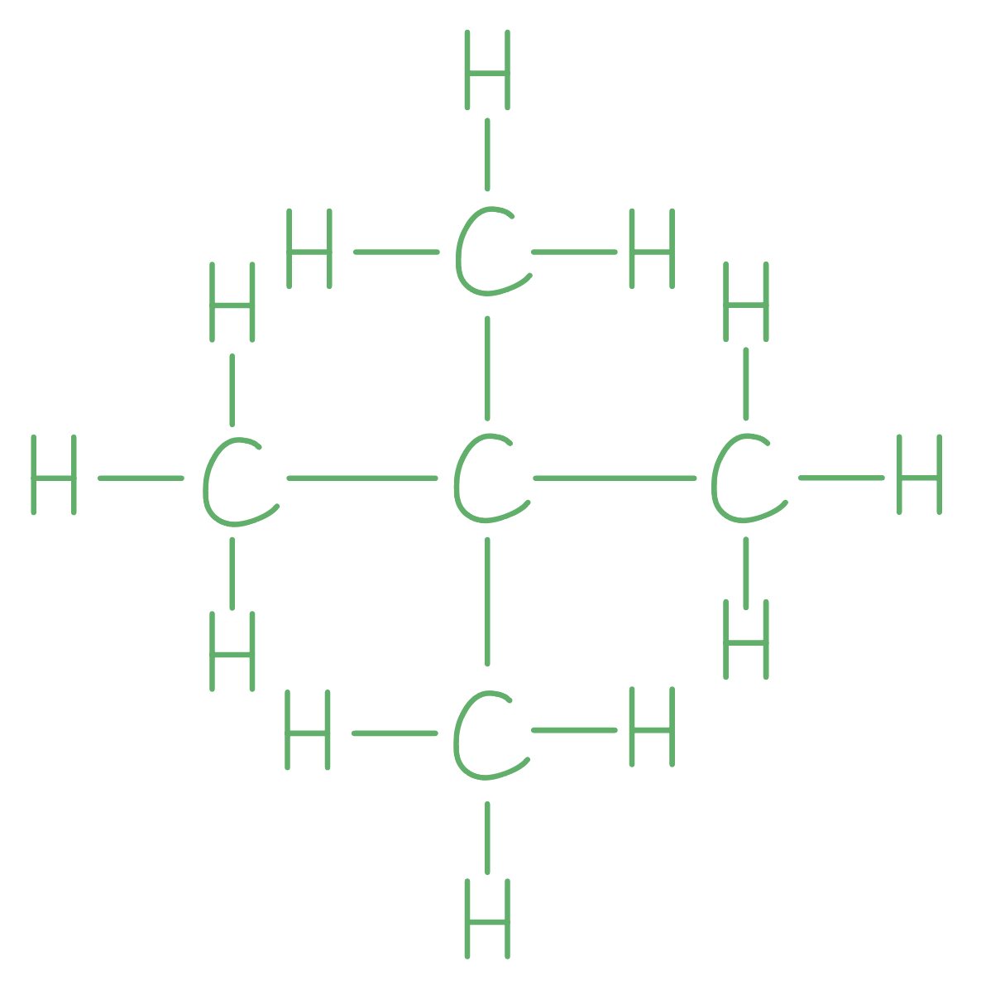

# Mark Schemes — Formulae, Functional Groups & Terminology
**11. Organic Chemistry** · Cambridge (CIE) IGCSE science (0654 & 0973)

## Multiple Choice Questions (12 questions)

### Q1
**Final answer:** **The correct answer is ****A**** because**

- A **homologous** series is a family of chemicals with **similar properties** that share the same general formula and which have the same **functional group**.
- The molecules shown in A are all alcohols.
- Alcohols have the functional group of R-OH

**B **is incorrect as as this group contains alkanes, alkenes and alcohols.

**C **is incorrect as as this group contains alkanes and alkenes.

**D **is incorrect as as this group contains carboxylic acids and alcohols.

### Q2
**Final answer:** **The correct answer is ****C**** because:**

- A homologous series is a family of chemicals with **similar properties** that share the same general formula and which have the same **functional group**.
- Each atom in the series has an oxygen atom with a double bond to a carbon. This is a series called **aldehydes. **This is not a group that you need to be able to draw or recall, but you must be able to look at a structure and see the pattern in a series and recognise it as a functional group.

**A **is incorrect as this would be the definition of a **hydrocarbon**

**B **is incorrect as the molecules shown have saturated carbon-carbon bonds, but this does not make a homologous series.

**D **is incorrect as a homologous series will have similar chemical properties.

### Q3
**Final answer:** **The correct answer is ****B**** because:**

- Butane is cracked to make an alkane and an alkene
- When you react an alkene with steam, you make an alcohol
- When an alcohol is oxidised, it produces a carboxylic acid 
- P is ethane as there is a carbon-carbon single bond
- Q is ethene as there is a carbon-carbon double bond
- R is ethanol as it has the -OH functional group for an alcohol
- S is ethanoic acid as it has the -COOH functional group for a carboxylic acid

**A**, **C** and **D** are incorrect as these do not identify the correct structure-name combinations

### Q4
**Final answer:** **The correct answer is ****B**** because: **

- A **homologous** series is a family of chemicals with **similar properties** that share the same general formula and which have the same **functional group**.
- The molecules shown in **B** are both alkanes.
- Alkanes are saturated hydrocarbons, which means that they only have single bonds in their structure and have the general formula CnH2n+2.

**A **is incorrect as the first molecule is an alcohol, with the functional group OH and the second molecule is a carboxylic acid, with the functional group COOH.

**C **is incorrect as the first molecule is an alkane and the second is an alkene, with the carbon carbon double bond as the functional group.

**D **is incorrect as the first molecule is an alkene with the functional group of a carbon carbon double bond and the second molecule is a polymer.

### Q5
**Final answer:** **The correct answer is ****D**** because:**

- Structure 1 is dibromoethane, it is an alkane with 2 bromine atoms attached
- Structure 3 is ethanol, it is a 2-carbon alkane with the alcohol functional group (R-OH)
- Structure 2 is named incorrectly as this is a 2-carbon hydrocarbon with a carbon-carbon double bond / C=C

  - This means that its name should be ethene

**A**, **B** and **C** are incorrect as these do not identify the correct structure-name combinations

### Q6
**Final answer:** **The correct answer is ****B**** because:**

- There are two **saturated** carbons in this molecule.
- There are no **double bonds** in this molecule.
- The **functional group** contains OH, this makes the molecule an alcohol

**A **is incorrect as **ethane** is a **hydrocarbon**, a molecule that contains hydrogen and carbon only.

**C **is incorrect as **ethanoic acid** has two carbons and the **functional group** of **COOH**

**D **is incorrect as **ethene **is an **unsaturated hydrocarbon** with a **carbon carbon double bond.**

### Q7
**Final answer:** **The correct answer is ****B**** because: **

- **Compounds with names ending in**** -ene**** and ****-ioic**** acid both have double bonds in their structure: **

  - **The ****-ene**** series all have at least one carbon double bond making them unsaturated.**
  - **The ****-oic**** acid series have a carbon/oxygen double bond in the carboxylic acid functional group (-COOH)**

> *The **-ane** (**alkane**) series are saturated and do not have any double bonds in their structure. The **-ol** series have the functional group of **-OH** and are called **alcohols**. *

> *It is common to forget to include the double bond in the carboxylic acid functional group! *

### Q8
**Final answer:** **The correct answer is ****B**** because:**

- Compounds in the same homologous series demonstrate a graduation in their physical properties
- This means there are small differences in physical properties, this happens as the size of the organic molecule increases

**A** is incorrect as compounds in the same homologous series have the same functional group. For example alcohols have an -OH group

**C** is incorrect as compounds in the same homologous series have the same general formula. For example alkenes have the same general formula CnH2n

**D** is incorrect as compounds in the same homologous series have similar chemical properties

### Q9
**Final answer:** **The correct answer is ****B**** because:**

- Displayed formula shows all of the atoms and the bonds between them
- Diagram B does not show the covalent bonds linking the atoms together
- The displayed formula of B is:

**A**, **C** and **D** are correct as these are all correct displayed formulas as all bonds are shown

### Q10
**Final answer:** **The correct answer is ****C**** because: **

- This is the only structure with a **carbon-carbon double bond**. **Alkenes** have a carbon-carbon double bond.

- A **homologous** series is a family of chemicals with **similar properties** that share the same general formula and which have the same **functional group**.
- Octane is from a homologous series called **alkanes.**
- Alkanes are **saturated** hydrocarbons, which means that they only have single bonds in their structure and have the general formula CnH2n+2.
- Molecules **A**, **B** and **D** are all alkanes.

### Q11
**Final answer:** **The correct answer is ****D**** because:**

- A **homologous** series is a family of chemicals with **similar properties** that share the same general formula and which have the same **functional group**.
- Butene, C4H8 and octene, C8H16, each have a **carbon-carbon double bond**. This is the functional group of the **alkenes**.

**A, B** and **C ** are incorrect because each of these properties will be different between each member of a homologous series.

### Q12
**Final answer:** **The correct answer is ****A**** because **

- A **homologous** series is a family of chemicals with **similar properties** that share the same general formula and which have the same **functional group**.
- The molecules shown in A have a carbon carbon double bond which is the same as ethene..
- The functional group of the alkene series is a carbon carbon double bond.

**B **and** C **are incorrect as both of these structures show an alkane.

**D **is incorrect as this structure shows an alcohol.
