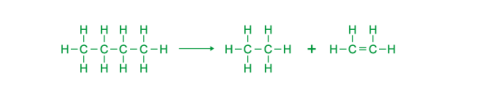

# Mark Schemes — Organic Families
**11. Organic Chemistry** · Cambridge (CIE) IGCSE science (0654 & 0973)

## Multiple Choice Questions (13 questions)

### Q1
**Final answer:** **The correct answer is C**

- Crude oil (petroleum) is a mixture of hydrocarbons with different chain lengths
- In **fractional distillation**, crude oil is heated so that most of it vaporises
- The vapours enter a **fractionating column**, which is **hot at the bottom and cooler at the top**

  - Hydrocarbons with **high boiling points** (long-chain molecules) **condense low down** in the column
  - Hydrocarbons with **low boiling points** (short-chain molecules) **rise higher** before condensing
- As chain length increases, hydrocarbons have **stronger intermolecular forces**

  - Stronger intermolecular forces mean **higher boiling points**, **higher viscosity**, and **lower volatility**
  - This explains why fractions with longer carbon chains are more viscous liquids
- Therefore, the viscosity of the fractions increases as chain length increases, so C is correct

**A **is incorrect because fractions with more carbon atoms have higher boiling points, not lower. This is because larger molecules have strong intermolecular forces of attraction

**B **is incorrect because fractions with small molecules have low boiling points and rise to the top of the fractionating column

**D **is incorrect because refinery gases contain short-chain hydrocarbons, which are more volatile than long-chain hydrocarbons

### Q2
**Final answer:** **The correct answer is ****A**** because:**

The process of **cracking** involves breaking large **hydrocarbon ** molecules into smaller molecules.

**Cracking **alkanes can produce; a shorter chain **alkane** or **alkene** or 1 or more shorter **alkenes** and **hydrogen**.

The molecule C4H8 has one more carbon and the original molecule of propane C3H8.

**B, C** and **D **are incorrect as all of these molecules could be a product of **cracking **of propane.

### Q3
**Final answer:** **The correct answer is ****D**** because:**

- **P** is **cracking. **The process of **cracking** involves breaking large **hydrocarbon ** molecules into smaller molecules.
- **Cracking **of butane creates ethane and ethene:

- **Q** is the **hydration **of ethene, water is added as steam in the presence of a **catalyst** and **ethanol** is produced.

- **R** is the complete **combustion** of **ethanol** which produces carbon dioxide and water

  - C2H5OH + 3 O2     →   2 CO2 + 3 H2O

**A **is incorrect as **distillation **is the separation of substances based on boiling point. **Fermentation **is a metabolic process carried out by organisms such as plants and yeast. **Respiration ** is a metabolic process carried out by many organisms to release energy.

**B** is incorrect as process P is incorrectly labelled as distillation.

**C** is incorrect as process Q and R are incorrectly labelled as fermentation and respiration.

### Q4
**Final answer:** **The correct answer is ****C**** because:**

- Gas **Y **is an alkene as it has a **carbon carbon** **double bond.**
- The double bond in the alkene breaks and bromine is added to the molecule, this causes the **discolouration** of the bromine water.
- This reaction shows **halogenation.**

**A, B **and** D **are incorrect as none of these compounds have a **carbon carbon double bond.**

### Q5
**The correct answer is ****B**** because **ethanol is formed by the **catalytic hydration** of **ethene** with steam.

**A, C** and **D **are incorrect as these substances are not used to make ethanol.

### Q6
**Final answer:** **The correct answer is ****C**** because:**

- **R** will decolourise bromine water.
- Compound **R** is an **alkene** with a **carbon carbon double bond**.
- This will react with the **bromine water** in a **halogenation** reaction.
- **P** has** 7** carbon atoms:

  - The process of **cracking** involves breaking large **hydrocarbon ** molecules into smaller molecules.
  - The total number of carbon atoms in the two smaller molecules is **7**. Carbon atoms are not lost in the reaction.

**A, B** and **D **are incorrect as Q is not unsaturated, this has no **carbon carbon double bonds**. Q will be an alkane, butane.

### Q7
**Final answer:** **The correct answer is ****A**** because**

- The boiling point of the hydrocarbon depends on the **molecular** **mass**. The **larger** the molecular **mass** the **higher** the **boiling** **point**.
- Larger molecules have more **intermolecular** **forces** which hold the molecules together, so more energy is needed to overcome these forces for a state change.
- Smaller molecules have less intermolecular forces between the molecules so need less energy to overcome these forces.

**B, C** and **D ** are incorrect because they all have boiling points above A and therefore bigger molecules.

### Q8
**Final answer:** **The correct answer is ****A**** because**

- The Motor vehicle industry requires large quantities of **gasoline** (petrol) and **diesel**.
- The table shows that North Sea has the largest percentage of these two products

The other compositions do not contain as much gasoline and diesel as North Sea so are not correct answers.

### Q9
**Final answer:** **The correct answer is ****B**** because:**

- Petroleum (crude oil) is a mixture of different hydrocarbons with different chain lengths and physical properties.
- Petroleum is separated through **fractional distillation**, which separates the molecules with similar boiling points called fractions.
- The fractions have a boiling point range; the boiling point depends on the molecular mass of the molecules.
- The **larger** the molecular **mass** the **higher** the **boiling** **point**; therefore larger molecules with high boiling points are separated at the bottom of the column.
- The shorter, lighter chains are separated at the top of the column.

**A, C** and **D ** are incorrect because chemical reactivity and solubility in water does vary with each fraction but these properties are not used to separate the mixture into fractions.

### Q10
**The correct answer is ****C**** because **ethanol is formed by the **fermentation** of **glucose** by organisms such as yeast and plants.

**A **is incorrect as **combustion **of ethane would not produce ethanol.

**B **is incorrect as **combustion **of glucose would not produce ethanol.

**D **is incorrect as **fermentation** of ethane would not produce ethanol.

### Q11
**Final answer:** **The correct answer is ****B**** because:**

- **Incomplete combustion** of **alkanes** in general produces carbon and/or carbon monoxide along with water

  - hydrocarbon + oxygen → carbon monoxide + carbon + water
- Carbon dioxide is formed with a plentiful supply of oxygen, during complete combustion
- Carbon monoxide is formed with a limited supply of oxygen
- Carbon is formed with a **very** limited supply of oxygen

  - Exam questions will sometimes indicate if the product of incomplete combustion is carbon monoxide or carbon

**A **is incorrect as this is the balanced symbol equation for the **complete** **combustion** of methane

**C **is incorrect as hydrogen is not a product of the combustion of alkanes

**D **is incorrect as this is not a balanced equation and has hydrogen gas as a product.

### Q12
**The correct answer is ****A**** because** ethanol is formed by the **catalytic hydration** of **ethene,** not ethane.

**B **is incorrect as the complete combustion of **ethanol** in excess oxygen produces carbon dioxide and water and heat, so it can be used as a fuel:

C2H5OH +3O2 → 2CO2 + +3H2O

**C **is incorrect as **ethanol **is an important solvent in many industrial processes.

**D **is incorrect as the **functional group** of alcohol is -OH

### Q13
**Final answer:** **The correct answer is ****C**** because:**

- The industrial process is **fractional** **distillation**.
- Fractional distillation separates the hydrocarbons in crude oil based on the **boiling points**. The boiling points are different due to the molecular mass.
- The product that is used as aircraft fuel is **paraffin** (this is also known as **kerosene**.)
- Paraffin has a low boiling point of 37 °C, it is a liquid at room temperature. This is lower than petrol which has a boiling point of 95 °C.

**A **is incorrect as the substance is not petrol, petrol is not used in aircraft as a fuel.

**B **and** D  **are incorrect as the industrial process is not thermal decomposition. Fractional distillation does not break the molecules but separates the mixture based on boiling point.
