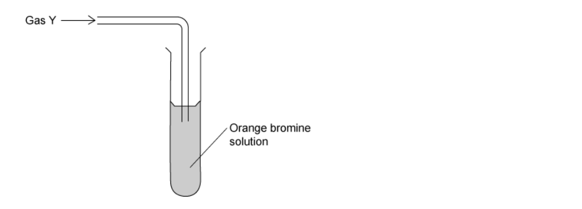

# Exam Questions — Organic Families
**11. Organic Chemistry** · Cambridge (CIE) IGCSE science (0654 & 0973)
> Source: [https://www.savemyexams.com/igcse/science/cie/co-ordinated-sciences-double-award/23/chemistry/topic-questions/](https://www.savemyexams.com/igcse/science/cie/co-ordinated-sciences-double-award/23/chemistry/topic-questions/) · 13 questions across 1 sets

## Multiple Choice Questions (13 questions)

### Q1 — easy — 1 marks

**Q1** [1 mark]

Petroleum is separated into fractions by fractional distillation.

Which statement about the properties of the fractions is correct?

### Q2 — hard — 1 marks

**Q2** [1 mark]

Hydrocarbons separated by fractional distillation of petroleum can be cracked to make useful shorter chain products.

Which substance is not a product of the cracking of propane, *M**r** *44?

### Q3 — hard — 1 marks

**Q3** [1 mark]

The diagram shows a sequence of reactions.

Which row correctly names the processes **P**, **Q** and **R**?

|   | **P** | **Q** | **R** |
|---|---|---|---|
| **A** | distillation | fermentation | respiration |
| **B** | distillation | hydration | combustion |
| **C** | cracking | fermentation | respiration |
| **D** | cracking | hydration | combustion |

### Q4 — hard — 1 marks

**Q4** [1 mark]

The apparatus below was used to test gas Y

The bromine solution quickly went colourless.

What is the correct structure of gas Y?

### Q5 — medium — 1 marks

**Q5** [1 mark]

Ethanol can be produced from substance Y.

substance Y + steam $\overset{\mathrm{catalyst}}{\rightarrow}$ ethanol

What is substance Y?

### Q6 — medium — 1 marks

**Q6** [1 mark]

A student carried out a cracking reaction on hydrocarbon,** P**, and obtained two products; **Q** and **R**.

The student then made the following notes:

| **1** | **Q** is unsaturated. |
|---|---|
| **2** | **R** will decolourise bromine water. |
| **3** | A molecule of** P** has 7 carbon atoms. |

Which of the statements are correct?

### Q7 — medium — 1 marks

**Q7** [1 mark]

The diagram below shows the apparatus used to separate petroleum (crude oil) into four fractions.

Which fraction contains the smallest hydrocarbon molecules?

| **fraction** | **boiling point range / °C** |
|---|---|
| **A** | up to 70 |
| **B** | 71 to 120 |
| **C** | 121 to 170 |
| **D** | over 171 |

### Q8 — medium — 1 marks

**Q8** [1 mark]

The table below shows 4 different sources of petroleum (crude oil) and their composition.

| **Fraction** | **Arabian Heavy /%** | **Arabian Light /%** | **Iranian Heavy /%** | **North Sea**  **/%** |
|---|---|---|---|---|
| **gasoline** | 18 | 21 | 21 | 23 |
| **kerosene** | 11.5 | 13 | 13 | 15 |
| **diesel** | 18 | 20 | 20 | 24 |
| **fuel oil** | 52.5 | 46 | 46 | 38 |

Which composition of petroleum would be the best for the motor vehicle industry?

### Q9 — medium — 1 marks

**Q9** [1 mark]

Which of the following properties of different compounds in petroleum enable it to be separated into fractions?

| ** ** | **1** | Chain length |
|---|---|---|
| ** ** | **2** | Chemical reactivity |
| ** ** | **3** | Solubility in water |
| ** ** | **4** | Boiling point |

### Q10 — easy — 1 marks

**Q10** [1 mark]

Ethanol is used as a solvent and fuel, it is produced by the ….1….. of ….2…. .

Which words would correctly complete the gaps 1 and 2?

|   | **1** | **2** |
|---|---|---|
| **A** | combustion | ethane |
| **B** | combustion | glucose |
| **C** | fermentation | glucose |
| **D** | fermentation | ethane |

### Q11 — easy — 1 marks

**Q11** [1 mark]

Which of the equations show the incomplete combustion of methane?

### Q12 — easy — 1 marks

**Q12** [1 mark]

Which of the following statements about ethanol is **not** correct?

### Q13 — easy — 1 marks

**Q13** [1 mark]

The diagram shows an industrial process involved in the production of a substance that is used as an aircraft fuel.

|   | **process** | **substance Q** |
|---|---|---|
| **A** | fractional distillation | petrol |
| **B** | thermal decomposition | paraffin |
| **C** | fractional distillation | paraffin |
| **D** | thermal decomposition | petrol |
