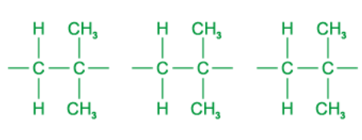
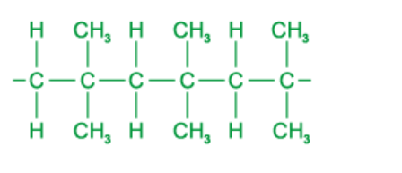

# Mark Schemes — Polymers
**11. Organic Chemistry** · Cambridge (CIE) IGCSE science (0654 & 0973)

## Multiple Choice Questions (15 questions)

### Q1
**Final answer:** **The correct answer is ****B**** because:**

- The structure shown is a polyamide which is a polymer where the individual monomer units are held together by amide (peptide) links (-CONH-).
- Polyamides are formed by condensation polymerisation of two monomers.
- One of the monomers has an amine (-NH2) group at each end and the other has a carboxylic acid group (-COOH) at both ends.
- The link between these two functional groups is the amide link and each one is formed as a water molecule is lost hence the name condensation polymerisation.

**A **is incorrect as water is formed when the amine and carboxylic groups join together meaning this process is a condensation reaction. In addition polymerisation there are no waste products.

**C** and **D **is incorrect as the amine and carboxylic groups are typical of monomers of a polyamide, whereas monomers of a polyester would consist of an alcohol (-OH) and a carboxylic acid (-COOH) group.

### Q2
**Final answer:** **The correct answer is ****B**** because:**

- Molecules 1 and 3 have the same groups attached to one carbon on the C=C double bond.
- They are the same molecule but the order of the functional groups has been changed slightly.

**A, C** and **D **are incorrect as molecules 2 and 4 do have the same groups attached but each group is bonded to a different carbon of the C=C double bond. This means that when they polymerize, they will have different positions on the chain to that of the molecule in the question.

### Q3
**Final answer:** **The correct answer is ****C**** because:**

- There is a carboxylic acid group (-COOH) and an amine group(-NH2) at either end.
- The link between these two functional groups is the amide link and each one is formed as a water molecule is lost, hence the name condensation polymerisation.
- There is a water molecule removed in the process shown in the question, therefore it is produced by condensation polymerisation.

**A** and **B **are incorrect as water is formed when the amine and carboxylic groups join together meaning this process is a condensation reaction. In addition polymerisation there are no waste products.

**D **is incorrect as Kevlar is held together by amide (peptide) links, whereas monomers of a polyester would consist of hydroxyl (-OH) and carboxylic acid (-COOH) groups and the polymer would be held together by ester links.

### Q4
**Final answer:** **The correct answer is ****A**** because:**

| **Step** | **Working out** |
|---|---|
| 1. Count the number of **carbon **atoms  present in each monomer. | A = 4, B = 2, C = 3 & D = 4 |
| 2. Break the double **bond in each monomer.** | This is to visualise the polymer it will form. |
| 3. Look for the corresponding polymer | The one that matches is A |

### Q5
**Final answer:** **The correct answer is ****D**** because:**

- Addition polymerisation of alkenes produces very long polymer molecules which contain only single C-C bonds.
- Methyl propene has two methyl groups present, one above and one below the double bond.
- Methyl propene has alternate H atoms and methyl groups, so the polymer should  continue this pattern.

| **Step** | **Diagram** |
|---|---|
| 1.  Draw three of the monomers side by side showing clearly the double bonds and groups attached to the carbon atoms. |  |
| 2.  Change the carbon-carbon double bonds to single bonds and add a single bond to each end of the monomers |  |
| 3.  Join these bonds together, forming the polymer. |  |

**A **is incorrect as it has carbon-carbon double bonds.

**B **is incorrect as the methyl groups are on one side only.

**C **is incorrect as the groups on the chain are not alternating.

### Q6
**Final answer:** **The correct answer is ****B**** because:**

- The compound is a saturated hydrocarbon as it contains single bonds only.
- The polymer is poly(ethene) or polythene.
- Polythene is used extensively as it is durable and flexible and has many applications including plastic bags and bottles.
- It is also a good electrical insulator and is used as coating in electrical wiring.

**A **is incorrect as the monomer is ethene not ethane.

**C** and **D **are incorrect as the polymer is saturated whereas the monomer is unsaturated.

As an easy way to remember, think of saturation in the sense that when something is saturated then nothing else will fit. A saturated solution for example is one in which no more solute can dissolve. A saturated hydrocarbon is one in which no more atoms can be added. As atoms tend to add across C=C double bonds, then if no double bond is present the compound must be saturated. An unsaturated compound must contain a C=C double bond.

### Q7
**Final answer:** **The correct answer is ****B**** because:**

- The structure shown is a polyamide which is a polymer where the individual monomer units are held together by amide (peptide) links (-CONH-).
- Polyamides are formed by condensation polymerisation of two monomers.
- One of the monomers has an amine (-NH2) group at each end and the other has a carboxylic acid group (-COOH) at both ends.
- The link between these two functional groups is the amide link and each one is formed as a water molecule is lost hence the name condensation polymerisation.

**A **is incorrect as water is formed when the amine and carboxylic groups join together meaning this process is a condensation reaction. In addition polymerisation there are no waste products.

**C** and **D **is incorrect as the amine and carboxylic groups are typical of monomers of a polyamide, whereas monomers of a polyester would consist of an alcohol (-OH) and a carboxylic acid (-COOH) group.
**Final answer:** **The correct answer is ****D**** because:**

- **The structure shown is a polyester which is a polymer where the individual monomer units are held together by ester links (-COO-).**
- **Polyesters are formed by condensation polymerisation of two monomers.**
- **One of the monomers has an alcohol (-OH) group and the other has a carboxylic acid group (-COOH).**

### Q8
**Final answer:** **The correct answer is ****C**** because:**

- Polymerisation of ethene is carried out at high temperatures with catalysts, the only product is polythene.
- Therefore, CO2 is not produced in this process.

**A, B** and **D **are incorrect as these processes all produce CO2.

### Q9
**Final answer:** **The correct answer is ****D**** because:**

- Polyesters and polyamides are formed by condensation polymerisation of two  monomers.
- One of the monomers has an alcohol (-OH) group at each end and the other has a carboxylic acid group (-COOH) at either end.

**A** and **B **are incorrect as water is formed when the polyesters and polyamides are formed meaning this process is a condensation reaction. In addition polymerisation there are no waste products.

**C **is incorrect as if the monomers were unsaturated hydrocarbons then this would form polymers such as poly(ethene) and poly(propene).

### Q10
**Final answer:** **The correct answer is ****D**** because:**

- The monomer that is used to form a polymer is shown in the brackets of the name of the polymer, therefore it is ethene
- Ethene is an unsaturated compound as it contains a carbon-carbon double bond

**A** and **C **are incorrect as ethane is an alkane and is not the correct name of the monomer

**B** is incorrect as ethene is not a saturated compound as it contains a carbon-carbon double bond

### Q11
**Final answer:** **The correct answer is ****C**** because:**

| **Step** | **Working out** |
|---|---|
| 1. Identify the **monomers **in the displayed diagram. |  |
| 2. Break the **bond **between these monomers. |  |
| 3. Add in the **double **bond between the carbon atoms. |  |
| 4. Write down the **formula **for what's left and identity this in the list of options given. | C2H3Cl, chloroethene   |

**A** and **B** are incorrect as the monomer must be an alkene.

**D** is incorrect as the monomer from which PVC is made has only one chlorine atom, not two.

### Q12
**Final answer:** **The correct answer is ****D**** because:**

- Addition polymerisation occurs in molecules that contain a C=C double bond.
- The bond breaks and molecules join together to form a much larger molecule.
- There is no other product formed.

**A **is incorrect as poly(ethene) is an example of an addition polymer and is not biodegradable.

**B** and **C **are incorrect as Terylene is an example of a condensation polymer which cannot be hydrolysed to make amino acids, and is also not a natural polymer.

### Q13
**Final answer:** **The correct answer is ****B**** because:**

- Addition polymerisation of alkenes produces very long molecules made up of a C-C backbone
- The carbon-carbon double bond in ethene can be made to open up, thus allowing many ethene molecules to join together. This makes a large molecule or polymer called poly(ethene) (or polythene).
- The reaction is carried out under high pressure with the use of a catalyst, which triggers the opening of the double bond.

**A **is incorrect as saturated hydrocarbons can not undergo polymerisation.

**C** and **D **are incorrect as cracking involves breaking long chain alkanes into smaller and more useful molecules, which is the opposite of polymerisation.

### Q14
**Final answer:** **The correct answer is ****B**** because:**

- Addition polymerisation involves the addition of many monomers to make a long chained polymer
- Poly(ethene) is formed when many ethene monomers join together due to the carbon-carbon double bond in ethene breaking

**A** is incorrect as cracking is the process where longer chain alkanes form shorter chain alkanes and alkenes

**C** is incorrect as fermentation is the process by which ethanol is produced from glucose in the presence of yeast, in the absence of oxygen at 25-35 oC

**D** is incorrect as catalytic addition of steam to ethene at 300°C and 6000kPa /60 atm in the presence of an acid catalyst produces ethanol

### Q15
**Final answer:** **The correct answer is ****B**** because:**

- The carbon carbon double bonds open up and form long chain molecules called  polymers.
- The resulting polymer produced from ethene monomers is called poly(ethene) or polythene.

**A** and **C** are incorrect as these are alkanes and have no double bonds.

**D** is incorrect as when ethene undergoes polymerisation it becomes poly(eth<u>e</u>ne), not poly(eth<u>a</u>ne).
