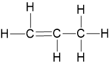
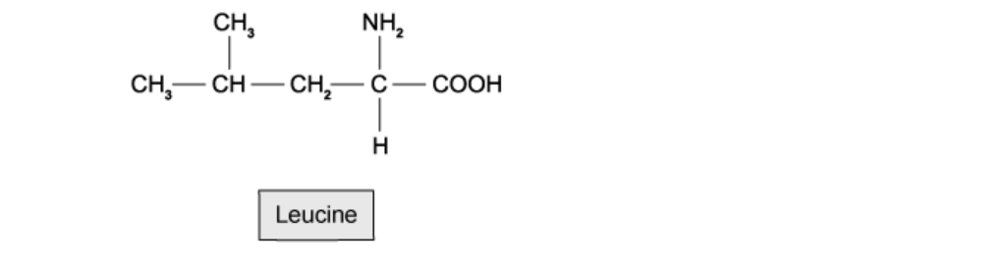

# Exam Questions — Formulae & Relative Masses
**3. Stoichiometry** · Cambridge (CIE) IGCSE science (0654 & 0973)
> Source: [https://www.savemyexams.com/igcse/science/cie/co-ordinated-sciences-double-award/23/chemistry/topic-questions/](https://www.savemyexams.com/igcse/science/cie/co-ordinated-sciences-double-award/23/chemistry/topic-questions/) · 17 questions across 1 sets

## Multiple Choice Questions (17 questions)

### Q1 — medium — 1 marks

**Q1** [1 mark]

Iron(III) chloride is an ionic compound.

What is the formula of iron(III) chloride?

### Q2 — medium — 1 marks

**Q2** [1 mark]

The displayed formula of propene is drawn below.

Calculate the relative molecular mass, *M**r*, of propene

(*A*r: C=12, H=1)

### Q3 — hard — 1 marks

**Q3** [1 mark]

**Extended tier only**

Magnesium nitrate and sodium carbonate react as shown.

Mg(NO3)2(aq) + Na2CO3(aq)  → MgCO3(s) + 2 NaNO3(aq)

Which row describes the spectator ions and the net ionic equation for the reaction?

|   | **spectator ions** | **net ionic equation** |
|---|---|---|
| **A** | Mg2+ and CO32- | Mg2+(aq) + CO32-(aq) → MgCO3(s) |
| **B** | NO3- and Na+ | NO3-(aq) + Na+(aq) → NaNO3(aq) |
| **C** | Mg2+ and CO32- | NO3-(aq) + Na+(aq) → NaNO3(aq) |
| **D** | NO3- and Na+ | Mg2+(aq) + CO32-(aq) → MgCO3(s) |

### Q4 — hard — 1 marks

**Q4** [1 mark]

**Extended tier only**

The left hand side for the reaction between ammonia and copper(II) oxide is shown. What are the products of the balanced equation?

3 CuO + 2 NH3 →

### Q5 — hard — 1 marks

**Q5** [1 mark]

**Extended tier only**

Nitric acid and potassium hydroxide react in a neutralisation reaction to produce salt and water, as shown by the equation below:

HNO3(aq) + KOH(aq) → KNO3(aq) + H2O(l)

Which row describes the spectator ions and the net ionic equation for the reaction?

|   | **spectator ions** | **net ionic equation** |
|---|---|---|
| **A** | NO3- and K+ | NO3-(aq) + K+(aq) → KNO3(aq) |
| **B** | H+ and OH- | NO3-(aq) + K+(aq) → KNO3(aq) |
| **C** | NO3- and K+ | H+(aq) + OH-(aq) → H2O(l) |
| **D** | H+ and OH- | H+(aq) + OH-(aq) → H2O(l) |

### Q6 — hard — 1 marks

**Q6** [1 mark]

**Extended tier only**

What is the balanced equation for the reaction between aqueous NaOH and Fe2(SO4)3?

### Q7 — hard — 1 marks

**Q7** [1 mark]

Ammonia is manufactured by the reaction of hydrogen and nitrogen in the Haber process, as shown in the equation below:

N2 + 3 H2 → 2 NH3

16.8 tonnes of ammonia can be produced from 14 tonnes of nitrogen.

How much nitrogen is needed to produce 51 tonnes of ammonia?

### Q8 — medium — 1 marks

**Q8** [1 mark]

**Extended tier only**

What is the balanced equation for the reaction of methane and oxygen?

### Q9 — medium — 1 marks

**Q9** [1 mark]

**Extended tier only**

Dilute sulfuric acid and barium chloride solution react to produce barium sulfate and hydrochloric acid, as shown in the reaction below:

H2SO4 + BaCl2 → BaSO4 + 2 HCl

Which row represents the correct state symbols for the reaction?

|   | **H****2****SO****4** | **BaCl****2** | **BaSO****4** | **HCl** |
|---|---|---|---|---|
| **A** | (aq) | (l) | (s) | (aq) |
| **B** | (l) | (aq) | (aq) | (l) |
| **C** | (aq) | (aq) | (s) | (aq) |
| **D** | (l) | (aq) | (l) | (aq) |

### Q10 — medium — 1 marks

**Q10** [1 mark]

6 g of hydrogen react with 48 g of oxygen to form water. A chemist performs the same reaction using 2 g of hydrogen.

What mass of oxygen is required to combine with the hydrogen?

### Q11 — medium — 1 marks

**Q11** [1 mark]

**Extended tier only**

The formula and charge for positive and negative ions are shown.

| **cation** | **anion** |
|---|---|
| Al3+, Mg2+, Cu2+, Fe2+, Li+ | F-, CO32-, NO3-, S2-, SO42- |

The table shows the name and formula of common ionic compounds formed from the ions. Which row is not correct?

|   | **name** | **formula** |
|---|---|---|
| **A** | lithium sulfide | Li2S |
| **B** | iron(II) fluoride | Fe2F3 |
| **C** | aluminium sulfate | Al2(SO4)3 |
| **D** | magnesium nitrate | Mg(NO3)2 |

### Q12 — medium — 1 marks

**Q12** [1 mark]

**Extended tier only**

A compound contains two atoms of oxygen and one atom of calcium. It also contains hydrogen in sufficient amounts so that the overall charge of the molecule is neutral.

What is the molecular formula for the compound?

### Q13 — easy — 1 marks

**Q13** [1 mark]

Leucine is an essential amino acid used in the synthesis of proteins in the body.

What is the relative molecular mass of leucine?

### Q14 — easy — 1 marks

**Q14** [1 mark]

**Extended tier only**

Hydrogen reacts with elements from Group VII to produce compounds called hydrogen halides. An example is when a molecule of hydrogen reacts with a molecule of fluorine to produce hydrogen fluoride.

What is the correct equation for the reaction?

### Q15 — easy — 1 marks

**Q15** [1 mark]

A molecule contains carbon, hydrogen and oxygen. For every carbon atom there are twice as many hydrogen atoms but the same number of oxygen atoms.

What is the formula of the molecule?

### Q16 — easy — 1 marks

**Q16** [1 mark]

When magnesium carbonate is heated, the products are magnesium oxide and carbon dioxide.

MgCO3 (s) → MgO (s) + CO2 (g)

What mass of magnesium oxide is formed when 21 g of magnesium carbonate thermally decomposes?

(*A*r = Mg = 24, C = 12, O = 16)

### Q17 — easy — 1 marks

**Q17** [1 mark]

Theobromine is a stimulant found in chocolate and in tea leaves and is closely related to caffeine, the stimulant found in coffee.

What is the formula of theobromine?
