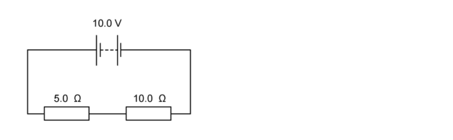
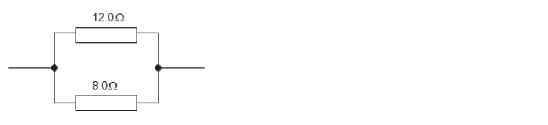

# Exam Questions — Electric Circuits & Electrical Safety
**4. Electricity & Magnetism** · Cambridge (CIE) IGCSE science (0654 & 0973)
> Source: [https://www.savemyexams.com/igcse/science/cie/co-ordinated-sciences-double-award/23/physics/topic-questions/](https://www.savemyexams.com/igcse/science/cie/co-ordinated-sciences-double-award/23/physics/topic-questions/) · 17 questions across 1 sets

## Multiple Choice Questions (17 questions)

### Q1 — medium — 1 marks

**Q1** [1 mark]

Which statements about the Sun are correct?

1. The Sun is a star of medium size.
2. The Sun consists mostly of nitrogen and oxygen.
3. The Sun is located inside the Milky Way galaxy.

### Q2 — medium — 1 marks

**Q2** [1 mark]

A book shop owner sets up the circuit below, but they find that the lamp is too dim.

What change can be made to the circuit to increase the brightness of the bulb?

### Q3 — hard — 1 marks

**Q3** [1 mark]

A teacher writes a set of notes about two **non-identical** bulbs which are connected in parallel.

He makes one mistake. Which of the statements below is incorrect?

### Q4 — hard — 1 marks

**Q4** [1 mark]

Which of the following statements about the current in ammeters **X**, **Y** and **Z** is correct?

### Q5 — easy — 1 marks

**Q5** [1 mark]

**Extended tier only**

Which diagram shows the correct symbol for a diode, and the correct direction of current moving through it?

### Q6 — easy — 1 marks

**Q6** [1 mark]

The diagram shows two resistors connected in parallel.

The total resistance of this combination will be:

### Q7 — hard — 1 marks

**Q7** [1 mark]

**Extended tier only**

Two resistors are connected in parallel.

The current through the top resistor is 2.0 A.

What is the reading on the ammeter?

### Q8 — easy — 1 marks

**Q8** [1 mark]

Which of the circuit diagrams above shows a fuse which has been correctly connected?

### Q9 — medium — 1 marks

**Q9** [1 mark]

The diagram shows two resistors connected in series with a battery.

What is the current through the battery?

### Q10 — medium — 1 marks

**Q10** [1 mark]

The diagram shows two bulbs, which have been connected in parallel. A fuse has been included in the circuit.

Each of the ammeters reads 1.2 A.

What fuse should be put in this circuit?

### Q11 — medium — 1 marks

**Q11** [1 mark]

A student sets up the circuit below, it contains four fuses and four bulbs.

She finds that none of the bulbs are lit, but only one of the fuses has blown.

Which fuse has blown?

### Q12 — hard — 1 marks

**Q12** [1 mark]

A person wants to install a circuit breaker to protect themselves and their lawnmower from too much current.

Under normal operating conditions, the lawnmower carries 4 A of current.

The manufacturer provides the graph below with the circuit breaker.

What will happen when the current is 4 A, and what will happen if the current rises to 14 A?

|   | **4 A** | **14 A** |
|---|---|---|
| **A** | circuit does not break | circuit does not break |
| **B** | circuit does not break | circuit breaks quickly |
| **C** | circuit breaks quickly | circuit does not break |
| **D** | circuit breaks quickly | circuit breaks quickly |

### Q13 — hard — 1 marks

**Q13** [1 mark]

A student connects together some identical resistors in three different combinations, as shown in the diagram.

Which of the answers below shows the correct order of the combinations from the lowest resistance to the highest?

### Q14 — hard — 1 marks

**Q14** [1 mark]

**Extended tier only**

Two resistors are connected in parallel.

What is the combined resistance of the combination?

### Q15 — hard — 1 marks

**Q15** [1 mark]

**Extended tier only**

All the light bulbs in the diagrams above are identical. Each one is rated as ‘10 W, 230 V’.

In which of the diagrams are all the bulbs working at their normal brightness?

### Q16 — medium — 1 marks

**Q16** [1 mark]

A surge of current in a kettle melts the 13 A fuse.

What will happen to the kettle next time it is used if the fuse is replaced with a 3 A fuse?

### Q17 — medium — 1 marks

**Q17** [1 mark]

An oven is wired into somebody’s kitchen. The oven is protected by a fuse, and functions normally, but the owner notices that the wires that connect the oven to the mains electricity supply get quite hot.

What could be done to reduce the temperature of the wires?
