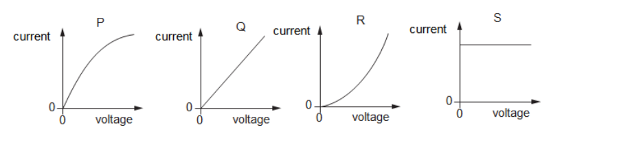
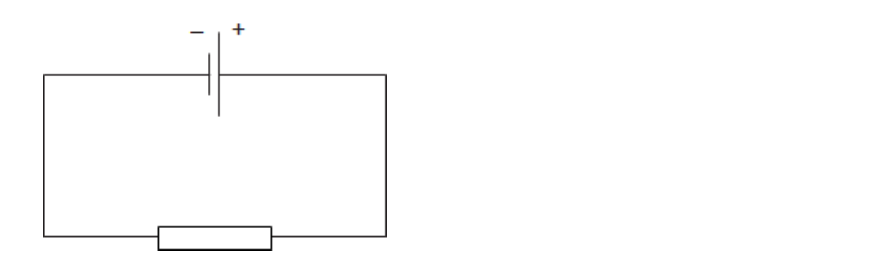

# Exam Questions — Electrical Quantities
**4. Electricity & Magnetism** · Cambridge (CIE) IGCSE science (0654 & 0973)
> Source: [https://www.savemyexams.com/igcse/science/cie/co-ordinated-sciences-double-award/23/physics/topic-questions/](https://www.savemyexams.com/igcse/science/cie/co-ordinated-sciences-double-award/23/physics/topic-questions/) · 21 questions across 1 sets

## Multiple Choice Questions (21 questions)

### Q1 — medium — 1 marks

**Q1** [1 mark]

A current of 0.50 A flows through a lamp for 4.0 minutes.

What is the charge that flows through the lamp?

### Q2 — medium — 1 marks

**Q2** [1 mark]

An electric heater with a power rating of $2000\text{W}$ is switched on for $3.0\text{hours}$. The cost of $1\text{kWh}$ of electricity is $20\text{cents}$.

What is the total cost of using the heater?

### Q3 — medium — 1 marks

**Q3** [1 mark]

The diagram shows a circuit containing a battery, three switches, $S_{1}$, $S_{2}$, and $S_{3}$, and two lamps $L_{1}$ and $L_{2}$.

A student wants to light lamp $L_{1}$ only.

Which switches must be closed?

### Q4 — easy — 1 marks

**Q4** [1 mark]

**Extended tier only**

What is the correct unit of charge?

### Q5 — medium — 1 marks

**Q5** [1 mark]

A PVC (plastic) rod is rubbed with a nylon cloth. This process causes electrons to be transferred between the rod and the cloth, causing both objects to become charged.

Which row gives the correct nature of the charges on both the cloth and the rod, and the effect the objects have on each other after becoming charged?

|   | **Charges on rod and cloth** | **Effect** |
|---|---|---|
| **A** | the same | repel |
| **B** | the same | attract |
| **C** | opposite | repel |
| **D** | opposite | attract |

### Q6 — medium — 1 marks

**Q6** [1 mark]

A student wants to charge up some rods by rubbing them with a cloth made from a suitable material.

He has a number of rods to choose from: a copper rod, a PVC rod, an aluminium rod and a glass rod.

Which two of the rods would hold a charge when rubbed with an appropriate cloth?

### Q7 — easy — 1 marks

**Q7** [1 mark]

What is the unit of electromotive force?

### Q8 — medium — 1 marks

**Q8** [1 mark]

A student rubs an acetate rod with a cloth, giving it a negative charge. She then holds it near an earthed, conducting sphere as shown in the diagrams below.

Which diagram shows the correct distribution of charges on the conducting sphere?

### Q9 — medium — 1 marks

**Q9** [1 mark]

**Extended tier only**

A student has four copper wires, of different dimensions.

Which of the following wires has the largest resistance?

|   | **Length of wire / cm** | **Diameter of wire / mm** |
|---|---|---|
| **A** | 100 | 0.2 |
| **B** | 300 | 0.1 |
| **C** | 50 | 0.4 |
| **D** | 30 | 0.5 |

### Q10 — medium — 1 marks

**Q10** [1 mark]

**Extended tier only**

A student considers how changing the diameter and length of a wire affects its resistance.

Which row shows the changes that could be made to the length and diameter of the wire to **decrease** its resistance?

|   | **Change to length** | **Change to diameter** |
|---|---|---|
| **A** | increase | increase |
| **B** | increase | decrease |
| **C** | decrease | increase |
| **D** | decrease | decrease |

### Q11 — hard — 1 marks

**Q11** [1 mark]

**Extended tier only**

Four current-voltage graphs are given below.

Which graph shows an ohmic resistor and which shows a filament lamp?

|   | **Filament lamp** | **Ohmic resistor** |
|---|---|---|
| **A** | Q | S |
| **B** | R | Q |
| **C** | P | Q |
| **D** | Q | R |

### Q12 — easy — 1 marks

**Q12** [1 mark]

Which line correctly states the equation for **electrical energy**?

### Q13 — easy — 1 marks

**Q13** [1 mark]

The diagram shows two light, silver-coated balls labelled **X** and **Y** hanging from threads near to each other.

Which line identifies the possible charges on **X** and **Y**?

|   | **X** | **Y** |
|---|---|---|
| **A** | neutral | neutral |
| **B** | negative | negative |
| **C** | negative | positive |
| **D** | positive | negative |

### Q14 — hard — 1 marks

**Q14** [1 mark]

A student connects a 6 V power supply to a 3 Ω resistor. The resistor is left connected to the power supply for 1 minute.

How much power is dissipated by the resistor?

### Q15 — hard — 1 marks

**Q15** [1 mark]

**Extended tier only**

Which row in the table gives the correct units for charge and e.m.f.?

|   | **Charge** | **EMF** |
|---|---|---|
| **A** | Q | E |
| **B** | C | V |
| **C** | A | J |
| **D** | J | ᘯ |

### Q16 — hard — 1 marks

**Q16** [1 mark]

**Extended tier only**

A student sets up a circuit as shown in the diagram.

A charge of 4.9 C flows through the resistor in 0.7 s.

Which row shows the correct current, direction of electron flow and direction of conventional current through the resistor?

|   | **current / A** | **direction of electron flow** | **direction of conventional current** |
|---|---|---|---|
| **A** | 7.00 | Left to right | Right to left |
| **B** | 3.43 | Left to right | Right to left |
| **C** | 7.00 | Right to left | Right to left |
| **D** | 3.43 | Right to left | Right to left |

### Q17 — hard — 1 marks

**Q17** [1 mark]

**Extended tier only**

What is the definition of an electric field?

### Q18 — hard — 1 marks

**Q18** [1 mark]

A student wants to measure the power dissipated by a 10 kΩ resistor.

What equipment should the student use to determine the power dissipated?

### Q19 — hard — 1 marks

**Q19** [1 mark]

A 2.0 Ω resistor is connected to meter X and meter Y as shown in the diagram.

Which row in the table shows possible values for the two meters?

|   | **X** | **Y** |
|---|---|---|
| **A** | 4.0 | 8.0 |
| **B** | 2.0 | 2.0 |
| **C** | 4.0 | 2.0 |
| **D** | 1.0 | 1.0 |

### Q20 — easy — 1 marks

**Q20** [1 mark]

Which pair of quantities have the same units?

### Q21 — hard — 1 marks

**Q21** [1 mark]

A 3.0 Ω resistor is connected to a 15 V power supply as shown in the diagram. The ammeter reads 5 A throughout the experiment.

How much energy is dissipated as heat by the resistor in 2 minutes?
