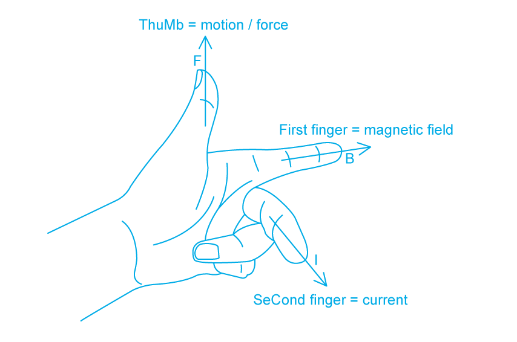
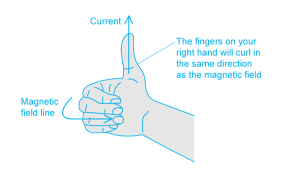

# Mark Schemes — Electromagnetic Effects
**4. Electricity & Magnetism** · Cambridge (CIE) IGCSE science (0654 & 0973)

## Multiple Choice Questions (13 questions)

### Q1
**Final answer:** **The correct answer is D**

- An e.m.f. is only induced in the coil when there is a change in the magnetic field through the coil
- Moving the magnet into the coil changes the magnetic flux through the coil, which induces an e.m.f. and causes a current to flow
- When the magnet is stationary inside the coil, the magnetic field through the coil is not changing
- No change in magnetic flux means no induced e.m.f. and therefore no current
- The ammeter reads zero

**A** & **B **are incorrect because a constant reading would require a continuously changing magnetic field. A stationary magnet produces a constant (unchanging) field, which does not induce an e.m.f.

**C** is incorrect because there is no gradual decrease. The reading drops to zero as soon as the magnet stops moving, not gradually over time.

### Q2
**Final answer:** **The correct answer is ****B**** because:**

- The relationship between the voltage and the number of coils of a transformer is: $\frac{V_{p}}{V_{s}}=\frac{N_{p}}{N_{s}}$
- The primary voltage is $V_{p}=12V$, the secondary voltage is $V_{s}=240V$ and the number of secondary coils is $N_{s}=1200$
- Substituting these values gives: $\frac{12}{240}=\frac{N_{p}}{1200}$
- Rearranging the equation gives: $N_{p}=12\times\frac{1200}{240}=60$

When doing calculations always write the formula out in full. Substitute the numbers in and write out each stage of rearranging the equation. This makes it much less likely that you’ll make mistakes.

### Q3
**Final answer:** **The correct answer is ****C**** because:**

- The relationship between the voltage and the number of coils of a transformer is: $\frac{V_{p}}{V_{s}}=\frac{N_{p}}{N_{s}}$
- The number of primary coils is $N_{p}=80$, the number of secondary coils is $N_{s}=400$ and the primary voltage is $V_{p}=48V$
- Substituting these values gives: $\frac{48}{V_{s}}=\frac{80}{400}$
- Rearranging the equation gives: $V_{s}=48\times\frac{400}{80}=240V$

When doing calculations always write the formula out in full. Substitute the numbers in and write out each stage of rearranging the equation. This makes it much less likely that you’ll make mistakes.

### Q4
**Final answer:** **The correct answer is ****B ****because:**

- In a simple a.c. generator a coil rotates between magnetic poles (or a magnet rotates around a coil)
- This causes the voltage to rise, then fall, then to rise in the opposite direction, then fall, and to repeat in this manner
- This produces a graph with a sine or cosine curve, which is shown by graph **B**

**A **&** C **are incorrect as the voltage is never negative in these graphs. An a.c. generator makes the voltage negative every half cycle.

**D **is incorrect as this graph shows d.c. (direct current)

### Q5
**Final answer:** **The correct answer is ****B ****because:**

- When a wire is moved through a magnetic field, the induced e.m.f. can be used to drive a current
- The combination of current and voltage can deliver electrical power to devices (*P* = *IV*), which causes them to work
- This is the process used by a generator to produce electricity

**A **is incorrect as an electric motor works using the reverse effect: when a current is passed through a wire in a magnetic field, it experiences a force.

**C **is incorrect as a photon accelerator is a fictitious device, popularised on a children’s TV show in the early 90s called “Bucky O’Hare”. One might argue that a light bulb accelerates photons.

**D **is incorrect as a transformer uses the induction effect, but does not use a moving wire, it uses an alternating magnetic field to create the same effect.

### Q6
**Final answer:** **The correct answer is ****A ****because: **

- Using Fleming’s left-hand rule:

  - the magnetic field (first finger) points from North to South
  - the current (second finger) points “into the page” in the direction of current flow.
  - the force on the wire (thumb) is directed downwards, in the direction OP

Fleming’s left-hand rule predicts the direction of the force on a current-carrying wire in a magnetic field.

This is a motor effect question, you know because current is already flowing in the wire, and you are asked to predict the direction of the force. If the wire had been pushed, it would be a generator question.

**Top Tip:** if a wire experiences a force without being touched, it’s the motor effect. If the wire is physically dragged through the field, it’s the generator effect.

Actually, the two are equivalent, but that requires slightly deeper thought than we need at IGCSE.

### Q7
**Final answer:** **The correct answer is ****C ****because:**

- Using Fleming’s left-hand rule:

  - the current (second finger) is directed along the wire, in the direction shown on the arrow
  - the force on the wire (thumb) is directed upwards, in the direction shown on the diagram
  - the magnetic field (first finger) points left to right

- Magnetic fields point from N to S, so the left pole is N and the right is S

Fleming’s left-hand rule predicts the direction of the force on a current-carrying wire in a magnetic field.

It’s very easy to get confused between the motor effect (left-hand rule) and the generator effect (right-hand rule).

**Top Tip:** if a wire experiences a force without being touched, it’s the motor effect. If the wire is physically dragged through the field, it’s the generator effect.

Actually, the two are equivalent, but that requires slightly deeper thought than we need at IGCSE.

### Q8
**Final answer:** **The correct answer is ****B**** because:**

- Electrical power is given by $P=VI$
- For an ideal transformer (100% efficient): power into a transformer = power out of a transformer
- Therefore, the relationship between the voltage and current in a transformer is: $I_{p}V_{p}=I_{s}V_{s}$
- The primary voltage is $V_{p}=25\mathrm{kV}=25000V$, the primary current is $I_{p}=4000A$ and the secondary voltage is $V_{s}=400\mathrm{kV}=400000V$
- Substituting these values gives: $4000\times25000=400000\timesI_{s}$
- Rearranging the equation gives: $I_{s}=\frac{4000\times25000}{400000}=250A$

When doing calculations always write the formula out in full. Substitute the numbers in and write out each stage of rearranging the equation. This makes it much less likely that you’ll make mistakes.

### Q9
**Final answer:** **The correct answer is ****D ****because:**

- A d.c. motor can be made to turn more quickly by:

  - increasing the current in the coil
  - adding more turns to the coil
  - increasing the magnetic field strength of the magnetic field

**A **is incorrect as reducing the strength of the magnetic field would cause it to turn more slowly.

**B **is incorrect as swapping both of these elements would cause it to turn in the same direction at the same speed.

**C **is incorrect as swapping the poles over would cause it to turn in the opposite direction.

### Q10
**Final answer:** **The correct answer is ****A ****because **

- A  d.c. motor uses a split ring commutator to reverse the direction of the current through the coil every half turn, and, therefore, to keep it spinning in the same direction.

a.c. generators use slip rings, transformers have no moving parts, and relays use no rings at all.

### Q11
**Final answer:** **The correct answer is ****B ****because: **

- Using the right-hand grip rule:

  - the current (thumb) points out of the page
  - the magnetic field lines (curled fingers) will be **anticlockwise**

Remember to use the right-hand grip rule to determine the direction of the magnetic field around a current-carrying wire

### Q12
**Final answer:** **The correct answer is ****B**** because:**

- A step-up transformer has more turns on the secondary coil than on the primary coil
- This means that Ns > Np (or Np < Ns)

### Q13
**Final answer:** **The correct answer is ****B ****because: **

- The magnetic field lines around a solenoid are similar to the magnetic field lines around a bar magnet.

