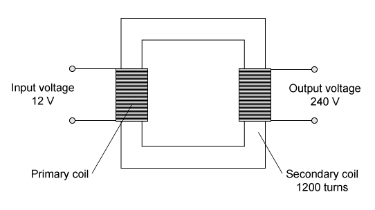

# Exam Questions — Electromagnetic Effects
**4. Electricity & Magnetism** · Cambridge (CIE) IGCSE science (0654 & 0973)
> Source: [https://www.savemyexams.com/igcse/science/cie/co-ordinated-sciences-double-award/23/physics/topic-questions/](https://www.savemyexams.com/igcse/science/cie/co-ordinated-sciences-double-award/23/physics/topic-questions/) · 13 questions across 1 sets

## Multiple Choice Questions (13 questions)

### Q1 — medium — 1 marks

**Q1** [1 mark]

A magnet is pushed into a coil of wire connected to a centre-zero sensitive ammeter. The ammeter shows a negative reading, as shown in diagram 1.

The magnet is then held stationary inside the coil.

What does the ammeter read when the magnet is stationary, as shown in diagram 2?p

### Q2 — hard — 1 marks

**Q2** [1 mark]

**Extended tier only**

A transformer has 1200 turns on its secondary coil and has an output voltage of 240 V.

If the input voltage is 12 V, how many turns are there on the primary coil?

### Q3 — hard — 1 marks

**Q3** [1 mark]

**Extended tier only**

Transformers are used to change the voltage of a power supply.

The diagram below shows a simple transformer.

If the input voltage is 48 V, what is the output voltage?

### Q4 — medium — 1 marks

**Q4** [1 mark]

**Extended tier only**

Which graph represents the output of a simple a.c. generator?

### Q5 — medium — 1 marks

**Q5** [1 mark]

**Extended tier only**

When a wire is moved through a magnetic field, an e.m.f. is induced in the wire.

Which of the following devices uses this effect?

### Q6 — hard — 1 marks

**Q6** [1 mark]

**Extended tier only**

A current-carrying wire is placed into a magnetic field as shown in the diagram. The wire experiences a force.

In which direction does the force on the wire act?

### Q7 — hard — 1 marks

**Q7** [1 mark]

**Extended tier only**

A current-carrying wire is placed between two magnetic poles as shown in the diagram below. It experiences an upwards force.

What is the orientation of the magnetic poles?

|   | **Left magnet** | **Right magnet** |
|---|---|---|
| **A** | N | N |
| **B** | S | N |
| **C** | N | S |
| **D** | S | S |

### Q8 — hard — 1 marks

**Q8** [1 mark]

**Extended tier only**

A transformer is used to raise the voltage of electricity produced at a power station before it is transmitted in power lines.

The power station generates electricity at a voltage of 25 kV and a current of 4000 A. The step-up transformer increases the voltage to 400 kV.

Assume that the transformer is 100% efficient.

What current flows in the power lines?

### Q9 — easy — 1 marks

**Q9** [1 mark]

**Extended tier only**

A simple d.c. electric motor is shown in the diagram.

Which of the following changes would make the coil turn more quickly?

### Q10 — easy — 1 marks

**Q10** [1 mark]

**Extended tier only**

Which device uses a split ring commutator?

### Q11 — easy — 1 marks

**Q11** [1 mark]

**Extended tier only**

Which diagram correctly shows the magnetic field lines around a current-carrying wire if the current is directed out of the page?

### Q12 — easy — 1 marks

**Q12** [1 mark]

**Extended tier only**

The number of turns in the primary coil and secondary coil of a transformer is Np and Ns respectively.

Which of the following statements represents a step-up transformer?

### Q13 — easy — 1 marks

**Q13** [1 mark]

**Extended tier only**

Which diagram shows the correct magnetic field pattern around a current-carrying solenoid?

