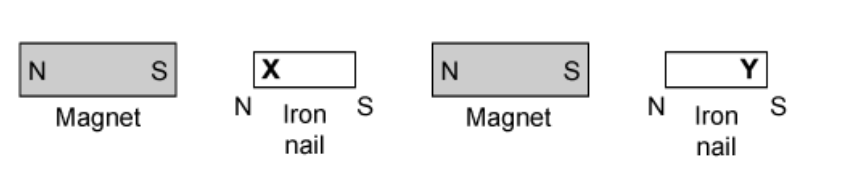

# Mark Schemes — Simple Phenomena of Magnetism
**4. Electricity & Magnetism** · Cambridge (CIE) IGCSE science (0654 & 0973)

## Multiple Choice Questions (11 questions)

### Q1
**Final answer:** **The correct answer is ****B**** because:**

- The strongest permanent magnet is able to hold the most paper clips when the bar magnet is taken away, regardless of how many it held when the bar magnet was present.
- Rod **B** can hold the most paper clips.

Each of the other rods holds fewer paperclips when the permanent magnet is taken away.

### Q2
**Final answer:** **The correct answer is ****D**** because:**

- Permanent magnets always attract magnetic materials. The iron bar is a magnetic material.
- Magnetic poles will be induced in the magnetic material which are opposite to the poles of the permanent magnet, which causes the attraction.

**A **is incorrect as the magnet will not repel the iron bar.

**B **is incorrect as the magnet will not repel the iron bar.

**C **is incorrect as the poles are the same as the permanent magnet’s poles. This would cause them to repel.

### Q3
**Final answer:** **The correct answer is ****A**** because:**

- In order for there to be repulsion between two metal bars, they must **both** be magnets. Otherwise it is impossible to have two like poles next to each other.
- Like magnetic poles repel.

**B **is incorrect as both ends of rod 3 attract. This means that it has two identical poles. This cannot happen in a magnet, and is only possible if the poles are changing in response to another magnetic field. This means that rod 3 is a magnetic material.

**C **is incorrect as in order to get repulsion at all, **both** of the bars must be magnets, not just one.

**D **is incorrect as in order to get repulsion at all, **both** of the bars must be magnets, not just one.

### Q4
**Final answer:** **The correct answer is ****B**** because:**

- Steel is slow to be magnetised (as it is an alloy of iron), and can retain its magnetism for a while

  - This makes it a good material for a magnet
- Iron can be magnetised and demagnetised very quickly

  - This means it becomes strongly magnetised when placed in contact with the magnets, but does not remain magnetised when taken away from the magnets
  - This makes it a good material for the keeper

Steel is often known as a 'hard' magnetic material and iron as a 'soft' magnetic material due to the relative amount of time they remain magnetised.

### Q5
**Final answer:** **The correct answer is ****C**** because:**

- Magnets attract magnetic materials.
- Materials containing iron are ferrous, and iron is a magnetic material. Therefore, a permanent magnet would attract ferrous materials (among other things).

**A **is incorrect as a permanent magnet will not repel materials that are not magnetic, it will have no effect on them.

**B **is incorrect as a permanent magnet will not repel non-ferrous materials. It will have no effect on most non-ferrous materials, and will attract cobalt and nickel.

**D **is incorrect as all permanent magnets have **two** poles, a north and a south. It is impossible for a permanent magnet to have only one pole.

### Q6
**Final answer:** **The correct answer is ****A**** because:**

- North poles will repel North poles of other permanent magnets.

**B **is incorrect as soft magnetic materials lose their magnetism quickly. A permanent magnet would not be permanent if it were made from a soft magnetic material.

**C **is incorrect as magnetic materials become magnets when placed in a magnetic field. They always become magnetic in such a way as to **attract** the magnet that causes them to become magnetic. They would never repel.

**D **is incorrect as magnetic field lines **never** cross.

### Q7
**Final answer:** **The correct answer is ****B**** because: **

- The diagram shows how the magnetic poles would be formed.

### Q8
**Final answer:** **The correct answer is ****C**** because:**

- A ferrous metal contains **iron**, a non-ferrous metal does not.
- Aluminium and copper are elements, so they cannot contain iron.
- Brass is an alloy of copper and tin, which does not contain iron.

**A** is incorrect as iron is ferrous, and steel is an alloy of iron.

**B** is incorrect as steel is an alloy of iron, which is ferrous.

**D** is incorrect as iron is ferrous.

### Q9
**Final answer:** **The correct answer is ****A**** because:**

- A hard magnetic material is required for a permanent magnet. Steel is a hard magnetic material that will retain its magnetism for a long time.
- A soft magnetic material is required for the core of an electromagnet. A material that loses its magnetism quickly is needed, so that the electromagnet can ‘let go’ of whatever it is holding.

The other answers do not pair iron with the core of an electromagnet, and/or steel with the permanent magnet.

### Q10
**Final answer:** **The correct answer is ****B**** because:**

- Ferrous metals contain **iron**
- These are either iron itself or an alloy of iron, such as **steel**

  - Therefore, steel and iron are both ferrous

An alloy is a substance that contains more than one metal. Iron alloys all contain small amounts of iron. In the case of steel, this is iron and carbon.

### Q11
**Final answer:** **The incorrect statement is ****D**** because:**

- A permanent magnet produces its own magnetic field

  - This means it never loses its magnetism
  - Most permanent magnets are made from 'hard' iron, nickel, or cobalt

- A soft magnetic material, such as soft iron, will only be magnetic whilst there is a current around it (such as in an electromagnet)

  - Once the current is switched off, it is demagnetised (loses its magnetism)
  - This means it wouldn't work as a permanent magnet

**A** is correct as opposite poles attract, so an S-pole will attract the N-pole of another magnet

**B** is correct as like poles repel, so an S-pole will repel the S-pole of another magnet

**C** is correct as permanent magnets can only attract or repel other magnetic materials, so it is true that they cannot repel non-magnetic materials
