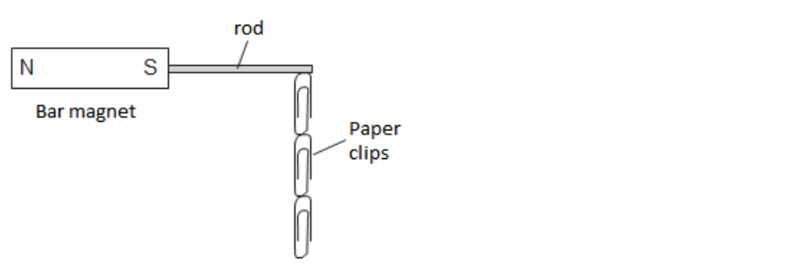
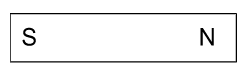
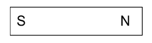
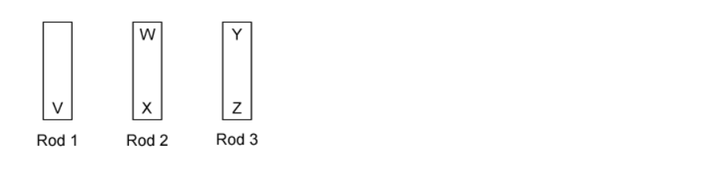

# Exam Questions — Simple Phenomena of Magnetism
**4. Electricity & Magnetism** · Cambridge (CIE) IGCSE science (0654 & 0973)
> Source: [https://www.savemyexams.com/igcse/science/cie/co-ordinated-sciences-double-award/23/physics/topic-questions/](https://www.savemyexams.com/igcse/science/cie/co-ordinated-sciences-double-award/23/physics/topic-questions/) · 11 questions across 1 sets

## Multiple Choice Questions (11 questions)

### Q1 — hard — 1 marks

**Q1** [1 mark]

A student carries out an experiment to find out which of four metal rods makes the best permanent magnet.

The rod is attached to the south pole of a permanent magnet, and then paper clips are attached to the rod. The number of paper clips that can be held by the rod is counted.

The permanent magnet is then removed from the rod, and the number of paper clips that remain attached are counted.

The results are summarised in the table below.

Which of the rods becomes the strongest permanent magnet?

| **rod** | **number of paper clips held by the rod** |   |
|---|---|---|
| **when the magnet is present** | **when the magnet is removed** |   |
| **A** | 5 | 2 |
| **B** | 4 | 3 |
| **C** | 2 | 0 |
| **D** | 3 | 2 |

### Q2 — hard — 1 marks

**Q2** [1 mark]

**Extended tier only**

A teacher, Mr. Garrison, brings a horseshoe magnet near to an iron bar as shown in the diagram.

Is the iron bar attracted to or repelled from the horseshoe magnet?

Which diagram shows the polarity of the poles that are produced in the iron bar?

| **Rod** | **Attracted / Repelled** | **Pole Distribution** |
|---|---|---|
| **A** | repelled |  |
| **B** | repelled |  |
| **C** | attracted |  |
| **D** | attracted |  |

### Q3 — hard — 1 marks

**Q3** [1 mark]

**Extended tier only**

A student has a collection of metal bars that keep sticking to each other. She suspects that they might be magnets, so she runs a test.

She holds end V of rod 1, near to each end of the two other rods. The ends are shown in the diagram below.

Her results are as follows:

End V:

- Repels end W
- Attracts end X
- Attracts end Y
- Attracts end Z

Which of the metal rods is a magnet?

### Q4 — medium — 1 marks

**Q4** [1 mark]

The diagram shows two bar magnets, stored with metal keepers across the ends. The keepers help to keep the magnets magnetised.

The material used for the keepers becomes strongly magnetised when placed in contact with the magnets, but does not remain magnetised when taken away from the magnets.

What is a suitable metal to use for the magnets and what is a suitable metal to use for the keepers?

|   | **Metal for keeper** | **Metal for magnet** |
|---|---|---|
| **A** | steel | steel |
| **B** | iron | steel |
| **C** | steel | iron |
| **D** | iron | iron |

### Q5 — medium — 1 marks

**Q5** [1 mark]

Which of the following statements could be used to describe something a permanent magnet could do?

### Q6 — medium — 1 marks

**Q6** [1 mark]

A student makes a series of statements about a permanent bar magnet.

Which of them is true?

### Q7 — medium — 1 marks

**Q7** [1 mark]

**Extended tier only**

A student lines up some permanent magnets with soft iron nails in between as shown in the diagram below.

What would the magnetic poles of locations **X **and **Y** be?

|   | **X** | **Y** |
|---|---|---|
| **A** | north | north |
| **B** | north | south |
| **C** | south | north |
| **D** | south | south |

### Q8 — easy — 1 marks

**Q8** [1 mark]

Which of the lists of metals below contains only metals which are non-ferrous?

### Q9 — easy — 1 marks

**Q9** [1 mark]

Which of the following choices of metal would be suitable for:

- Use as a permanent magnet?
- Use as the core in an electromagnet?

|   | **Use as a permanent magnet** | **Use as the core of an electromagnet** |
|---|---|---|
| **A** | steel | iron |
| **B** | steel | steel |
| **C** | iron | iron |
| **D** | iron | steel |

### Q10 — easy — 1 marks

**Q10** [1 mark]

Which of the lists below are metals that are ferrous?

### Q11 — easy — 1 marks

**Q11** [1 mark]

Which statement about a permanent bar magnet is **incorrect**?
