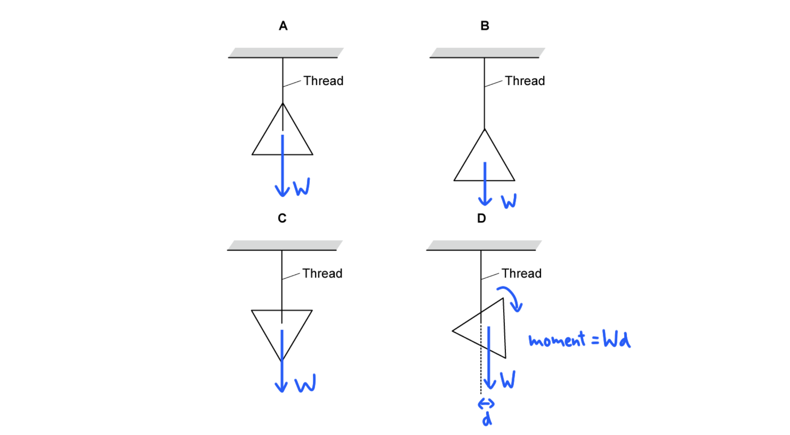

# Mark Schemes — Effects of Forces
**1. Motion, Forces & Energy** · Cambridge (CIE) IGCSE science (0654 & 0973)

## Multiple Choice Questions (27 questions)

### Q1
**Final answer:** **The correct answer is B**

- Point P is where the straight-line section of the graph ends and the line begins to curve
- This is the **limit of proportionality**: the point beyond which the extension is no longer directly proportional to the applied force
- Below point P, the graph is a straight line through the origin, meaning force and extension are directly proportional (Hooke's law applies)

**A **&** C **are incorrect because the maximum load and the maximum extension would be at the far right end of the graph, not where the curve begins.

**D** is incorrect because the spring constant is not a point on the graph. The spring constant is found from the gradient of the straight-line section (force per unit extension).

### Q2
**Final answer:** **The correct answer is A**

- For a beam to be balanced (in equilibrium), the total clockwise moment must equal the total anticlockwise moment
- The moment of a force is calculated using the equation:

$\text{moment}=\text{force}\times\text{perpendicular distance from pivot}$

- There is an anticlockwise moment due to the force $F$ at a distance $x$ to the left of the pivot

$\mathrm{anticlockwise} \mathrm{moment}=F\timesx$

- Therefore, to balance the beam, there must be a clockwise moment due to the second force $2F$ at a distance $d$ to the right of the pivot

$\mathrm{clockwise} \mathrm{moment}=2F\timesd$

- Set these expressions equal to each other:

$2F\timesd=F\timesx$

- Rearrange the equation to make $d$ the subject and cancel the $F$ terms:

$d=\frac{F\timesx}{2F}$

$d=\frac{x}{2}$

- This is option** A**

### Q3
**Final answer:** **The correct answer is A**

- An object moving at a **constant speed** in a straight line has zero acceleration
- Newton’s first law states that an object will continue to move at a constant velocity unless acted upon by a resultant force
- Since the aeroplane is moving at a constant speed, and its direction is not changing, the horizontal forces (thrust and drag) and vertical forces (lift and weight) must be **balanced**
- Therefore, the resultant force on the aeroplane is zero

**B** is incorrect as a resultant force in the direction of travel would cause the aeroplane to accelerate and increase its speed.

**C** is incorrect as a resultant force in the opposite direction to travel would act as a braking force and cause the aeroplane to decelerate.

**D** is incorrect as a resultant force acting vertically downwards would cause the aeroplane to accelerate towards the Earth and change its vertical height.

### Q4
**Final answer:** **The correct answer is ****D**** because:**

- Acceleration is always in the direction of the resultant force, so we need the largest resultant force to the left to get the largest acceleration to the left.
- Resultant force = mass x acceleration
- For **D** the resultant force is: R = (35 + 30) - (50 + 40) = - 25 N

- This is the largest resultant force to the left in the question.

**A **is incorrect as resultant force = 20 - (20 + 20) = - 20 N to the left

**B **is incorrect as resultant force = 45 - (10 + 35) = 0 N

**C** is incorrect as resultant force = 0 - (10 + 10) = - 20 N to the left

### Q5
**Final answer:** **The correct answer is ****A**** because:**

- To calculate the resultant force in this case you subtract all the upward forces from the downward force.
- 200 - (75 + 35) = 90 N downwards.

**B** is incorrect as the downward forces have not been considered

**C **is incorrect as the upward forces have not been considered

**D **is incorrect as the direction is wrong

### Q6
**Final answer:** **The correct answer is ****C**** because:**

- The size of a moment is proportional to the **force** applied and the **distance** of that force from the pivot
- A larger force increases the moment and a greater distance increases the moment

  - Option **C** has both of these

The width of the screwdriver has nothing to do with the size of the moment applied. Often, questions will have option designed to "catch you out". Knowing the content will make these very easy to spot!

### Q7
**Final answer:** **The correct answer is**** D ****because:**

- For equilibrium, the resultant force must be zero, and the resultant moment must be zero.
- The resultant force is zero, as the pivot will be providing an upwards reaction force (not shown) equal to the two downwards forces.
- The resultant moment is zero because the two forces are equal in size and the same distance either side of the pivot.

**A** is incorrect as the resultant force on the left hand side of the beam is zero, so the beam would rotate clockwise.

**B** is incorrect as the resultant moment is zero, but the beam would lift up off the pivot.

**C** is incorrect as the forces act in opposite directions, which would make the beam rotate clockwise.

### Q8
**Final answer:** **The correct answer is ****A ****because:**

- Newton's first law states that an object will remain at rest or moving with a constant velocity unless acted upon by a resultant force
- Therefore, the only correct summary is **A**

**B **is incorrect as objects can move with a constant velocity without a resultant force being applied

**C **is incorrect as an object may speed up if a resultant force is applied, but it can also slow down or change direction

**D **is incorrect as an object may change direction if a resultant force is applied, but it can also slow down or speed up

### Q9
**Final answer:** **The correct answer is ****C**** because:**

- Moment = force x distance from pivot
- Anticlockwise moments arise from the 10 N force from the pan

  - Anticlockwise moment = F × d = 10 × 0.15 = 1.5 N
- Clockwise moments arise from the box on the right hand side

  - The beam is 65 cm long, so the box is 50 cm = 0.50 m from the pivot
  - Clockwise moment = F x d = F x 0.50

- If the beam is in equilibrium then the sum of the clockwise moments = the sum of the anticlockwise moments

  - F × 0.50 = 1.5 N
  - F = $\frac{1.5}{0.5}$

- F = 3 N
- We, therefore, require six 0.5 N weights to balance the yardarm.

### Q10
**Final answer:** **The correct answer is ****C**** because:**

- The centre of gravity of an object is the point at which the weight of the object may be considered to act
- For symmetrical objects with uniform density, the centre of gravity is located at the point of symmetry

- Point **C** is located at the point of symmetry

### Q11
**Final answer:** **The correct answer is ****B**** because:**

- The motorbike is travelling at a constant speed. This means that the resultant force on it must be 0 N.
- The resultant force on the motorbike, before the third, unknown, force is added, is 2000 - 800 = 1200 N forwards.
- Therefore, a force of 1200 N backwards is required to give a resultant force of 0 N.

**A **is incorrect as this would give a resultant force of 4000 N forwards.

**C** is incorrect as this would give a resultant force of 2400 N forwards.

**D **is incorrect as this would give a resultant force of 1600 N backwards.

### Q12
**Final answer:** **The correct answer is ****D**** because:**

- Resultant force = mass x acceleration
- $7000-D=2500\times1.2$
- $D=4000N$

### Q13
**Final answer:** **The correct answer is ****D**** because:**

- We are looking for the corkscrew with the greatest moment.
- In **D**, both forces are acting in an anticlockwise direction about the pivot.
- Both forces are the maximum distance away from the pivot (in the centre), which means the moment will be the maximum.

**A **is incorrect as the forces act in opposite directions (the topmost F is in the clockwise direction, the bottommost F is in the anticlockwise moment), so they cancel each other out.

**B **is incorrect as one of the forces is only halfway along the corkscrew handle and although both forces act in the anticlockwise direction about the pivot, because one of the moments is only halfway along the corkscrew, the combined moment in **B** is less than combined moments in corkscrew **D**.

**C **is incorrect as the forces act in opposite directions about the pivot, and so cancel each other out, even though they are as far from the pivot as they can be.

### Q14
**Final answer:** **The correct answer is ****D**** because:**

- The triangle's centre of gravity is at the central point of symmetry
- **D** is the only diagram where the centre of gravity of the triangle is not directly below the thread

When the centre of gravity is **not** below the line of the thread, there is a moment. The **weight** force of the shape is a **non-zero** **distance** from the pivot (where the thread is attached to the shape), so in the case of diagram **D**, the triangle will **rotate** clockwise.

### Q15
**Final answer:** **The correct answer is ****C**** because:**

- An object is stable while its centre of gravity is directly over its base..
- C has the widest base, so is the most stable.

**A** is incorrect as it has the joint narrowest base

**B** is incorrect as it does not have the widest base

**D** is incorrect as it has the joint narrowest base, and its centre of mass is high up. Both of these factors make it very unstable.

### Q16
**Final answer:** **The correct answer is ****C**** because:**

- Objects which travel at a constant speed in a straight line need no resultant force.
- All the other objects are either changing speed, or direction, both of which require a resultant force.

**A** is incorrect as the motorbike is changing direction when going round a bend, this requires a resultant force.

**B** is incorrect as the rocket is accelerating, this requires a resultant force.

**D** is incorrect as the car is accelerating, this requires a resultant force.

### Q17
**Final answer:** **The correct answer is**** C ****because:**

- Resultant force = mass x acceleration
- For** C** the resultant force is:

  - *F* = 10 N + 10 N = 20 N
  - $a=\frac{F}{m}$
  - $a=\frac{20}{5}$
  - $a=4.0m/s^{2}$
- This is the highest acceleration of the options given.

**A **is incorrect as acceleration = $\frac{20}{10}=2.0m/s^{2}$

**B **is incorrect as acceleration = $\frac{0}{2.0}=0m/s^{2}$

**D **is incorrect as acceleration = $\frac{25}{7.5}=3.3m/s^{2}$

### Q18
**Final answer:** **The correct answer is ****B**** because:**

- For an object to be in equilibrium both the resultant force and the resultant moment acting on it must be zero.
- This is a basic definition question dressed up to look like a moments problem.

**A** is incorrect as if the upward force were larger than the downwards force, the beam would accelerate upwards. This is not equilibrium.

**C** is incorrect as if the resultant force were not zero, the beam would accelerate. It would not be in equilibrium.

**D** is incorrect as if this were the case, the upward force would be larger than the downwards force. The beam would not be in equilibrium.

### Q19
**Final answer:** **The correct answer is**** B**** because:**

- Using the acceleration equation,  $a=\frac{\Deltav}{t}$

  - $a=\frac{0-13.5}{22}=-0.61m/s^{2}$
- Using Newton's second law,  $F=ma$

  - $F=950\times-0.61=-579.5N$
- The force required to stop the car is −580 N

  - This is 580 N in the direction opposing the motion of the car

### Q20
**Final answer:** **The correct answer is ****D**** because:**

- Buses are designed with a low centre of mass and a wide base, for maximum stability.
- Passengers standing on the top deck would raise that centre of mass.
- This would make the bus less stable and more prone to tipping over when going round corners.

**A** is incorrect as they probably can’t be trusted, but the driver has a mirror and a periscope so he can see what’s happening on the top deck.

**B **is incorrect as again true, but irrelevant.

**C** is incorrect as they actually would increase the GPE of the bus, but that doesn’t cause any ill effect at all.

### Q21
**Final answer:** **The correct answer is ****B**** because**

- For equilibrium there must be:

  - **No resultant force**
  - **No resultant moment**
- Object B has equal forces acting in opposite directions, so its **resultant force is zero.**
- It also has the forces exactly in line, so they do not produce a turning force.

**A** is incorrect as this object would have both a resultant force and a moment

**C** is incorrect as this object would have no resultant force, but it would have a moment.

**D** is incorrect as this object would have no moment, but it would have a resultant force.

### Q22
**Final answer:** **The correct answer is ****A**** because**

- If the beam is in equilibrium then the sum of the clockwise moments = the sum of the anticlockwise moments.
- Moment = force x distance from pivot.
- Clockwise moments arise from the 200 N force.
- Anticlockwise moments arise from the weight of the beam.
- We know that the weight always acts from the centre of mass of an object, and that the centre of mass of a uniform object is in the centre, in this case 1.5 m from the pivot.
- 200 x 0.5 = 1.5 x W
- W = 66.7 N

### Q23
**Final answer:** **The correct answer is ****D**** because:**

- The velocity is changing, therefore the car is accelerating (deceleration is negative acceleration)

  - So a resultant force must be acting on the car
- The car is slowing down, therefore the resultant force must be acting against the direction of motion

  - The only answer that shows this is **D**

### Q24
**Final answer:** **The correct answer is ****C**** because:**

- For equilibrium, the resultant force must be zero, and the resultant moment must be zero.
- In this question, we need only deal with the resultant moment.
- The centre of mass is directly over the pivot point, so the distance of the weight from the pivot is zero, this means the moment is zero.
- Therefore, the wardrobe is in equilibrium (though a tiny force would tip it away from equilibrium)

**A** is incorrect as the weight makes an anticlockwise moment. The wardrobe would tip anticlockwise

**B** is incorrect as the weight makes a clockwise moment about the pivot. The wardrobe would tip clockwise.

**D** is incorrect as the weight makes a clockwise moment about the pivot. The wardrobe would tip clockwise.

### Q25
**Final answer:** **The correct answer is ****C**** because:**

- If the acceleration is zero, the resultant force must also be zero.
- The acceleration is given by the gradient of a speed-time graph.
- In section C, the gradient is zero, therefore, the acceleration is zero and the resultant force is zero.

**A** is incorrect as the car is accelerating, therefore there is a resultant force.

**B** is incorrect as the car is accelerating, at a reducing rate, therefore there is a resultant force.

**D** is incorrect as the car is decelerating, therefore, there is a resultant force.

### Q26
**Final answer:** **The correct answer is ****A**** because:**

- The car begins at rest and speeds up

  - Since velocity is increasing it is accelerating
- Therefore, a resultant force is acting on the car in the direction of motion

  - This discounts options **C** and **D**
- The question states that the car's speed increases rapidly
- Therefore, the resultant force will be relatively large

  - The only option that shows this is **A**

**B **is incorrect as the resultant force is not large enough to produce a rapid increase in speed

**C **is incorrect as the forces are balanced so there would be no change in motion

**D **is incorrect as the car is speeding up, therefore the resultant force must be in the direction of forward motion

### Q27
**Final answer:** **The correct answer is ****D**** because:**

- If the beam is to rotate clockwise, the **clockwise moment must be greater than the anticlockwise moment.**
- Moment = force x distance from pivot
- The forces on the right of the beams turn them clockwise, while those on the left turn them anticlockwise.
- In no case is force x distance on the right greater than force x distance on the left.

**For X:**

- anticlockwise force = 3.0 m x 4.0 N = 12 N/m
- clockwise force = 2.0 m x 4.0 N = 8 N/m
- = turns anticlockwise (left)

**For Y:**

- anticlockwise force = 6.0 m x 4.0 N = 24 N/m
- clockwise force = 2.0 m x 8.0 N = 16 N/m
- = turns anticlockwise (left)

**For Z:**

- anticlockwise force = 3.0 m x 5.0 N = 15 N/m
- clockwise force = 6.0 m x 2.0 N = 12 N/m
- = turns anticlockwise (left)
