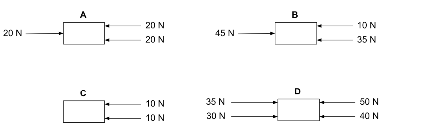
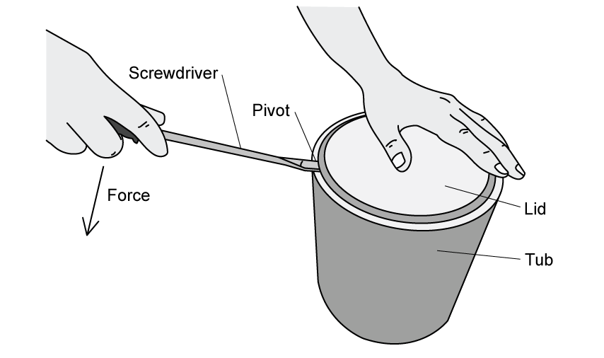
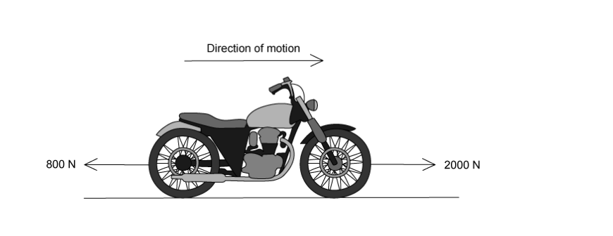
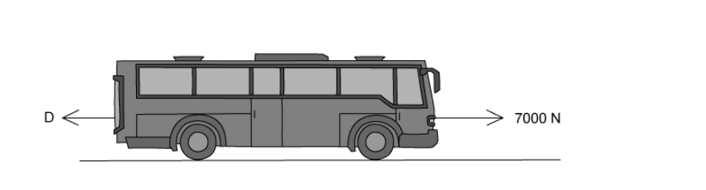
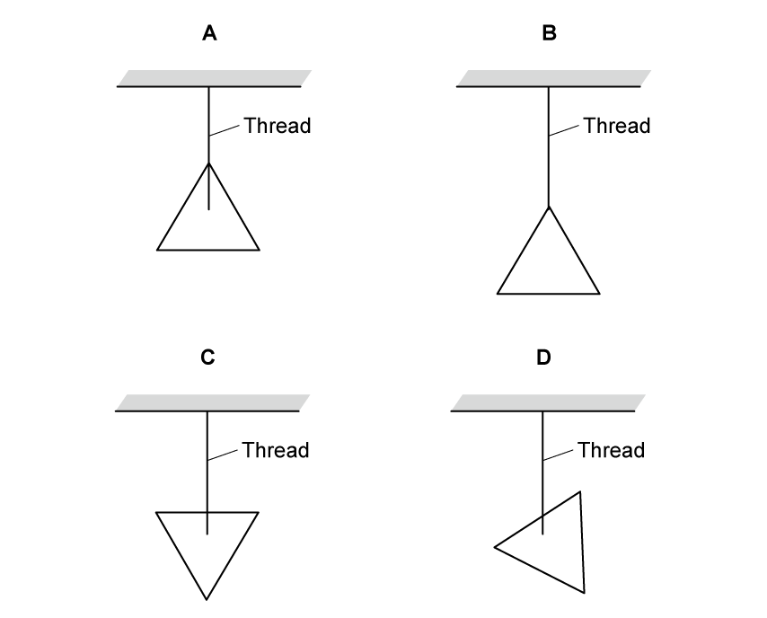
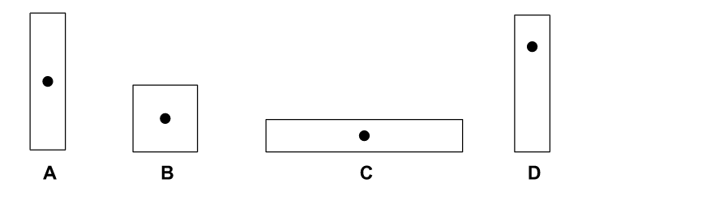
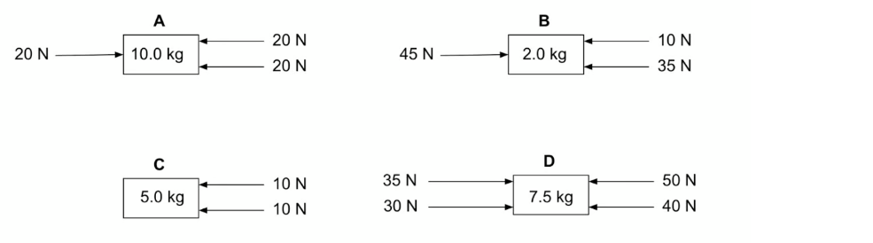
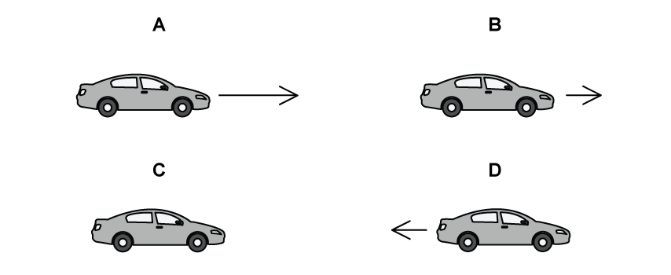

# Exam Questions — Effects of Forces
**1. Motion, Forces & Energy** · Cambridge (CIE) IGCSE science (0654 & 0973)
> Source: [https://www.savemyexams.com/igcse/science/cie/co-ordinated-sciences-double-award/23/physics/topic-questions/](https://www.savemyexams.com/igcse/science/cie/co-ordinated-sciences-double-award/23/physics/topic-questions/) · 27 questions across 1 sets

## Multiple Choice Questions (27 questions)

### Q1 — medium — 1 marks

**Q1** [1 mark]

The graph shows the load-extension graph for a spring.

What does point P represent?

### Q2 — medium — 1 marks

**Q2** [1 mark]

The diagram shows a uniform beam which is balanced on a pivot at its centre. A force $F$ is applied at a distance $x$ to the left of the pivot. A second force $2F$ is applied to the right of the pivot to keep the beam in equilibrium.

What is the distance of the second force from the pivot?

### Q3 — medium — 1 marks

**Q3** [1 mark]

An aeroplane flies horizontally at constant speed as shown.

Which statement about the resultant force on the aeroplane is correct?

### Q4 — medium — 1 marks

**Q4** [1 mark]

The diagram shows four objects, each with the same mass. Each object is acted on by the forces shown.

Which object will experience the largest acceleration to the left?

### Q5 — medium — 1 marks

**Q5** [1 mark]

An object with three forces acting on it is shown below.

What is the resultant force acting on the object?

### Q6 — easy — 1 marks

**Q6** [1 mark]

A woman is using a screwdriver to prise the lid off a cylindrical tub of paint.

Which row states how she would increase the moment applied by the greatest amount?

|   | Type of screwdriver | Force applied |
|---|---|---|
| **A** | Wider | Double |
| **B** | Wider | Half |
| **C** | Longer | Double |
| **D** | Longer | Half |

### Q7 — medium — 1 marks

**Q7** [1 mark]

**Extended tier only**

The diagrams each show a beam resting on a pivot and being acted on by some forces. The beam is not attached to the pivot. The pivot is in the centre of the rod in each case.

Which of the beams is in equilibrium?

### Q8 — medium — 1 marks

**Q8** [1 mark]

**Extended tier only**

Two students were discussing Newton's first law of motion.

Which statement correctly summarises this law?

### Q9 — medium — 1 marks

**Q9** [1 mark]

**Extended tier only**

A ‘yardarm’ is a stick, hung from a string, that is used to weigh goods. Goods are placed in the pan on the left, and weights are added to the box on the right side until it balances.

The weight of the pan and the box are such that the weight of the yardarm itself is entirely balanced by the pan.

The yardarm is 65 cm long.

How many 0.5 N weights need to be added to the box in order to balance the yardarm?

### Q10 — hard — 1 marks

**Q10** [1 mark]

A cardboard rectangle is hung from a nail as shown in the diagram.

A plumb line is also hung from the nail.

Which of the points labelled shows the centre of gravity of the cardboard rectangle?

### Q11 — medium — 1 marks

**Q11** [1 mark]

A motorbike travels at a constant speed along a flat road. Three horizontal forces act on the motorbike. Two of them are shown in the diagram below.

What is the size and direction of the third force?

### Q12 — hard — 1 marks

**Q12** [1 mark]

**Extended tier only**

A bus drives along a flat road. Its engine produces a forward driving force of 7000 N. Drag forces, *D* also act on the bus.

The bus has an acceleration of 1.2 m/s2 and a mass of 2500 kg.

What is the value of D?

### Q13 — medium — 1 marks

**Q13** [1 mark]

**Extended tier only**

A corkscrew is used to open a bottle of wine.

Two forces are applied at each of the positions shown below.

Which pair of forces produces the greatest turning force?

### Q14 — easy — 1 marks

**Q14** [1 mark]

A triangle with uniform density is suspended from a thread. Which diagram shows a system which is **not** in equilibrium?

### Q15 — easy — 1 marks

**Q15** [1 mark]

Four cuboids are shown in the diagram below. The position of their centre of gravity is also shown.

Which of the cuboids is the most stable?

### Q16 — easy — 1 marks

**Q16** [1 mark]

**Extended tier only**

In which of the following situations would no resultant force be required?

### Q17 — hard — 1 marks

**Q17** [1 mark]

**Extended tier only**

The diagram shows four objects, each with a different mass. Each object is acted on by the forces shown.

Which object will experience the largest magnitude of acceleration?

### Q18 — medium — 1 marks

**Q18** [1 mark]

A plank rests on two supports, as shown in the diagram. The plank is in equilibrium. Three forces act on the plank.

Which statement is true?

### Q19 — medium — 1 marks

**Q19** [1 mark]

**Extended tier only**

A car slows down as it approaches a traffic light. The car was traveling at 13.5 m/s and it takes 22 s to come to a stop.

The mass of the car is 950 kg.

Calculate the force required to stop the car.

### Q20 — medium — 1 marks

**Q20** [1 mark]

Why are passengers not allowed to stand up on the top deck of a double decker bus?

### Q21 — easy — 1 marks

**Q21** [1 mark]

Four objects are shown below. Each is acted on by two forces.

Which of the objects is in equilibrium?

### Q22 — hard — 1 marks

**Q22** [1 mark]

**Extended tier only**

A uniform beam is pivoted at one end and suspended by a 200 N force as shown in the diagram.

The beam is in equilibrium.

What is the weight of the beam?

### Q23 — hard — 1 marks

**Q23** [1 mark]

**Extended tier only**

A car is driving on a motorway at a constant speed of 70 miles per hour.

The driver notices a queue of traffic up ahead and begins to slow down.

Which diagram best describes the resultant force acting on the car as it slows down?

### Q24 — medium — 1 marks

**Q24** [1 mark]

A wardrobe is shown tilted at a variety of angles.

In which position is the wardrobe in equilibrium?

### Q25 — hard — 1 marks

**Q25** [1 mark]

**Extended tier only**

The graph below shows the journey of a truck along a straight, flat road.

During which part of the journey is the resultant force on the truck equal to zero?

### Q26 — easy — 1 marks

**Q26** [1 mark]

A car starts from rest and rapidly increases speed.

There is a forward acting force on the car from the engine, and a backward acting force on the car from air resistance and friction.

Choose the force diagram and description that best describes the magnitude of the opposing forces.

### Q27 — medium — 1 marks

**Q27** [1 mark]

**Extended tier only**

The diagrams below show three beams, each is pivoted at the centre. Each beam also has two forces acting on it, as shown.

Which of the beams will rotate clockwise?
