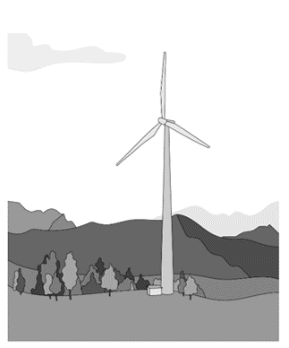
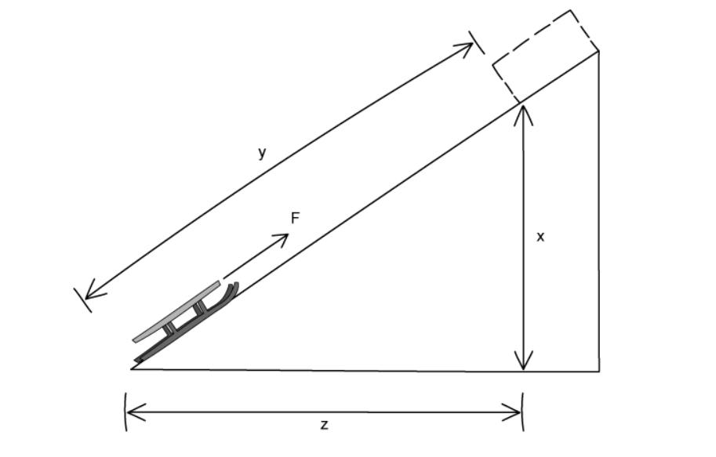

# Exam Questions — Energy, Work & Power
**1. Motion, Forces & Energy** · Cambridge (CIE) IGCSE science (0654 & 0973)
> Source: [https://www.savemyexams.com/igcse/science/cie/co-ordinated-sciences-double-award/23/physics/topic-questions/](https://www.savemyexams.com/igcse/science/cie/co-ordinated-sciences-double-award/23/physics/topic-questions/) · 33 questions across 1 sets

## Multiple Choice Questions (33 questions)

### Q1 — medium — 1 marks

**Q1** [1 mark]

A ball is dropped from a height above the ground.

Which transfer between energy stores takes place as the ball falls towards the ground?

### Q2 — medium — 1 marks

**Q2** [1 mark]

A fork lift truck lifts a heavy box onto a shelf.

Which action requires the greatest power output from the fork lift truck.

### Q3 — hard — 1 marks

**Q3** [1 mark]

The diagram below shows how a solar cell produces electricity using energy from the sun.

Energy is transferred by radiation to the silicon layer of the solar cell causing charges to move. This movement of charges produces a current.

The efficiency of a solar cell is far below 100%.

Which of the following statements does **not **account for wasted energy?

### Q4 — medium — 1 marks

**Q4** [1 mark]

Listed below are some energy resources.

**W**   wind powering a turbine

**X**   water falling through a hydroelectric turbine

**Y**   alcohol made from crops which have been grown for burning in a biomass generator

**Z**   uranium for nuclear fission reactors

Which of the resources are renewable?

### Q5 — hard — 1 marks

**Q5** [1 mark]

**Extended tier only**

A large truck of mass 5000 kg is travelling at 5.0 m/s. A motorbike has a mass of 200 kg. Both the truck and the motorbike have the same kinetic energy.

What is the speed of the motorbike?

### Q6 — easy — 1 marks

**Q6** [1 mark]

Which of the following statements is **not** a summary of the law of conservation of energy?

### Q7 — easy — 1 marks

**Q7** [1 mark]

**Extended tier only**

Which energy source relies on radiation from the Sun?

### Q8 — medium — 1 marks

**Q8** [1 mark]

The law of conservation of energy states that energy cannot be created or destroyed, it can only be transferred from one store to another.

Which of the following statements is true?

### Q9 — medium — 1 marks

**Q9** [1 mark]

What feature do geothermal, hydroelectric and nuclear energy sources share?

### Q10 — medium — 1 marks

**Q10** [1 mark]

Four different electric bicycles are driven along a road.

The work done by their motor, and the time taken to do that work is shown in the table below.

Which of the electric bicycles produces the most power?

|   | **Work done / J** | **Time taken / s** |
|---|---|---|
| **A** | 10 000 | 20 |
| **B** | 20 000 | 40 |
| **C** | 400 000 | 400 |
| **D** | 2000 | 1 |

### Q11 — hard — 1 marks

**Q11** [1 mark]

Which of the following energy sources cause damage to natural habitats?

### Q12 — medium — 1 marks

**Q12** [1 mark]

Which of the following energy transfers is most efficient?

### Q13 — medium — 1 marks

**Q13** [1 mark]

Which statement about nuclear fuel is correct?

### Q14 — medium — 1 marks

**Q14** [1 mark]

The image below shows a simplified layout of a non-condensing gas boiler that is typically used to heat houses in the United Kingdom.

Which option correctly describes the energy transfers taking place in the boiler?

### Q15 — hard — 1 marks

**Q15** [1 mark]

**Extended tier only**

A penny is held at the top of Blackpool tower. The penny is released and falls a distance *h* to the ground. It reaches a speed *v* as it falls.

As the penny falls, air resistance causes some of the original energy of the penny to be transferred into the air as heat.

Which of the expressions below gives the work done against air resistance?

### Q16 — medium — 1 marks

**Q16** [1 mark]

Which statement best describes the differences between solar cells and solar panels?

### Q17 — hard — 1 marks

**Q17** [1 mark]

When plants are grown they take in carbon dioxide from the atmosphere during photosynthesis, but when biofuel is burned it releases carbon dioxide back into the atmosphere.

A company manufacturing biofuels claim that they are carbon neutral.

Why is this claim considered to be controversial?

### Q18 — easy — 1 marks

**Q18** [1 mark]

Identify the **incorrect** definition of power.

### Q19 — hard — 1 marks

**Q19** [1 mark]

**Extended tier only**

The diagram shows an LED light bulb.

Which expression gives the efficiency of the bulb?

### Q20 — medium — 1 marks

**Q20** [1 mark]

Which statement best describes nuclear fuel as an energy source?

### Q21 — easy — 1 marks

**Q21** [1 mark]

Which disadvantage does not apply to geothermal energy?

### Q22 — easy — 1 marks

**Q22** [1 mark]

**Extended tier only**

Which energy resource involves splitting heavy nuclei?

### Q23 — hard — 1 marks

**Q23** [1 mark]

It is possible to reduce the harmful effects of burning fossil fuels on the environment without reducing the amount of fossil fuels burned.

Which of the following suggestions would **not** reduce the harmful effects of burning fossil fuels?

### Q24 — easy — 1 marks

**Q24** [1 mark]

Which energy resource does not release greenhouse gases?

### Q25 — hard — 1 marks

**Q25** [1 mark]

**Extended tier only**

The diagram below shows a wind turbine.

What is the change in the kinetic energy if the wind speed is reduced by half?

### Q26 — hard — 1 marks

**Q26** [1 mark]

A crane lifts four pallets of bricks, each of which weigh 5000 N. The crane lifts each pallet a height of 30m. The crane takes 4 minutes to do this.

How much useful power did the crane produce to lift the bricks?

### Q27 — medium — 1 marks

**Q27** [1 mark]

A sledge is pushed up a hill with a force, F.

The work done on the sledge depends on the force applied and on a distance moved.

Which distance?

### Q28 — easy — 1 marks

**Q28** [1 mark]

Which energy transfer takes place when a log burns in a fire?

### Q29 — hard — 1 marks

**Q29** [1 mark]

Which of the following energy sources produce no atmospheric pollution?

### Q30 — easy — 1 marks

**Q30** [1 mark]

Identify the correct energy transfer taking place when an electric kettle is boiling water

### Q31 — easy — 1 marks

**Q31** [1 mark]

**Extended tier only**

Which energy resource does not use the Sun as the source of its energy?

### Q32 — easy — 1 marks

**Q32** [1 mark]

Which row correctly matches an energy store with an example of that store?

| ** ** | **Energy Store** | **Example** |
|---|---|---|
| **A.** | kinetic | a car moving at 70 km / h |
| **B.** | elastic | a box sitting high on a shelf |
| **C.** | magnetic | compression of springs in a car's suspension |
| **D.** | chemical | the nuclei of uranium atoms |

### Q33 — medium — 1 marks

**Q33** [1 mark]

A trolley is pushed with a force that causes it to move a certain distance. It moves in the direction it is pushed.

Which row in the table represents the combination of force and distance that means the smallest amount of work is done on the trolley?

|   | **Force / N** | **Distance moved / m** |
|---|---|---|
| **A** | 20 | 20 |
| **B** | 40 | 10 |
| **C** | 50 | 6.0 |
| **D** | 70 | 4.0 |
