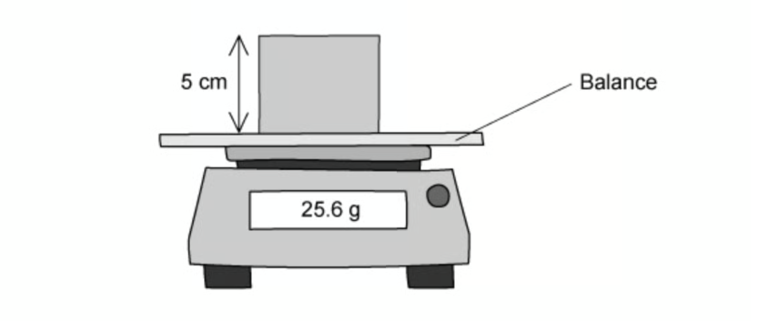
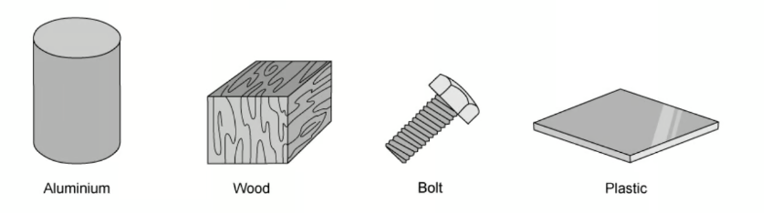

# Exam Questions — Mass, Weight & Density
**1. Motion, Forces & Energy** · Cambridge (CIE) IGCSE science (0654 & 0973)
> Source: [https://www.savemyexams.com/igcse/science/cie/co-ordinated-sciences-double-award/23/physics/topic-questions/](https://www.savemyexams.com/igcse/science/cie/co-ordinated-sciences-double-award/23/physics/topic-questions/) · 28 questions across 1 sets

## Multiple Choice Questions (28 questions)

### Q1 — medium — 1 marks

**Q1** [1 mark]

The table shows the mass and the volume of two objects, P and Q. The objects are placed in a tank of water which has a density of $1.0\text{g/cm}^{3}$.

| object | mass / g | volume / cm3 |
|---|---|---|
| P | 15 | 5 |
| Q | 15 | 20 |

Which statement is correct?

### Q2 — medium — 1 marks

**Q2** [1 mark]

The density of a block of wood is 2.7 g/cm3 and a mass of 583.8 g.

What is its volume?

### Q3 — medium — 1 marks

**Q3** [1 mark]

The two diagrams below show a measuring cylinder.

In the diagram on the left, the measuring cylinder is empty. In the diagram on the right, the measuring cylinder contains a liquid.

What is the density of the liquid?

### Q4 — easy — 1 marks

**Q4** [1 mark]

Which row in the table gives the correct units for mass and for weight?

|   | **Mass** | **Weight** |
|---|---|---|
| **A** | kg | kg |
| **B** | N | kg |
| **C** | N | N |
| **D** | kg | N |

### Q5 — medium — 1 marks

**Q5** [1 mark]

Which piece of equipment is used to measure the mass of an object?

### Q6 — hard — 1 marks

**Q6** [1 mark]

A teacher has a hot cup of tea.

Some of the liquid in the cup evaporates.

Choose the line from the table below that correctly describes what happens to the mass and the weight of the tea in the cup.

|   | **Mass** | **Weight** |
|---|---|---|
| **A** | increases | decreases |
| **B** | increases | increases |
| **C** | decreases | decreases |
| **D** | decreases | increases |

### Q7 — medium — 1 marks

**Q7** [1 mark]

Some unknown liquid in a beaker has a mass of 200 g and a volume of 230 cm3.

The density of water is 1.0 g/cm3

How does the density of the unknown liquid compare with the density of water?

### Q8 — hard — 1 marks

**Q8** [1 mark]

Four blocks, **W**,** X** , **Y** and **Z** are shown below.

Which of the two blocks have the same density?

### Q9 — medium — 1 marks

**Q9** [1 mark]

A student wants to measure the density of a piece of rock. She starts by measuring its mass ,  and finds that it is 2500 g.

Next she puts 500 cm3 of water into a large measuring cylinder , then adds the rock. The level in the measuring cylinder rises to 800 cm3.

What is the density of the rock?

### Q10 — easy — 1 marks

**Q10** [1 mark]

Which of the quantities below is weight an example of?

### Q11 — hard — 1 marks

**Q11** [1 mark]

A cheesemonger uses a newton meter to measure the weight of a block of cheese.

The cheese has a weight of 5.0 N

What is the approximate mass of the cheese?

### Q12 — easy — 1 marks

**Q12** [1 mark]

How is the weight of an object defined?

### Q13 — medium — 1 marks

**Q13** [1 mark]

A cube of side length 5 cm is placed on a mass balance.

What is the density of the cube?

### Q14 — easy — 1 marks

**Q14** [1 mark]

Which of the following quantities is measured in kilograms?

### Q15 — medium — 1 marks

**Q15** [1 mark]

A lump of butter has a volume of 350 cm3 and a mass of 319 g.

What is the density of the butter?

### Q16 — hard — 1 marks

**Q16** [1 mark]

The diagram shows a ball of bread dough, before and after it has been compressed (had the air knocked out of it).

What happens to the mass and the weight of the dough when it is compressed?

|   | **Mass** | **Weight** |
|---|---|---|
| **A** | stays the same | decreases |
| **B** | stays the same | stays the same |
| **C** | decreases | decreases |
| **D** | decreases | stays the same |

### Q17 — hard — 1 marks

**Q17** [1 mark]

A block of an unknown material is shown in the diagram.

It's mass is 500 g.

What is the density of the block?

### Q18 — hard — 1 marks

**Q18** [1 mark]

The masses and volumes of four different objects are given in the table.

Which of the objects has the lowest density?

|   | **Mass / g** | ** Volume / cm****3** |
|---|---|---|
| **A** | 100 | 100 |
| **B** | 150 | 50 |
| **C** | 85 | 17 |
| **D** | 10 | 20 |

### Q19 — hard — 1 marks

**Q19** [1 mark]

A dummy, named Starman, dressed in a white racing suit, was launched into space by Elon Musk’s first Falcon Heavy rocket. Starman was sent on a journey towards Mars.

Compared with being on the Earth’s surface, how do Starman’s mass and weight change when he is on his journey to Mars?

|   | **Mass** | **Weight** |
|---|---|---|
| **A** | stays the same | decreases |
| **B** | stays the same | stays the same |
| **C** | decreases | decreases |
| **D** | decreases | stays the same |

### Q20 — medium — 1 marks

**Q20** [1 mark]

Two beams have the same rectangular cross section, but one is longer than the other.

Both beams are made from the same material.

Which quantity is the same in both beams?

### Q21 — hard — 1 marks

**Q21** [1 mark]

A teacher wants to measure the density of a wooden cylinder.

She measures the radius, height and mass of the cylinder.

Which of the measurements that she has taken are required to calculate the density of the cylinder?

### Q22 — medium — 1 marks

**Q22** [1 mark]

An astronaut has a mass of 80 kg on the Earth.

The gravitational field strength on the Moon is 1.6 N/kg.

What is the weight of the astronaut on the Moon?

### Q23 — easy — 1 marks

**Q23** [1 mark]

Which of the following statements about mass or weight is true?

### Q24 — hard — 1 marks

**Q24** [1 mark]

A block is shown in the diagram. It has a mass of* m*.

Which expression, below, could be used to calculate the density of the block?

### Q25 — easy — 1 marks

**Q25** [1 mark]

A student is given four objects, a mass balance and a metre ruler.

Which of the objects can he determine the density of , using only the metre ruler and the mass balance?

### Q26 — medium — 1 marks

**Q26** [1 mark]

The diagram shows a measuring cylinder containing a liquid , and that same measuring cylinder when it is empty.

What is the density of the liquid?

### Q27 — medium — 1 marks

**Q27** [1 mark]

A geologist wants to determine the density of the object shown below.

What needs to be known in order to calculate its density ?

### Q28 — hard — 1 marks

**Q28** [1 mark]

An astronaut buys a 5.0 kg tin of Quality Street chocolates on Earth.

She takes that 5.0 kg tin of Quality Street chocolate to the Moon.

What is the mass of the tin of Quality Street chocolate on the Moon?
