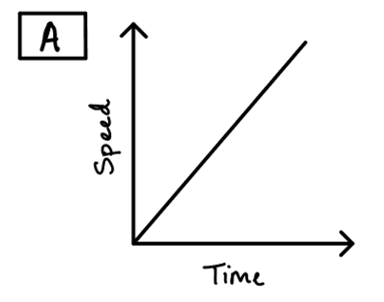
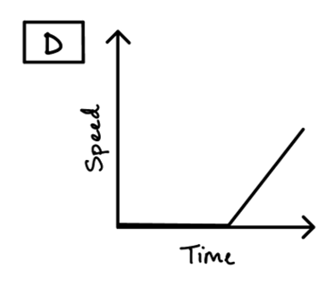
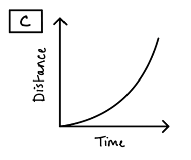
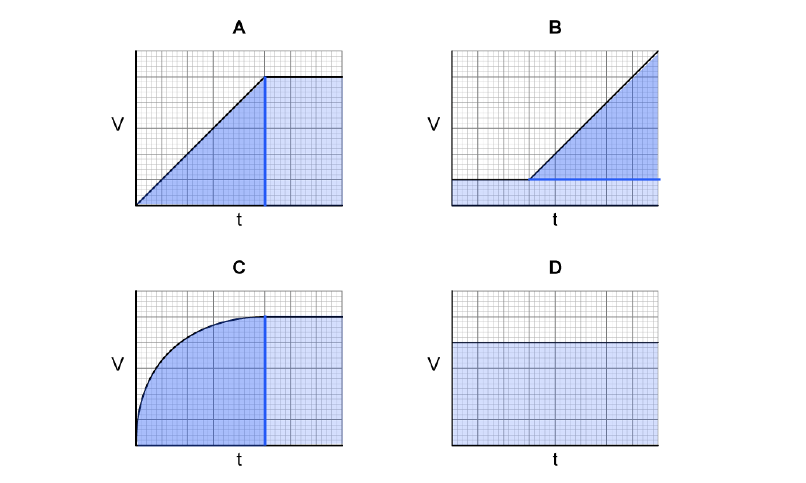

# Mark Schemes — Motion
**1. Motion, Forces & Energy** · Cambridge (CIE) IGCSE science (0654 & 0973)

## Multiple Choice Questions (14 questions)

### Q1
**Final answer:** **The correct answer is C**

- On a speed–time graph, the distance travelled is equal to the area under the graph
- Constant speed is represented by the horizontal section of the graph, which occurs between $10\text{s}$ and $25\text{s}$
- The time interval for this section is calculated by subtracting the start time from the end time: $25-10=15\text{s}$
- The distance travelled by the car between $10\text{s}$ and $25\text{s}$ is:

$\mathrm{distance}=\mathrm{speed}\times\mathrm{time}=\mathrm{area} \mathrm{under} \mathrm{graph}$

$\mathrm{distance}=10\times15=150m$

**A **is incorrect as this is the area between $0\text{s}$ and $10\text{s}$ `open parentheses 1 half cross times 10 cross times 10 space equals space 50 space straight m close parentheses`

**B** is incorrect as it uses the formula for the area of a triangle instead of a rectangle `open parentheses 1 half cross times 10 cross times 15 space equals space 75 space straight m close parentheses`

**D** is incorrect as it uses the total time of $25\text{s}$ instead of the interval where speed was constant `open parentheses 50 space plus thin space 150 space equals space 200 space straight m close parentheses`

### Q2
**Final answer:** **The correct answer is C**

- On a speed–time graph, the distance travelled is equal to the area under the graph
- Constant speed is represented by the horizontal section of the graph, which occurs between $10\text{s}$ and $25\text{s}$
- The time interval for this section is calculated by subtracting the start time from the end time: $25-10=15\text{s}$
- The distance travelled by the car between $10\text{s}$ and $25\text{s}$ is:

$\mathrm{distance}=\mathrm{speed}\times\mathrm{time}=\mathrm{area} \mathrm{under} \mathrm{graph}$

$\mathrm{distance}=10\times15=150m$

**A **is incorrect as this is the area between $0\text{s}$ and $10\text{s}$ `open parentheses 1 half cross times 10 cross times 10 space equals space 50 space straight m close parentheses`

**B** is incorrect as it uses the formula for the area of a triangle instead of a rectangle `open parentheses 1 half cross times 10 cross times 15 space equals space 75 space straight m close parentheses`

**D** is incorrect as it uses the total time of $25\text{s}$ instead of the interval where speed was constant `open parentheses 50 space plus thin space 150 space equals space 200 space straight m close parentheses`

### Q3
**Final answer:** **The correct answer is ****C**** because:**

- Constant speed means that the speed is not changing
- Therefore, constant speed on a speed-time graph is a horizontal line
- Graph **C **is the only graph showing constant speed

| **A** is incorrect as |   the speed is increasing over time, therefore the object is getting faster or **accelerating** |
|---|---|
| **B** is incorrect as |   the speed is decreasing over time, therefore the object is slowing   down or **decelerating** |
| **D** is incorrect as |   the **speed is zero** for the first part of the graph which means the object is **not moving. **We can say the object is **at rest.** Then the object's speed begins to **increase** over time, so the object is **accelerating** in the second part of the graph |

### Q4
**Final answer:** ** The correct answer ****B**** is because:**

- On a distance-time graph, constant speed is shown by a non-horizontal straight line
- This shows that the distance travelled per unit time is increasing at a steady rate
- Therefore, the only correct graph is graph **B**

| **A** is incorrect as |   A horizontal line shows that distance is not changing over time, therefore the object is **stationary** |
|---|---|
| **C** is incorrect as |   An upward curved line shows that the distance travelled over time is increasing. The object is speeding up or **accelerating** |
| **D** is incorrect as |   A curve like this shows that the distance travelled over time is decreasing. The object is slowing down or **decelerating** |

### Q5
**Final answer:** **The correct answer is ****C**** because:**

- Distance = speed x time taken
- The total distance travelled by the sound to the cliff and back again will be twice the distance the man is away from the cliff. Therefore, we must divide our answer by 2.
- Distance = $\frac{343\times0.84}{2}$ =  144 m

**A **is incorrect as speed has been, incorrectly, divided by time, and the factor of 2 not accounted for.

**B **is incorrect as speed has, correctly, been multiplied by time, but the factor of 2 has not been accounted for.

**D **is incorrect as speed has been, incorrectly, divided by time, though the factor of 2 has been accounted for.

### Q6
**Final answer:** **The correct answer is ****D**** because:**

- On a speed-time graph, distance is represented by the **area under the graph**
- Section **D** has the largest area underneath the line, therefore the greatest distance is covered here

- There are **4.5** large squares under part **A** of the line
- There are **12** large squares under part **B** of the line
- There are **4** large squares under part **C** of the line
- There are **14** large squares under part **D** of the line

  - When finding the area under a sloped line, split the area into a rectangle and a triangle
  - Then use the **½ × base × height** formula for the triangular area and **base × height** for the rectangular area

### Q7
**Final answer:** **The correct answer is ****A ****because:**

- The motorbike is moving at a constant speed when the gradient of the line is 0 (the line is horizontal).
- This happens between t = 20 and t = 30 seconds.
- The distance travelled by an object is given by the area under a speed-time graph.

This is the area you’re looking for:

Distance = (30 - 20) x 15 = 150 m

**B **is incorrect as the distance has not been correctly calculated.

**C** is incorrect as this would be the distance if the time was calculated at 20 s.

**D** is incorrect as this would be the distance if the time was calculated at 50 s

### Q8
**Final answer:** **The correct answer is ****D**** because:    **

- average speed* *= $\frac{\mathrm{total} \mathrm{distance}}{\mathrm{total} \mathrm{time}}=\frac{10.0+3.0}{6.0+3.0}$

**A** is incorrect as this is only the average speed of the roadworks part of the journey.

**B** is incorrect as this is the average speed of the motorway part of the journey.

**C **is incorrect as this is the sum of the two average speeds, it will not give the correct average speed.

### Q9
**Final answer:** **The correct answer is ****C**** because:**

- The acceleration is given by the gradient of a speed-time graph

  - This gradient is found by taking a tangent to the curve

- At time = 20 s, the tangent (and therefore the gradient) is exactly horizontal: gradient equals zero
- Therefore, at time = 20 s, acceleration = zero

**A **is incorrect as this is the gradient just before 20 s

**B** is incorrect as this is the gradient just after 20 s.

**D **is incorrect as this is a reading of the speed of the cyclist at 20 s, not the acceleration.

### Q10
**Final answer:** **The correct answer is**** B**** because:**

- average speed = $\frac{totaldistancetravelled}{timetaken}$
- The Go Kart does 8 laps of the 300 m course, so the total distance is 300 x 8.
- average speed = $\frac{300\times8}{4.0\times60}$ = 10 m/s

Remember to convert the time in minutes into seconds!

**A** is incorrect as the distance of 1 lap has been divided by the time in minutes.

**C** is incorrect as the distance of just 1 lap has been divided by the correct time.

**D** is incorrect as the distance of the whole race has been divided by the time in minutes. 600 m/s is faster than even the fastest rifle bullet, so this answer ought to ring alarm bells.

### Q11
**Final answer:** **The correct answer is ****C**** because:**

- The area under a speed-time graph represents distance
- Consider graph **A**:

  - Split the area into a triangle and a rectangle
  - Area = (½ × 5 × 5) + (3 × 5) = 27.5
- Consider graph **B**:

  - Split the area into a rectangle and triangle
  - Area = (8 × 1) + (½ × 5 × 5) = 20.5
- Consider graph **C**:

  - Split the area into approximately one quarter of a circle and a rectangle
  - Area ≈ (¼ × π × 52) + (3 × 5) = 34.6
- Consider graph **D**:

  - Area = (8 × 4) = 32
- The largest area is under graph **C**

- With more complicated graph shapes, a good tactic is to **split** the area under a curve into recognisable shapes - **triangles**, **rectangles** and even sections of **circles**

### Q12
**Final answer:** **The correct answer is ****D**** because:**

- average speed = $\frac{totaldistancetravelled}{timeintheair}$ = $\frac{100+50+30+70}{4.0-0.5}=71.4\mathrm{km}/h$

**A **is incorrect as the 30 minute stop has been added to the total time.

**B **is incorrect as this the total distance travelled.

**C** is incorrect as the time spent on the ground has not been accounted for.

### Q13
**Final answer:** **The correct answer is ****A ****because:**

- The distance travelled by an object is given by the **area **under a speed-time graph
- This is because distance = speed × time
- The area in question is a triangle. The area of a triangle is calculated using ½ × base × height
- Distance = area of triangle =  ½ × 6.5 × 8.0 = 26 m
- Therefore equation **A** is correct

**B, C and D **are incorrect as these equations have been incorrectly set up.

### Q14
**Final answer:** **The correct answer is ****C**** because:**

- Speed is calculated using

  - $v=\frac{s}{t}$
- $v=\frac{s}{t}=\frac{30}{2.5}=12$

  - This eliminates options **A** and **B**
- Distance is given in **metres** and time is given in **seconds**, so units are metres per second (m/s)

  - Therefore, the answer is **C**
