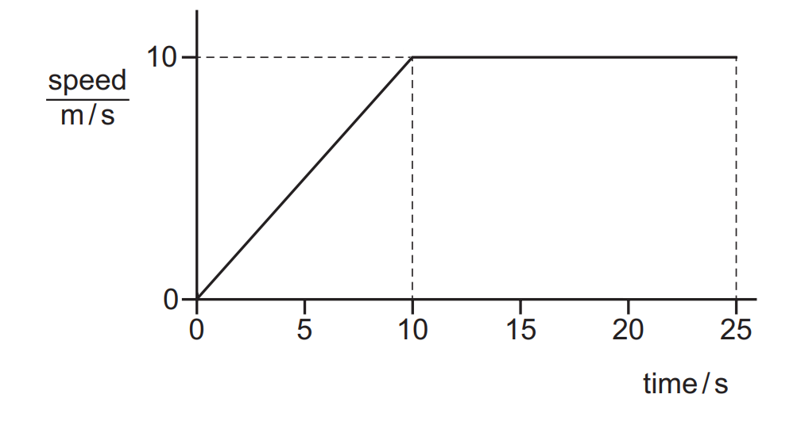
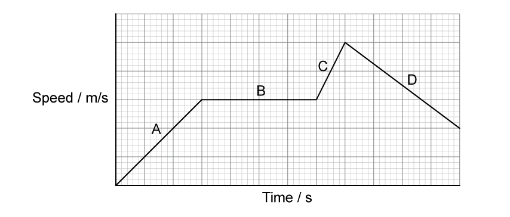
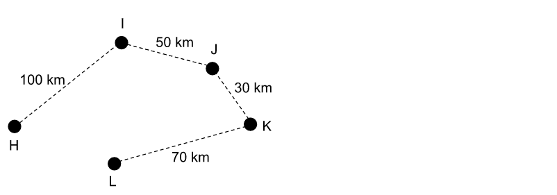
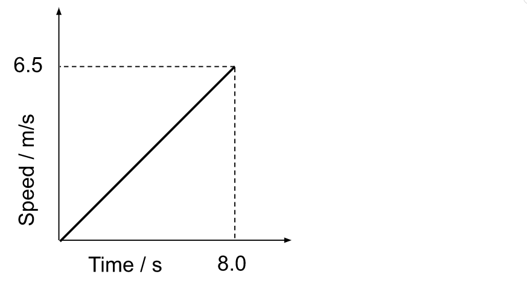

# Exam Questions — Motion
**1. Motion, Forces & Energy** · Cambridge (CIE) IGCSE science (0654 & 0973)
> Source: [https://www.savemyexams.com/igcse/science/cie/co-ordinated-sciences-double-award/23/physics/topic-questions/](https://www.savemyexams.com/igcse/science/cie/co-ordinated-sciences-double-award/23/physics/topic-questions/) · 14 questions across 1 sets

## Multiple Choice Questions (14 questions)

### Q1 — medium — 1 marks

**Q1** [1 mark]

The diagram shows a speed–time graph for a car travelling along a straight road.

What is the distance travelled by the car while it is moving at constant speed?

### Q2 — medium — 1 marks

**Q2** [1 mark]

The diagram shows a speed–time graph for a car travelling along a straight road.

What is the distance travelled by the car while it is moving at constant speed?

### Q3 — easy — 1 marks

**Q3** [1 mark]

Which speed-time graph shows an object moving with a constant speed?

### Q4 — easy — 1 marks

**Q4** [1 mark]

Which distance-time graph shows an object moving with constant speed?

### Q5 — hard — 1 marks

**Q5** [1 mark]

A man claps in a forest. There is nobody around to hear the sound.

However, there is a very flat cliff face some distance away, and the man hears an echo from the clap 0.84 s later.

The speed of sound in air is 343 m/s.

How far away was the man from the cliff?

### Q6 — easy — 1 marks

**Q6** [1 mark]

In which section of the graph is the most distance covered?

### Q7 — hard — 1 marks

**Q7** [1 mark]

The graph shows the motion of a motorbike.

What is the distance travelled by the motorbike while it is moving at a constant speed?

### Q8 — medium — 1 marks

**Q8** [1 mark]

A car travels along a clear 10.0 km section of motorway in 6.0 minutes. It then drives through 3.0 km of roadworks in 3.0 minutes.

Which calculation will give the correct average speed for the journey?

### Q9 — hard — 1 marks

**Q9** [1 mark]

**Extended tier only**

The graph shows the speed-time graph of a cyclist moving in a straight line.

What is the acceleration of the cyclist at a time of 20 seconds?

### Q10 — medium — 1 marks

**Q10** [1 mark]

During a Go Karting race, a car does 8 laps of a 300 m course. It takes 4.0 minutes to complete the race.

What was the average speed of the Go Kart?

### Q11 — medium — 1 marks

**Q11** [1 mark]

Four speed-time graphs have axes with the same scales. Each large square has a height of 1 m/s and width of 1 s.

Which graph shows the greatest distance covered?

### Q12 — hard — 1 marks

**Q12** [1 mark]

A helicopter flies the route shown below.

It stops at point I for 30 minutes to pick up some cargo.

The total time the helicopter takes between taking off from **H** and landing at **L** is 4.0 hours.

Calculate the average speed of the helicopter **when it is flying.**

### Q13 — medium — 1 marks

**Q13** [1 mark]

The graph shows the journey undertaken by a car.

Which equation correctly gives the distance travelled by the car?

### Q14 — easy — 1 marks

**Q14** [1 mark]

What is the speed of a bowling ball which travels down a 30 m lane in 2.5 seconds?
