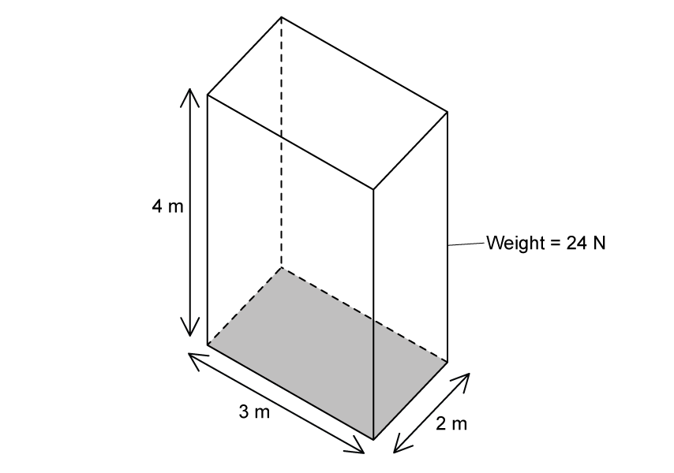

# Exam Questions — Pressure
**1. Motion, Forces & Energy** · Cambridge (CIE) IGCSE science (0654 & 0973)
> Source: [https://www.savemyexams.com/igcse/science/cie/co-ordinated-sciences-double-award/23/physics/topic-questions/](https://www.savemyexams.com/igcse/science/cie/co-ordinated-sciences-double-award/23/physics/topic-questions/) · 9 questions across 1 sets

## Multiple Choice Questions (9 questions)

### Q1 — easy — 1 marks

**Q1** [1 mark]

Which is an example of a force acting over a small area to produce a large pressure?

### Q2 — easy — 1 marks

**Q2** [1 mark]

A woman is in contact with the floor.

In which of these poses does she produce the most pressure on the floor?

Assume she is wearing flat shoes in each pose.

### Q3 — medium — 1 marks

**Q3** [1 mark]

A wooden block rests on a table.

On which surface should the block be laid to produce the largest pressure on the table?

### Q4 — hard — 1 marks

**Q4** [1 mark]

The table gives four combinations of the force applied to a surface and the area over which it acts.

Which row gives the smallest pressure exerted on the surface?

|   | **Force / N** | **Area / m****2** |
|---|---|---|
| **A** | 40 | 0.5 |
| **B** | 40 | 2.0 |
| **C** | 80 | 0.5 |
| **D** | 80 | 2.0 |

### Q5 — medium — 1 marks

**Q5** [1 mark]

What pressure does the object in the diagram below exert on the ground beneath it?

### Q6 — hard — 1 marks

**Q6** [1 mark]

The ornament in Fig. 1 is designed to balance in either of the positions shown.

Calculate the difference in the pressure on the ground when the ornament's position is changed.

### Q7 — medium — 1 marks

**Q7** [1 mark]

A briefcase, with flat, rectangular sides rests on the floor as shown in the diagram.

The briefcase is now turned so that it rests with its large, flat side on the floor.

How has the change affected the force on the floor, and the pressure exerted by the briefcase on the floor?

|   | **Force** | **Pressure** |
|---|---|---|
| **A** | unchanged | decreased |
| **B** | unchanged | unchanged |
| **C** | decreased | decreased |
| **D** | decreased | unchanged |

### Q8 — easy — 1 marks

**Q8** [1 mark]

A water-filled tank is resting on a table as shown in Fig. 1

Using the measurements in the diagram, determine the area which should be used to calculate the pressure the tank exerts on the table.

### Q9 — hard — 1 marks

**Q9** [1 mark]

A person walking through snow sinks into it.

The person makes a change so that they do not sink as far next time they go out.

What do they do?
