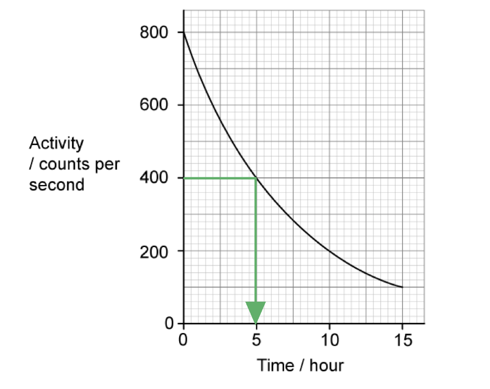

# Mark Schemes — Radioactivity
**5. Nuclear Physics** · Cambridge (CIE) IGCSE science (0654 & 0973)

## Multiple Choice Questions (15 questions)

### Q1
**Final answer:** **The correct answer is A**

- Radium-226 (`Rn presubscript 88 presuperscript 226`) has a nucleon number of 226 and a proton number of 88
- In alpha decay, the nucleus emits an alpha particle (`alpha presubscript 2 presuperscript 4`), which consists of 2 protons and 2 neutrons (a helium-4 nucleus)
- The nucleon number decreases by 4:

$226 - 4 = 222$

- The proton number decreases by 2:

$88 - 2 = 86$

- The new nucleus is radon-222 with nucleon number 222 and proton number 86p

### Q2
**Final answer:** **The correct answer is B**

- Background radiation comes from both natural and man-made sources
- Natural sources include

  - cosmic rays
  - radon gas
  - radioactive elements found naturally in rocks, buildings, and even food and drink
- Man-made sources include medical procedures (like X-rays) and nuclear power generation

**A** is incorrect as medical X-rays are a man-made source of radiation

**C** is incorrect as nuclear power stations are a man-made source of radiation

**D** is incorrect as mobile phones do not emit ionising nuclear radiation and are not a source of background radiation

> **[exam-tip]**
> Remember that background radiation has both natural and man-made sources. Be careful not to confuse non-ionising radiation (e.g. from mobile phones) with ionising nuclear radiation — mobile phones are not a source of background radiation.

### Q3
**Final answer:** **The correct answer is ****A**** because:**

- Lead can block **α**, **β** and **γ** radiation
- Aluminium will only block **α** and **β** radiation.
- Copper will block some **α**, **β** and **γ** radiation, but it is not as effective as lead.

### Q4
**Final answer:** **The correct answer is ****B**** because:**

- **α-**particles are stopped by a few cm of air, and so none would pass through the aluminium.
- **γ**-rays are highly penetrating and so almost all of it would get through the aluminium. This means the sensors would not be able to detect a change.
- **β**-particles would be **partially absorbed** by the aluminium. This means that if the thickness changed, the amount of **β**-particles passing through would also change.

### Q5
**Final answer:** **The correct answer is ****A**** because:**

- During **beta** decay a **neutron** **changes** into a **proton** and an **electron**  (**β**-particle).
- The proton remains in the nucleus. This means that the **proton** number **increases** by 1.
- The nucleon number is equal to the number of protons plus the number of neutrons. Since a neutron has changed into a proton, this number remains the same.

### Q6
**Final answer:** **The correct answer is ****D**** because:**

- The half-life is the time taken for the count rate of radioactive source to fall to half its initial value
- From the graph, the initial count rate is 800 counts/s
- The half-life is the time taken to fall to a count rate of

  - $\frac{800}{2}=400\mathrm{counts}/s$

- This is at 5 hours
- 5 hours in minutes is

  - 5 × 60 = 300 minutes

Take care to look at the **units** of the time axis before choosing your answer!

### Q7
**Final answer:** **The correct answer is ****C**** because:**

- If the half-life is 4 days, then 12 days is **three half-lifes**.
- After each half-life, the count-rate reduces by **half**.
- After 4 days, the count-rate would be (8000 ÷ 2 = ) 4000 β-particles per minute.
- After 8 days, the count-rate would be (4000 ÷ 2 = ) 2000 β-particles per minute.
- After 12 days, the count-rate would be (2000 ÷ 2 = ) 1000 β-particles per minute.

### Q8
**Final answer:** **The correct answer is ****C**** because:**

- The half-life of a radioactive isotope is the time taken for the count rate to fall to **half** its initial value
- For this isotope, this is the time taken to reach:

  - $\frac{1200}{2}=600\mathrm{counts}/s$
- This would occur between 3-4 hours (between 673 counts/s and 555 counts/s)

### Q9
**Final answer:** **The correct answer is ****D**** because:**

- As **γ**-rays travel through most materials they are only partially stopped by a few cm of lead
- This makes them the most penetrating out of the three types of radiation

**A** is incorrect as both **α**-particles and** β**-particles have a charge.

**B** is incorrect as **γ**-rays are only *reduced* by a few mm of lead.

**C** is incorrect as **α**-particles have the greatest ionising effect.

### Q10
**Final answer:** **The correct answer is ****C**** because:**

- The temperature **does not **change the radioactivity of the source.
- Shielding the source with lead, reducing the time spent handling the source and keeping as far away from the source as feasible are all effective ways of reducing the risk from radiation.

### Q11
**Final answer:** **The correct answer is**** B**** because:**

- **α-**particles are stopped by a sheet of paper.
- **β**-particles are stopped by a few mm of aluminium.
- **γ**-rays are partially stopped by a few cm of lead.

### Q12
**Final answer:** **The correct answer is ****A****:**

- An **α**-particle consists of two protons and two neutrons.
- When a nuclide emits an **α**-particle, the nuclide loses two protons and two neutrons. This means the proton number reduces by two and the nucleon number reduces by four.
- **Nuclear equations must be balanced**, which means the sum of the nucleon numbers on the left of the equation must equal the sum on the right. The same goes for the proton numbers.
- Since the proton number has changed, this means that it is a different element.

**B** is incorrect as in this answer the numbers are correct, but since the proton number has changed then this element is no longer uranium (U).

**C** is incorrect as this equation does not describe the decay. Uranium is the nuclide which decays into **α**-particle and another nuclide. Therefore, the **α**-particle should be on the right hand side. You should also notice that this equation is not balanced.

**D** is incorrect as this equation is not balanced, the total proton number on the left hand side is 92, and on the right hand side is 88+2=90. Therefore this cannot be correct.

### Q13
**Final answer:** **The correct answer is ****D ****because:**

- **α**-particles have a positive charge of +2 and an atomic mass of 4
- This makes them heavier and more charged than other types of radiation
- For this reason, they are more likely to interact with matter, causing **ionisation**

**A** is incorrect as **α**-particles consist of two protons and two neutrons. This means they have an overall charge of +2. They don’t contain any electrons.

**B** is incorrect as **γ**-rays are the most penetrating.

**C** is incorrect as **γ**-rays are a type of electromagnetic radiation.

### Q14
**Final answer:** **The correct answer is ****D**** because:**

- When a nuclide decays by **β** emission, a neutron decays into a proton plus a **β**-particle. This is shown in the diagram below. 
- When this occurs, the proton number increases by 1 but the nucleon number doesn’t change.

**A** is incorrect as an **α**-particle is two protons and two neutrons. If strontium decayed by emitting this particle, the nucleon number would reduce by four and the proton number would reduce by two.

**B** is incorrect as if a nuclide emitted a neutron, the nucleon number would decrease by one but the proton number would stay the same.

**C** is incorrect as **γ**-rays are not particles. If a nuclide emits a **γ**-ray, the proton and neutron number remain the same.

### Q15
**Final answer:** **The correct answer is ****B**** because:**

- If the initial count-rate is 300 counts per second, then the half-life is the time it takes for this to fall to half of it's starting level.
- Half of 300 is 150 counts per second. This takes 40 seconds.
