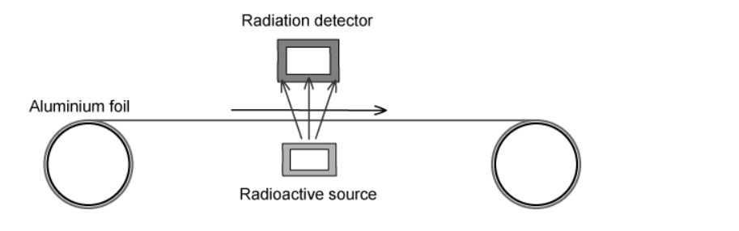
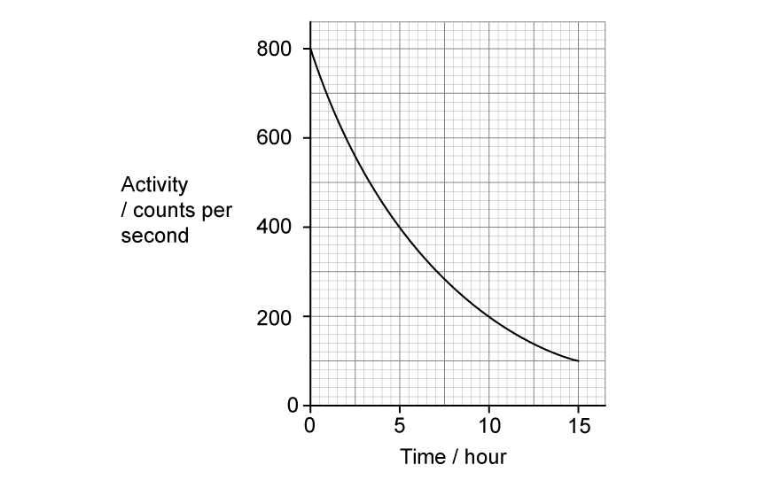
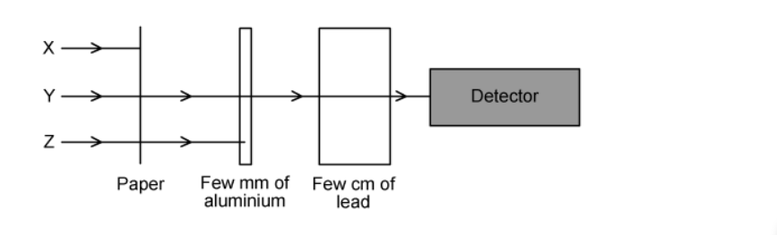

# Exam Questions — Radioactivity
**5. Nuclear Physics** · Cambridge (CIE) IGCSE science (0654 & 0973)
> Source: [https://www.savemyexams.com/igcse/science/cie/co-ordinated-sciences-double-award/23/physics/topic-questions/](https://www.savemyexams.com/igcse/science/cie/co-ordinated-sciences-double-award/23/physics/topic-questions/) · 15 questions across 1 sets

## Multiple Choice Questions (15 questions)

### Q1 — medium — 1 marks

**Q1** [1 mark]

A nucleus of radium-226 ($Ra_{88}^{226}$) undergoes alpha decay.

What are the nucleon number and the proton number of the new nucleus formed?

|   | nucleon number | proton number |
|---|---|---|
| **A** | 222 | 86 |
| **B** | 222 | 88 |
| **C** | 224 | 87 |
| **D** | 230 | 90p |

### Q2 — medium — 1 marks

**Q2** [1 mark]

Background radiation is the radiation that is always present in the environment around us.

Which list contains only **natural** sources of background radiation?

### Q3 — easy — 1 marks

**Q3** [1 mark]

Radioactive materials are usually stored in containers lined with metal. This is done to reduce the amount of radiation being emitted, to protect people nearby.

What type of metal is used for this purpose?

### Q4 — hard — 1 marks

**Q4** [1 mark]

**Extended tier only**

Radioactive sources are often used in industry as part of manufacturing processes. The diagram below shows radiation being used to measure the thickness of a sheet of aluminium foil. The detector feeds back to the rollers to adjust the thickness.

What type of radiation would be the most suitable for this purpose?

### Q5 — medium — 1 marks

**Q5** [1 mark]

A radioactive nucleus emits a **β**-particle.

What happens to the proton number and the nucleon number of this nucleus?

|   | **Proton number** | **Nucleon number** |
|---|---|---|
| **A** | increases by 1 | stays the same |
| **B** | stays the same | decreases by one |
| **C** | decreases by 2 | decreases by 4 |
| **D** | decreases by 1 | stays the same |

### Q6 — hard — 1 marks

**Q6** [1 mark]

The graph shows the activity of a radioactive source over a period of time.

What is the half-life of the source?

### Q7 — hard — 1 marks

**Q7** [1 mark]

A radioactive substance has a half-life of 4 days.

It is currently emitting 8000 **β**-particles per minute.

How many **β**-particles will it emit per minute after 12 days?

### Q8 — medium — 1 marks

**Q8** [1 mark]

The count rate from a radioactive isotope is recorded every hour. The count rate is corrected for background radiation. The table shows the readings.

| time / hours | 0 | 1 | 2 | 3 | 4 | 5 |
|---|---|---|---|---|---|---|
| corrected count rate / counts/s | 1200 | 990 | 816 | 673 | 555 | 458 |

What estimate of the half-life of the isotope can be obtained from the readings in the table?

### Q9 — easy — 1 marks

**Q9** [1 mark]

There are three main types of radiation which may be emitted during radioactive decay: **α**-particles, **β**-particles and **γ**-rays.

Which of the following statements about these types of emissions is **true**?

### Q10 — easy — 1 marks

**Q10** [1 mark]

Which statement is **not** a method used to minimise the risk caused by working with radioactive sources.

### Q11 — easy — 1 marks

**Q11** [1 mark]

A student has three radioactive sources **X**,** Y** and **Z**. They devised the following experiment to determine what type of radiation each source is emitting.

The student found that the radiation from **X** was stopped by a sheet of paper, **Y** was partially stopped by a few cm of lead and **Z** was stopped by a few mm of aluminium.

Which of the following correctly identifies each type of radiation

|   | **X** | **Y** | **Z** |
|---|---|---|---|
| **A** | **α**-particle | **β**-particle | **γ**-ray |
| **B** | **α**-particle | **γ**-ray | **β**-particle |
| **C** | **γ**-ray | **β**-particle | **α**-particle |
| **D** | **β**-particle | **γ**-ray | **α**-particle |

### Q12 — medium — 1 marks

**Q12** [1 mark]

**Extended tier only**

A nucleus of uranium ( $U_{92}^{238}$) is unstable and decays by emitting an **α**-particle.

Which equation correctly describes this process?

### Q13 — easy — 1 marks

**Q13** [1 mark]

Which statement about **α**-particles is correct?

### Q14 — medium — 1 marks

**Q14** [1 mark]

**Extended tier only**

Strontium-90 is a radioactive substance with the nuclide symbol $S_{38}^{90} r$ .

It decays by emitting radiation, as shown by the following equation.

$S_{38}^{90} r \rightarrow Y_{39}^{90} + ?$

What is missing in this equation?

### Q15 — medium — 1 marks

**Q15** [1 mark]

A student carried out an experiment to find the half-life of a radioactive substance. Their results are shown in the table below.

| **Time(seconds)** | **Count-rate from source(counts per second)** |
|---|---|
| 0 | 300 |
| 20 | 200 |
| 40 | 150 |
| 60 | 100 |
| 80 | 75 |

What is the half-life of this substance?
